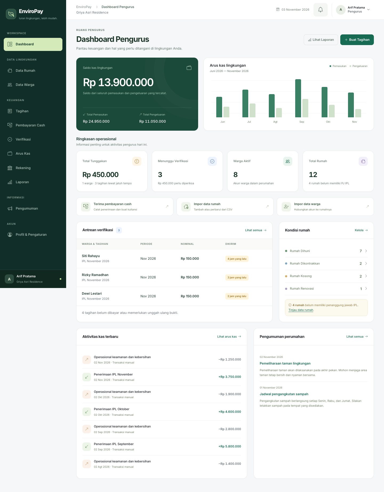
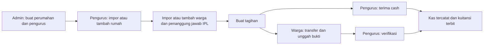

<div align="center">

# EnviroPay

**Lingkungan tertata. Iuran terkelola.**

Aplikasi pengelolaan Iuran Pemeliharaan Lingkungan (IPL): dari pendataan rumah dan warga, penagihan, pembayaran, hingga laporan kas perumahan.


[](LICENSE)

[Mulai instalasi](#instalasi-lokal) · [Fitur](#fitur-utama) · [Panduan penggunaan](docs/PANDUAN-PENGGUNA.md) · [WhatsApp](#whatsapp-fonnte) · [Deployment](#deployment-dan-pembaruan)

</div>

---

Satu instalasi mendukung beberapa perumahan. Akses pengurus dan warga dibatasi ke perumahan masing-masing; admin mengelola data perumahan dan akun pengurus.

## Preview



*Preview menggunakan data demo fiktif. UI menyesuaikan desktop dan HP; dashboard tersedia untuk admin, pengurus, dan warga.*

## Fitur utama

| Area | Yang tersedia |
| --- | --- |
| **Dashboard** | Saldo lingkungan, grafik arus kas enam bulan, ringkasan tunggakan, antrean verifikasi, dan akses cepat sesuai peran. |
| **Rumah & warga** | Tambah manual, impor CSV dengan template dan pratinjau, hubungan akun ke rumah, penanggung jawab IPL, serta histori rumah. |
| **Kondisi rumah** | Dihuni, Dikontrakkan, Kosong, dan Renovasi sebagai status terpisah; aturan tarif rumah kosong dapat disesuaikan. |
| **Template tagihan** | Simpan komponen, penerima dan jatuh tempo; tinjau lalu terbitkan sekali per template/periode. |
| **Tagihan IPL** | Komponen biaya, periode, jatuh tempo, penerima semua warga aktif atau warga tertentu, dan beberapa tagihan pada periode yang sama. |
| **Pembayaran** | Transfer manual dan cash, untuk satu atau beberapa tagihan sekaligus; satu bukti dan satu pencatatan kas per pembayaran gabungan. |
| **Kuitansi** | Nomor tetap, salinan data saat penerbitan, kuitansi teks WhatsApp untuk transfer dan tunai, serta unduh PDF A4/cetak dari browser. |
| **Tindak lanjut tunggakan** | Catatan komunikasi, janji bayar, jadwal dan pengurus penanggung jawab, tanpa mengubah status pembayaran. |
| **Kontrol kas** | Tanggal transaksi terpisah dari waktu pencatatan, lampiran nota privat, riwayat aktivitas dan tutup buku bulanan. |
| **Kas & laporan** | Pemasukan otomatis dari pembayaran, kategori kas manual, laporan pemasukan/pengeluaran/gabungan, rekap per kategori, laporan tunggakan/tagihan, rekap tahunan per rumah, serta ekspor PDF dan CSV sesuai filter. |
| **Pengumuman** | Draft, terbitkan, arsipkan, serta pemberitahuan kepada warga aktif. |
| **Notifikasi** | Lonceng, pengingat dan kuitansi teks WhatsApp melalui Fonnte, serta riwayat pengiriman untuk pengurus. |
| **Akun & antarmuka** | Ubah password sendiri, format nominal rupiah saat mengetik, navigasi per peran, dan tabel ramah HP. |

### Hak akses

| Peran | Tanggung jawab |
| --- | --- |
| **Admin tunggal** | Mengelola perumahan dan akun pengurus; mengaktifkan atau menonaktifkan akses. |
| **Pengurus** | Mengelola rumah, warga, rekening, tagihan, pembayaran, kas, pengumuman, dan laporan dalam perumahannya. |
| **Warga** | Mengakses tagihan dan kuitansi sendiri, mengunggah bukti, serta melihat pengumuman dan transparansi kas lingkungannya. |

Tidak tersedia pendaftaran publik. Akun admin dibuat melalui CLI; pengurus dibuat admin, dan warga dibuat atau diimpor pengurus.

## Alur penggunaan



Transfer yang ditolak dapat diunggah ulang. Pembayaran cash langsung terverifikasi setelah pengurus mengonfirmasi penerimaan uang. Pencatatan pembayaran, kas, kuitansi, dan notifikasi dilakukan dalam satu transaksi database.

## Teknologi

| Lapisan | Teknologi |
| --- | --- |
| Backend | Laravel 12, PHP 8.2+, Eloquent, policy, dan session database |
| Frontend | Blade, Bootstrap 5, Bootstrap Icons, JavaScript, dan Vite 6 |
| Database | SQLite untuk mulai lokal; MySQL/MariaDB dapat dikonfigurasi |
| Dokumen | Dompdf untuk kuitansi dan laporan PDF |
| Notifikasi | Database notifications, Laravel Scheduler, dan API WhatsApp Fonnte |
| Pengujian | PHPUnit dengan SQLite in-memory dan Node.js test runner |

## Instalasi lokal

### 1. Siapkan kebutuhan

- PHP **8.2+** dan Composer 2, beserta ekstensi yang dibutuhkan dependensi. `composer check-platform-reqs` memeriksa kebutuhan PHP setelah instalasi.
- Node.js **22 LTS** dan npm untuk membangun frontend.
- SQLite dengan ekstensi PHP `pdo_sqlite`, atau server MySQL/MariaDB dengan `pdo_mysql`.

### 2. Ambil proyek dan pasang dependensi

```bash
git clone https://github.com/FerdinandTJ/Website-Pembayaran-IPL-Iuran-Pemeliharaan-Lingkungan-.git enviropay
cd enviropay
composer install
npm ci
cp .env.example .env
php artisan key:generate
```

### 3. Atur database

Aplikasi dapat berjalan tanpa XAMPP menggunakan PHP CLI dan SQLite. Konfigurasi contoh menggunakan SQLite. Untuk instalasi baru, buat file databasenya jika belum tersedia:

```bash
php -r "file_exists('database/database.sqlite') || touch('database/database.sqlite');"
```

Pastikan `.env` menggunakan:

```dotenv
APP_URL=http://127.0.0.1:8000
APP_TIMEZONE=Asia/Jakarta
DB_CONNECTION=sqlite
SESSION_DRIVER=database
```

<details>
<summary><strong>Menggunakan MySQL/MariaDB, termasuk XAMPP</strong></summary>

Buat database kosong, lalu sesuaikan `.env` dengan kredensial lokal Anda:

```dotenv
DB_CONNECTION=mysql
DB_HOST=127.0.0.1
DB_PORT=3306
DB_DATABASE=enviropay
DB_USERNAME=nama_user_database
DB_PASSWORD=password_database
```

Untuk MariaDB, `DB_CONNECTION=mariadb` juga tersedia. Pastikan PHP CLI yang menjalankan Artisan/Composer dan PHP web server sama-sama memenuhi kebutuhan versi dan ekstensi. Untuk Apache, arahkan document root ke folder `public/`.

</details>

### 4. Migrasi dan buat admin

```bash
php artisan migrate
php artisan app:create-admin
npm run build
```

Pembuatan admin meminta nama, username, email, dan password secara interaktif. Hanya satu admin diizinkan dan tidak ada kredensial bawaan.

### 5. Jalankan aplikasi

```bash
php artisan serve
```

Buka **http://127.0.0.1:8000**, masuk sebagai admin, buat perumahan dan pengurus, lalu lanjutkan pendataan dari akun pengurus.

Untuk pengembangan frontend, jalankan `npm run dev` di terminal lain. Jalankan `php artisan schedule:work` di terminal terpisah jika ingin mengaktifkan pengingat, pengiriman WhatsApp, dan pembersihan data sementara.

> Sudah memiliki data? Gunakan `php artisan migrate` untuk pembaruan. `migrate:fresh` menghapus seluruh tabel dan tidak diperlukan untuk instalasi ini.

## Panduan fitur pengurus

| Menu | Cara penggunaan dan aturan utama |
| --- | --- |
| **Data Rumah & Data Warga** | Tambah manual atau impor CSV melalui template dan pratinjau. Identitas yang sama diperbarui; data baru ditambahkan. Impor rumah lebih dahulu agar warga langsung terhubung melalui `house_code`. |
| **Tarif rumah** | Tentukan penanggung jawab IPL dan kondisi rumah. Rumah kosong dapat memakai tarif penuh, nominal khusus pengganti total, atau bebas tagihan baru. Perubahan tarif tidak mengubah tunggakan lama. |
| **Template Tagihan** | Simpan komponen, penerima dan jatuh tempo. Pilih periode, tinjau pratinjau, lalu konfirmasi penerbitan. Satu template hanya bisa diterbitkan sekali per periode; menyimpan template tidak menerbitkan tagihan. |
| **Pembayaran** | Transfer perlu verifikasi pengurus; cash langsung disahkan setelah uang diterima. Pilih hingga 100 tagihan satu warga untuk pembayaran gabungan dengan satu bukti, satu pencatatan kas, dan satu kuitansi. Cicilan belum tersedia. |
| **Tindak Lanjut** | Catat komunikasi, janji bayar, jadwal hubungi kembali dan penanggung jawab. Catatan tidak mengubah status pembayaran atau mengirim WhatsApp. |
| **Arus Kas** | Catat pemasukan/pengeluaran beserta kategori dan tanggal transaksi. Lampirkan satu JPG/PNG/WebP/PDF maksimal 5 MB; akses lampiran hanya untuk pengurus perumahan. Kas dari pembayaran tagihan dicatat otomatis dan tidak dapat diedit manual. |
| **Riwayat Aktivitas** | Telusuri pelaku, waktu dan perubahan sebelum/sesudah sejak fitur aktif. Log tidak dapat diedit atau dihapus melalui aplikasi; aktivitas lama tidak diisi ulang. |
| **Tutup Buku** | Tutup bulan yang sudah berakhir untuk mengunci perubahan kas yang memengaruhi saldo periode tertutup. Buka kembali dari periode terakhir dengan alasan wajib. Tagihan lama tetap dapat dibayar pada bulan berjalan. |

Rincian format impor, tarif, pembayaran, kuitansi dan langkah penggunaan tersedia di [panduan pengguna](docs/PANDUAN-PENGGUNA.md).

### Laporan dan ekspor

- **Tunggakan:** pantau tagihan belum lunas dan warga yang perlu ditindaklanjuti.
- **Tagihan Bulanan:** tinjau realisasi tagihan pada periode yang dipilih.
- **Kas Bulanan:** pilih pemasukan saja, pengeluaran saja, atau gabungan; kombinasikan kategori, sumber pencatatan dan pencarian. Ringkasan serta rekap kategori mencakup seluruh hasil filter. Saldo awal/akhir seluruh perumahan ditampilkan terpisah dari total hasil filter.
- **Rekap Tahunan Rumah:** matriks Januari–Desember dengan dropdown tahun, pencarian rumah dan filter status. Klik bulan untuk rincian tagihan. Bulan tanpa tagihan ditandai **Belum Ada Tagihan**; status **Lunas** mensyaratkan seluruh tagihan bulan itu terverifikasi.

Semua laporan mendukung **CSV dan PDF sesuai filter**. PDF berformat A4 landscape dengan identitas perumahan, filter, waktu unduh dan nomor halaman; batasnya 2.000 baris untuk laporan biasa dan 500 baris untuk rekap tahunan. Gunakan filter lebih sempit atau CSV untuk data lebih besar. PDF dibuat langsung oleh aplikasi tanpa layanan eksternal.

Laporan kas memakai **tanggal transaksi**, sementara waktu pencatatan tetap tersimpan. Rekap tahunan mengikuti rumah saat tagihan diterbitkan dan status pembayaran terkini; pergantian penghuni tidak memindahkan tunggakan lama. Tagihan tanpa rumah tercatat ditampilkan terpisah per akun. Tutup buku menyimpan ringkasan kas saat disahkan, bukan rekonstruksi status tagihan pada akhir tahun.

## WhatsApp Fonnte

Lonceng aplikasi menyediakan pemberitahuan tagihan, pembayaran, verifikasi, pengumuman dan pengingat. Jumlah belum dibaca diperbarui setiap 30 detik saat tab terlihat. Pengiriman WhatsApp menggunakan Fonnte; fitur aktivasi notifikasi layar HP / Web Push telah dihapus.

| Kejadian | Pesan WhatsApp kepada warga |
| --- | --- |
| Tagihan baru | Rincian biaya, nominal, jatuh tempo dan tautan tagihan. |
| H-3 sebelum / H+1 setelah jatuh tempo | Pengingat untuk tagihan belum lunas atau bukti pembayarannya ditolak. |
| Transfer disetujui / cash diterima | Kuitansi teks berstatus **LUNAS**, dengan metode pembayaran, rincian dan tautan kuitansi. |
| Pembayaran gabungan disahkan | Satu kuitansi teks berisi seluruh tagihan yang dibayar, untuk transfer maupun cash. |

Kuitansi memakai format teks WhatsApp yang rapi, nomor tetap, identitas warga/rumah, rincian biaya, total, waktu konfirmasi WIB dan nama pengurus. Isinya mengikuti salinan data saat kuitansi diterbitkan. PDF tidak dilampirkan ke pesan; warga dapat mengunduhnya dari aplikasi. Unggah bukti, penolakan pembayaran dan pengumuman memakai lonceng aplikasi.

### Konfigurasi

1. Hubungkan nomor pengirim di dashboard [Fonnte](https://fonnte.com/) dan pastikan perangkat serta kuota pengiriman tersedia. Webhook tidak diperlukan untuk pengiriman satu arah ini.
2. Isi `.env` pada server:

```dotenv
FONNTE_ENABLED=true
FONNTE_TOKEN=token_perangkat_anda
APP_URL=https://ipl.domain-anda.id
```

3. Isi nomor WhatsApp warga melalui **Data Warga** atau kolom `phone_number` saat impor, misalnya `081234567890` atau `+6281234567890`. Aplikasi menerima satu nomor seluler Indonesia per akun.
4. Terapkan konfigurasi dan jalankan scheduler di terminal terpisah:

```bash
php artisan config:clear
php artisan migrate
php artisan schedule:work
```

Untuk production, bangun ulang config cache dan gunakan [cron scheduler](#deployment-dan-pembaruan). Satu instalasi menggunakan satu token/nomor pengirim untuk seluruh perumahan. Token disimpan pada server dan `.env` tidak dimasukkan ke Git. `APP_URL` perlu dapat dibuka dari HP warga; alamat localhost hanya menunjuk ke perangkat yang membukanya.

### Jadwal dan pemeriksaan pengiriman

Pengingat diperiksa setiap hari **08.00 WIB**; antrean dikirim **setiap menit**, maksimal 20 pesan per eksekusi bawaan. Akun/perumahan harus aktif dan nomor harus valid. Pengingat untuk tagihan lunas atau menunggu verifikasi dilewati. Setiap kejadian dideduplikasi; antrean yang lebih dari satu hari dilewati. Pesan saat fitur nonaktif dan pengingat lampau yang terlewat tidak dikirim retroaktif.

Pengiriman berlangsung setelah transaksi database selesai. Gangguan Fonnte tidak membatalkan penerbitan tagihan atau pembayaran. Penolakan eksplisit provider dan HTTP 429 dicoba ulang dengan jeda bertambah, maksimal lima percobaan. Timeout, HTTP 5xx atau hasil tidak pasti memerlukan pemeriksaan; tidak dikirim ulang otomatis.

Buka **Riwayat WhatsApp** untuk filter tanggal, nama/rumah, jenis pesan dan status, lalu buka **Detail** untuk kendala serta petunjuk penanganan. Default tanggal adalah bulan berjalan sampai hari ini dalam WIB; kosongkan kedua tanggal untuk seluruh riwayat.

| Status | Arti dan tindakan |
| --- | --- |
| **Antre / Sedang Diproses** | Menunggu jadwal atau sedang ditangani pengirim. Periksa scheduler jika berlarut. |
| **Diterima Fonnte** | API menerima permintaan; belum membuktikan pesan sampai atau dibaca warga. |
| **Gagal** | Gagal permanen atau batas percobaan tercapai. Periksa petunjuk detail, token, perangkat dan kuota. |
| **Dilewati** | Nomor/akun/tagihan tidak memenuhi syarat atau antrean kedaluwarsa. |
| **Perlu Diperiksa** | Hasil tidak pasti. Periksa waktu dan nomor tujuan di riwayat Fonnte sebelum tindakan lanjutan. |

Riwayat hanya menampilkan antrean aplikasi dan tidak menyediakan tombol kirim ulang. Nomor tujuan percobaan terakhir dicatat terenkripsi, terpisah dari nomor warga saat ini; riwayat lama yang belum memiliki catatan ditampilkan **Belum tercatat**. Jumlah pemrosesan mencakup pemeriksaan kelayakan, sehingga tidak selalu berarti pesan telah dikirim ke API.

Untuk uji dengan database terpisah dan nomor milik sendiri, buat satu tagihan akun uji lalu jalankan:

```bash
php artisan schedule:list
php artisan app:send-whatsapp --limit=1
```

Perintah kedua mengirim pesan nyata ke antrean tertua yang memenuhi syarat. Untuk uji kuitansi, verifikasi transfer atau catat cash akun uji, lalu proses antrean kembali.

## Deployment dan pembaruan

Gunakan web server HTTPS dengan document root **`public/`**, PHP yang memenuhi dependensi, serta database terkonfigurasi. Atur environment production:

```dotenv
APP_ENV=production
APP_DEBUG=false
APP_URL=https://ipl.domain-anda.id
APP_TIMEZONE=Asia/Jakarta
SESSION_DRIVER=database
SESSION_SECURE_COOKIE=true
CACHE_STORE=database
```

Pastikan `storage/` dan `bootstrap/cache/` dapat ditulis oleh proses web/scheduler. Lindungi `.env`, `.git`, database, backup dan private storage dari akses publik. Bukti pembayaran serta nota disimpan di `storage/app/private/` dan diakses melalui route terotorisasi; tidak memerlukan `storage:link`. Sinkronkan waktu server karena tanggal aplikasi mengikuti server.

Untuk instalasi baru, ikuti langkah instalasi dengan `composer install --no-dev --prefer-dist --optimize-autoloader`, lalu jalankan `php artisan optimize` setelah environment, migrasi dan aset siap. Node.js dibutuhkan saat build, bukan sebagai proses server aplikasi.

Untuk **pembaruan instalasi yang sudah memiliki data**, backup database, `.env` dan seluruh `storage/app/private/` terlebih dahulu. Pertahankan `APP_KEY` agar data terenkripsi tetap dapat dibaca. Dalam maintenance window:

```bash
php artisan down
git pull --ff-only
composer install --no-dev --prefer-dist --optimize-autoloader
npm ci
npm run build
php artisan optimize:clear
php artisan migrate --force
php artisan optimize
php artisan up
```

Jalankan `up` setelah semua langkah berhasil. Migrasi pembersihan menghapus tabel langganan/antrean Web Push yang sudah tidak digunakan; tabel notifikasi aplikasi dan WhatsApp tetap aktif. Jangan menjalankan `migrate:fresh` atau membuat ulang kunci pada instalasi berisi data. Migrasi mempertahankan transaksi lama, mengisi tanggal transaksi dari waktu pencatatan, mengategorikan pembayaran tagihan otomatis, dan menandai kas manual lama **Belum Dikategorikan**. Tinjau rumah berkode `LEGACY-{id}` dari migrasi versi lama, termasuk penanggung jawab dan tarifnya.

Tambahkan cron setiap menit, sesuaikan path proyek dan PHP:

```cron
* * * * * cd /path/to/project && /path/to/php artisan schedule:run >> /path/to/project/storage/logs/scheduler.log 2>&1
```

Cron harus memakai database, environment, cache persistent dan izin file yang sama dengan aplikasi. Atur rotasi log. Restart proses aplikasi/scheduler jangka panjang setelah deployment agar kode baru dimuat. Pengiriman WhatsApp saat ini menggunakan scheduler dan tidak memerlukan queue worker tambahan.

Setelah pembaruan, periksa login, dashboard, laporan dan `php artisan schedule:list`. Jika aset hilang, periksa `public/build`; untuk halaman 500 periksa `storage/logs/laravel.log` dan izin direktori. Jika WhatsApp tertahan, periksa cron, konfigurasi Fonnte, koneksi perangkat, kuota serta nomor warga.

## Development dan pengujian

```bash
# Backend: database SQLite in-memory, terpisah dari data aplikasi
php artisan test

# Frontend: format rupiah dan pemilihan pembayaran
npm run test:frontend

# Build aset produksi
npm run build

# Audit dependensi
composer audit --locked
npm audit
```

Pengujian mencakup isolasi perumahan, autentikasi, tagihan, verifikasi/cash, konsistensi kas, kuitansi, impor CSV, notifikasi, laporan, dan validasi keamanan. Catatan pengujian serta batas pemeriksaan ada di [SECURITY.md](SECURITY.md).

## Struktur proyek

```text
app/
├── Console/Commands/      # Admin, pengingat, dan pengiriman WhatsApp
├── Http/Controllers/     # Admin, pengurus, warga, dan layanan bersama
├── Models/               # Perumahan, rumah, warga, tagihan, kas, dan notifikasi
├── Notifications/        # Notifikasi database per perumahan
├── Policies/             # Otorisasi resource
└── Services/             # Pembayaran, impor, laporan, sesi, dan WhatsApp
database/migrations/      # Skema dan migrasi pembaruan
resources/
├── css/                  # Tema dan komponen UI responsif
├── js/                   # Interaksi, format rupiah, dan pemilihan pembayaran
└── views/                # Layout, dashboard, formulir, dan dokumen Blade
tests/                    # Pengujian backend dan frontend
docs/                     # SRS, panduan penggunaan dan gambar dokumentasi
```

## Dokumentasi lanjutan

| Dokumen | Isi |
| --- | --- |
| [Software Requirements Specification](docs/SRS.md) | Kebutuhan sistem, ERD, PDM, kamus data, DFD, alur proses dan kriteria penerimaan. |
| [Panduan penggunaan](docs/PANDUAN-PENGGUNA.md) | Rumah dan tarif IPL, format CSV, aturan pembaruan, cash, kuitansi, pengumuman, password, dan laporan. |
| [Keamanan](SECURITY.md) | Kontrol akses, perlindungan data, pemeriksaan dependensi, dan batas audit. |

## Cakupan saat ini

Pembayaran transfer diverifikasi manual oleh pengurus. Integrasi payment gateway, rekonsiliasi bank otomatis, email, cicilan, dan percakapan chat belum tersedia. WhatsApp pengingat melalui Fonnte memerlukan token perangkat, nomor warga, dan scheduler aktif.

## Lisensi

Proyek ini menggunakan [lisensi MIT](LICENSE).
