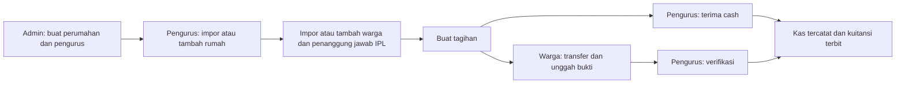

<div align="center">

# EnviroPay

**Lingkungan tertata. Iuran terkelola.**

Aplikasi pengelolaan Iuran Pemeliharaan Lingkungan (IPL): dari pendataan rumah dan warga, penagihan, pembayaran, hingga laporan kas perumahan.


[](LICENSE)

[Mulai instalasi](#instalasi-lokal) · [Fitur](#fitur-utama) · [Panduan penggunaan](docs/PANDUAN-PENGGUNA.md) · [Deployment](docs/DEPLOYMENT.md)

</div>

---

## Tentang EnviroPay

EnviroPay membantu pengurus mengelola administrasi lingkungan dalam satu aplikasi, sementara warga dapat memeriksa tagihan, mengunggah bukti transfer, mengunduh kuitansi, dan mengikuti pengumuman perumahan.

Satu instalasi mendukung beberapa perumahan. Akses pengurus dan warga dibatasi ke perumahan masing-masing; admin mengelola data perumahan dan akun pengurus.

## Preview


*Preview menggunakan data demo fiktif. UI menyesuaikan desktop dan HP; dashboard tersedia untuk admin, pengurus, dan warga.*

## Fitur utama

| Area | Yang tersedia |
| --- | --- |
| **Dashboard** | Saldo lingkungan, grafik arus kas enam bulan, ringkasan tunggakan, antrean verifikasi, dan akses cepat sesuai peran. |
| **Rumah & warga** | Tambah manual, impor CSV dengan template dan pratinjau, hubungan akun ke rumah, penanggung jawab IPL, serta histori rumah. |
| **Kondisi rumah** | Dihuni, Dikontrakkan, Kosong, dan Renovasi sebagai status terpisah; aturan tarif rumah kosong dapat disesuaikan. |
| **Tagihan IPL** | Komponen biaya, periode, jatuh tempo, penerima semua warga aktif atau warga tertentu, dan beberapa tagihan pada periode yang sama. |
| **Pembayaran** | Transfer manual dan cash, untuk satu atau beberapa tagihan sekaligus; satu bukti dan satu pencatatan kas per pembayaran gabungan. |
| **Kuitansi** | Nomor tetap, salinan data saat penerbitan, kuitansi teks WhatsApp untuk transfer dan tunai, serta unduh PDF A4/cetak dari browser. |
| **Kas & laporan** | Pemasukan otomatis dari pembayaran, kas manual, laporan tunggakan/tagihan/kas, filter, dan ekspor CSV. |
| **Pengumuman** | Draft, terbitkan, arsipkan, serta pemberitahuan kepada warga aktif. |
| **Notifikasi** | Lonceng dalam aplikasi, pengingat jatuh tempo otomatis, dan WhatsApp melalui Fonnte. |
| **Akun & antarmuka** | Ubah password sendiri, format nominal rupiah saat mengetik, navigasi per peran, dan tabel ramah HP. |

### Hak akses

| Peran | Tanggung jawab |
| --- | --- |
| **Admin tunggal** | Mengelola perumahan dan akun pengurus; mengaktifkan atau menonaktifkan akses. |
| **Pengurus** | Mengelola rumah, warga, rekening, tagihan, pembayaran, kas, pengumuman, dan laporan dalam perumahannya. |
| **Warga** | Mengakses tagihan dan kuitansi sendiri, mengunggah bukti, serta melihat pengumuman dan transparansi kas lingkungannya. |

Tidak tersedia pendaftaran publik. Akun admin dibuat melalui CLI; pengurus dibuat admin, dan warga dibuat atau diimpor pengurus.

## Alur penggunaan



Transfer yang ditolak dapat diunggah ulang. Pembayaran cash langsung terverifikasi setelah pengurus mengonfirmasi penerimaan uang. Pencatatan pembayaran, kas, kuitansi, dan notifikasi dilakukan dalam satu transaksi database.

## Teknologi

| Lapisan | Teknologi |
| --- | --- |
| Backend | Laravel 12, PHP 8.2+, Eloquent, policy, dan session database |
| Frontend | Blade, Bootstrap 5, Bootstrap Icons, JavaScript, dan Vite 6 |
| Database | SQLite untuk mulai lokal; MySQL/MariaDB dapat dikonfigurasi |
| Dokumen | Dompdf untuk kuitansi PDF |
| Notifikasi | Database notifications, Laravel Scheduler, dan API WhatsApp Fonnte |
| Pengujian | PHPUnit dengan SQLite in-memory dan Node.js test runner |

## Instalasi lokal

### 1. Siapkan kebutuhan

- PHP **8.2+** dan Composer 2, beserta ekstensi yang dibutuhkan dependensi. `composer check-platform-reqs` memeriksa kebutuhan PHP setelah instalasi.
- Node.js **22 LTS** dan npm untuk membangun frontend.
- SQLite dengan ekstensi PHP `pdo_sqlite`, atau server MySQL/MariaDB dengan `pdo_mysql`.

### 2. Ambil proyek dan pasang dependensi

```bash
git clone https://github.com/FerdinandTJ/Website-Pembayaran-IPL-Iuran-Pemeliharaan-Lingkungan-.git enviropay
cd enviropay
composer install
npm ci
cp .env.example .env
php artisan key:generate
```

### 3. Atur database

Aplikasi dapat berjalan tanpa XAMPP menggunakan PHP CLI dan SQLite. Konfigurasi contoh menggunakan SQLite. Untuk instalasi baru, buat file databasenya jika belum tersedia:

```bash
php -r "file_exists('database/database.sqlite') || touch('database/database.sqlite');"
```

Pastikan `.env` menggunakan:

```dotenv
APP_URL=http://127.0.0.1:8000
APP_TIMEZONE=Asia/Jakarta
DB_CONNECTION=sqlite
SESSION_DRIVER=database
```

<details>
<summary><strong>Menggunakan MySQL/MariaDB, termasuk XAMPP</strong></summary>

Buat database kosong, lalu sesuaikan `.env` dengan kredensial lokal Anda:

```dotenv
DB_CONNECTION=mysql
DB_HOST=127.0.0.1
DB_PORT=3306
DB_DATABASE=enviropay
DB_USERNAME=nama_user_database
DB_PASSWORD=password_database
```

Untuk MariaDB, `DB_CONNECTION=mariadb` juga tersedia. Pastikan PHP CLI yang menjalankan Artisan/Composer dan PHP web server sama-sama memenuhi kebutuhan versi dan ekstensi. Untuk Apache, arahkan document root ke folder `public/`.

</details>

### 4. Migrasi dan buat admin

```bash
php artisan migrate
php artisan app:create-admin
npm run build
```

Pembuatan admin meminta nama, username, email, dan password secara interaktif. Hanya satu admin diizinkan dan tidak ada kredensial bawaan.

### 5. Jalankan aplikasi

```bash
php artisan serve
```

Buka **http://127.0.0.1:8000**, masuk sebagai admin, buat perumahan dan pengurus, lalu lanjutkan pendataan dari akun pengurus.

Untuk pengembangan frontend, jalankan `npm run dev` di terminal lain. Jalankan `php artisan schedule:work` di terminal terpisah jika ingin mengaktifkan pengingat, pengiriman WhatsApp, dan pembersihan data sementara.

> Sudah memiliki data? Gunakan `php artisan migrate` untuk pembaruan. `migrate:fresh` menghapus seluruh tabel dan tidak diperlukan untuk instalasi ini.

## Aturan penting

### Impor: data sama diperbarui, data baru ditambahkan

Unduh template langsung dari **Data Rumah** atau **Data Warga**, unggah CSV, tinjau baris **Baru/Perbarui**, lalu konfirmasi. Tambah data manual tetap tersedia.

- **Rumah:** dicocokkan melalui kode unik dalam perumahan. Maksimal 1.000 baris per file.
- **Warga:** dicocokkan melalui username atau email. Identitas yang bertabrakan dengan akun lain ditolak. Maksimal 100 baris per file.
- File maksimal **2 MB**, mendukung pemisah koma/titik koma. Pratinjau berlaku **30 menit**.
- Satu baris bermasalah menahan seluruh impor. Konfirmasi memvalidasi ulang dan menyimpan satu batch secara atomik.
- Impor rumah terlebih dahulu, kemudian impor warga dengan `house_code` agar akun langsung terhubung ke rumahnya.

Rincian kolom, password, penanggung jawab, dan perlakuan sel kosong tersedia di [panduan penggunaan](docs/PANDUAN-PENGGUNA.md).

### Rumah dan tarif IPL

Satu akun warga terhubung ke satu rumah saat ini. Satu rumah dapat memiliki beberapa akun, dengan satu penanggung jawab IPL untuk tagihan baru.

| Kondisi rumah | Aturan tagihan baru |
| --- | --- |
| Dihuni | Komponen normal |
| Dikontrakkan | Komponen normal; status tetap berbeda dari Dihuni |
| Renovasi | Komponen normal |
| Kosong — tarif penuh | Komponen normal |
| Kosong — nominal khusus | Total komponen diganti nominal khusus positif per tagihan IPL |
| Kosong — bebas iuran baru | Dilewati saat pembuatan tagihan dengan aturan rumah kosong aktif |

Contoh: komponen normal **Rp 100.000** dan nominal khusus **Rp 25.000** menghasilkan tagihan **Rp 25.000**. Nominal khusus menggantikan total, bukan menjadi potongan. Perubahan tarif tidak menghitung ulang tagihan atau tunggakan lama.

### Pembayaran dan kuitansi

| Metode | Alur |
| --- | --- |
| Transfer | Warga memilih satu atau beberapa tagihan, transfer sesuai total, unggah satu JPG/PNG/WebP maksimal 5 MB, lalu pengurus memverifikasi atau menolak seluruh pembayaran dengan alasan. |
| Cash | Pengurus memilih warga dan satu atau beberapa tagihan `unpaid`/`rejected`, meninjau total, lalu mengonfirmasi uang diterima. |

Transfer dan cash mendukung pemilihan hingga 100 tagihan milik satu warga. Sistem otomatis mencatat satu pilihan sebagai pembayaran biasa, dan dua atau lebih sebagai pembayaran gabungan. Cicilan dan nominal sebagian belum tersedia. Tagihan `pending` perlu diproses terlebih dahulu. Pembayaran gabungan melunasi seluruh pilihan secara atomik, mencatat satu pemasukan kas, serta menerbitkan satu kuitansi berisi rincian per tagihan. Pemasukan dari pembayaran tagihan tidak dapat diedit atau dihapus melalui kas manual.

## Notifikasi aplikasi dan WhatsApp

**Lonceng aplikasi** menyimpan pemberitahuan tagihan, hasil verifikasi, pembayaran, pengumuman, dan pengingat. Jumlah belum dibaca diperbarui setiap 30 detik saat tab terlihat.

**WhatsApp Fonnte** mengirim pesan sesuai kejadian berikut:

| Kejadian | Pesan kepada warga |
| --- | --- |
| Tagihan baru diterbitkan | Rincian tagihan, nominal, jatuh tempo, dan tautan untuk melihat tagihan serta mengunggah bukti pembayaran. |
| H-3 sebelum jatuh tempo | Pengingat pembayaran untuk tagihan yang belum lunas atau bukti pembayarannya ditolak. |
| H+1 setelah jatuh tempo | Pengingat tunggakan untuk tagihan yang belum lunas atau bukti pembayarannya ditolak. |
| Transfer disetujui pengurus | Kuitansi teks dengan status **LUNAS** dan metode **Transfer Bank**. |
| Pengurus mengonfirmasi uang tunai diterima | Kuitansi teks dengan status **LUNAS** dan metode **Tunai / Cash**. |
| Pembayaran gabungan disahkan | Satu kuitansi teks berisi seluruh tagihan yang dibayar, untuk transfer maupun tunai. |

Kuitansi WhatsApp memakai judul tebal, nomor kuitansi, nama warga, rumah, rincian pembayaran, total, waktu konfirmasi WIB, nama pengurus, dan tautan kuitansi. Isinya mengikuti salinan data saat kuitansi diterbitkan. WhatsApp mengirim **pesan teks tanpa lampiran PDF**; fitur unduh PDF dan cetak tetap tersedia di aplikasi.

Pemeriksaan pengingat berjalan setiap hari pukul **08.00 WIB**. Antrean pengiriman diproses **setiap menit** saat scheduler aktif, maksimal 20 pesan per eksekusi bawaan. Akun dan perumahan penerima harus aktif serta nomor WhatsApp warga harus valid. Tagihan lunas atau menunggu verifikasi tidak mendapat pengingat pembayaran. Setiap kejadian dideduplikasi, dan satu kuitansi hanya memiliki satu antrean pengiriman. Status diterima API Fonnte belum membuktikan pesan sampai atau dibaca warga.

### Mengaktifkan WhatsApp Fonnte

1. Hubungkan nomor WhatsApp pengirim melalui **Device → Connect** di dashboard Fonnte dan pastikan perangkat terhubung serta kuotanya tersedia. Webhook tidak diperlukan untuk pengiriman satu arah ini.
2. Isi konfigurasi pada `.env` dengan token perangkat pengirim:

```dotenv
FONNTE_ENABLED=true
FONNTE_TOKEN=token_perangkat_anda
APP_URL=https://ipl.domain-anda.id
```

3. Isi nomor WhatsApp warga melalui **Data Warga** atau impor CSV, misalnya `081234567890` atau `+6281234567890`.
4. Terapkan migrasi dan jalankan scheduler di terminal terpisah:

```bash
php artisan config:clear
php artisan migrate
php artisan schedule:work
```

Untuk production gunakan cron scheduler dan jalankan `php artisan config:cache` setelah perubahan konfigurasi. Default WhatsApp nonaktif sampai dikonfigurasi. Satu instalasi memakai satu token/nomor pengirim untuk seluruh perumahan. Simpan token hanya pada server; `.env` tidak dimasukkan ke Git. `APP_URL` harus dapat diakses warga agar tautan dalam pesan bisa dibuka dari HP.

Untuk uji dengan akun warga dan nomor WhatsApp milik sendiri, buat satu tagihan khusus akun tersebut, lalu proses antrean:

```bash
php artisan app:send-whatsapp --limit=1
```

Perintah tersebut mengirim pesan nyata ke antrean tertua yang memenuhi syarat. Untuk menguji kuitansi, verifikasi transfer atau catat penerimaan tunai akun uji, lalu proses antrean kembali. Tagihan dan kuitansi yang diterbitkan saat WhatsApp nonaktif tidak dikirim retroaktif.

Fitur **Aktifkan notifikasi layar HP / Web Push** telah dihapus. Lonceng aplikasi tetap tersedia untuk pemberitahuan, termasuk unggah bukti, penolakan pembayaran, dan pengumuman.

Lihat [panduan notifikasi dan Fonnte](docs/NOTIFIKASI.md) untuk contoh kuitansi WhatsApp, cron production, status antrean, retry, dan penanganan kegagalan.

## Development dan pengujian

```bash
# Backend: database SQLite in-memory, terpisah dari data aplikasi
php artisan test

# Frontend: format rupiah dan pemilihan pembayaran
npm run test:frontend

# Build aset produksi
npm run build

# Audit dependensi
composer audit --locked
npm audit
```

Pengujian mencakup isolasi perumahan, autentikasi, tagihan, verifikasi/cash, konsistensi kas, kuitansi, impor CSV, notifikasi, laporan, dan validasi keamanan. Catatan pengujian serta batas pemeriksaan ada di [SECURITY.md](SECURITY.md).

## Struktur proyek

```text
app/
├── Console/Commands/      # Admin, pengingat, dan pengiriman WhatsApp
├── Http/Controllers/     # Admin, pengurus, warga, dan layanan bersama
├── Models/               # Perumahan, rumah, warga, tagihan, kas, dan notifikasi
├── Notifications/        # Notifikasi database per perumahan
├── Policies/             # Otorisasi resource
└── Services/             # Pembayaran, impor, laporan, sesi, dan WhatsApp
database/migrations/      # Skema dan migrasi pembaruan
resources/
├── css/                  # Tema dan komponen UI responsif
├── js/                   # Interaksi, format rupiah, dan pemilihan pembayaran
└── views/                # Layout, dashboard, formulir, dan dokumen Blade
public/service-worker.js  # Menonaktifkan worker Web Push lama
tests/                    # Pengujian backend dan frontend
docs/                     # Panduan penggunaan, notifikasi, dan deployment
```

## Dokumentasi lanjutan

| Dokumen | Isi |
| --- | --- |
| [Panduan penggunaan](docs/PANDUAN-PENGGUNA.md) | Rumah dan tarif IPL, format CSV, aturan pembaruan, cash, kuitansi, pengumuman, password, dan laporan. |
| [Notifikasi & WhatsApp](docs/NOTIFIKASI.md) | Lonceng, pengingat dan kuitansi teks WhatsApp Fonnte, scheduler, dan status pengiriman. |
| [Deployment & pembaruan](docs/DEPLOYMENT.md) | Konfigurasi production, upgrade tanpa menghapus data, backup, dan troubleshooting. |
| [Keamanan](SECURITY.md) | Kontrol akses, perlindungan data, pemeriksaan dependensi, dan batas audit. |

## Cakupan saat ini

Pembayaran transfer diverifikasi manual oleh pengurus. Integrasi payment gateway, rekonsiliasi bank otomatis, email, cicilan, dan percakapan chat belum tersedia. WhatsApp pengingat melalui Fonnte memerlukan token perangkat, nomor warga, dan scheduler aktif.

## Lisensi

Proyek ini menggunakan [lisensi MIT](LICENSE).
