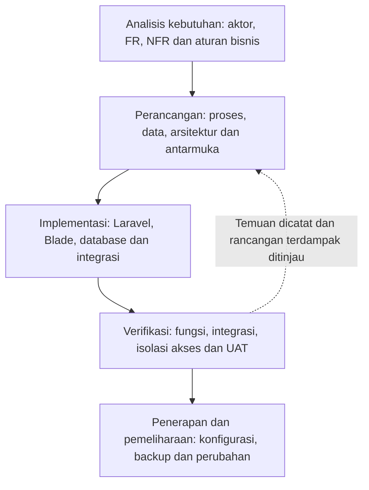
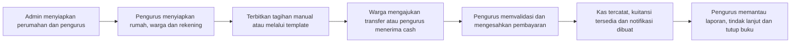
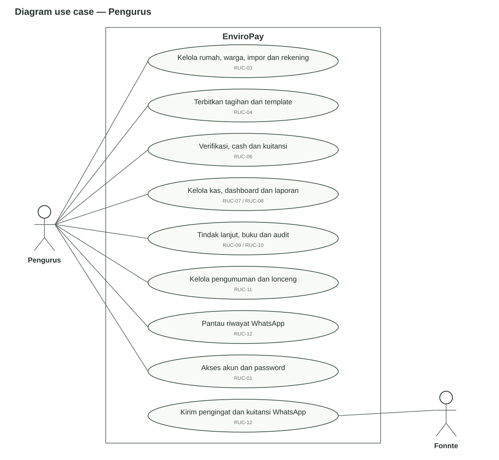
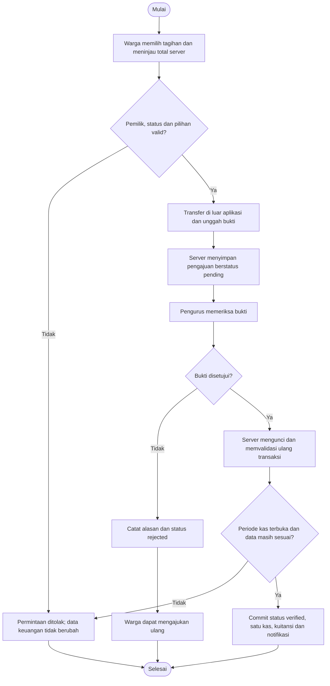
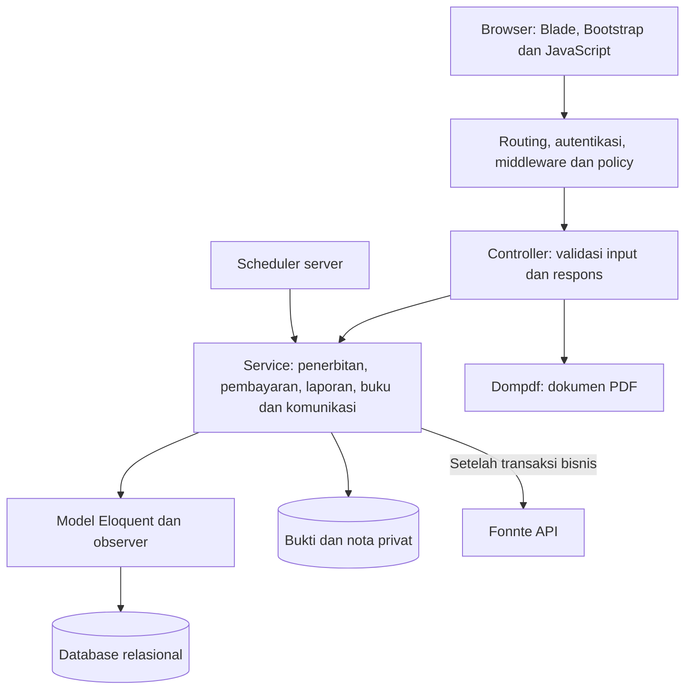
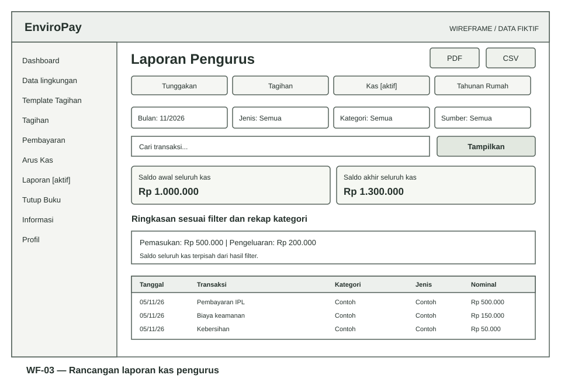

# BAB III — METODE DAN PERANCANGAN SISTEM

**Rancang Bangun Sistem Informasi Pembayaran Iuran Pemeliharaan Lingkungan Berbasis Web Menggunakan Metode Waterfall pada EnviroPay**

| Identitas dokumen | Keterangan |
| --- | --- |
| Versi / tanggal | 1.0 / 8 November 2026 |
| Acuan implementasi | Commit `94cda91`, seluruh migration sampai `2026_11_06_000006` |
| Metode pengembangan | Waterfall, sesuai pilihan pemilik proyek |
| Cakupan | Bahan Bab III: metode, analisis, rancangan, dan rencana evaluasi perangkat lunak |
| Status | Rancangan teknis berbasis implementasi; identitas lokasi, penelitian lapangan dan persetujuan pengguna belum dilengkapi |

[Indeks dokumentasi](README.md) · [SRS](SRS.md) · [Panduan pengguna](PANDUAN-PENGGUNA.md)

Naskah ini memusatkan pembahasan pada perancangan EnviroPay. Judul merupakan usulan yang dapat disesuaikan dengan objek penelitian. Bab I dan Bab II tidak disusun dalam paket ini. Penomoran gambar/tabel merupakan penomoran kerja untuk Bab III; format halaman, kutipan dan penomoran otomatis mengikuti pedoman kampus saat dipindahkan ke naskah akhir.

## 3.1 Metode pengembangan sistem

Pengembangan sistem dirancang menggunakan Waterfall dengan tahapan analisis kebutuhan, perancangan, implementasi, verifikasi/pengujian, serta penerapan dan pemeliharaan. Setiap tahap menghasilkan artefak yang ditinjau sebelum menjadi masukan tahap berikutnya. Apabila ditemukan ketidaksesuaian, perubahan dicatat dan artefak terdampak diperbarui sebelum pengujian diulang.

Kerangka lima tahap di bawah adalah adaptasi operasional untuk proyek ini. Pembahasan asli Royce memperlihatkan rangkaian kebutuhan–desain–kode–uji–operasi sekaligus mengingatkan risiko proses yang mengabaikan umpan balik dan keterlibatan pengguna. Diagram berikut bukan salinan diagram asli atau klaim bahwa penulis tersebut menetapkan persis lima tahap ini. [Royce, *Managing the Development of Large Software Systems* (1970), salinan makalah](https://github.com/tpn/pdfs/blob/master/Managing%20the%20Development%20of%20Large%20Software%20Systems%20-%201970%20%28waterfall%29.pdf).

*Gambar 3.1. Tahapan Waterfall yang diadaptasi untuk EnviroPay. Sumber: rancangan proyek.*

Pemilihan Waterfall didasarkan pada kebutuhan untuk menyediakan artefak analisis dan rancangan yang dapat ditelusuri. Ini merupakan alasan rancangan pengelolaan pengembangan, bukan bukti bahwa kebutuhan lapangan sudah stabil. Implementasi aplikasi telah berkembang melalui beberapa perubahan sebelum paket akademik ini disusun. Oleh karena itu, dokumen mengelompokkan artefak yang tersedia ke tahapan Waterfall dan tidak mengklaim seluruh riwayat pengembangan sejak awal berlangsung secara linear atau telah mendapat persetujuan formal tiap tahap.

**Tabel 3.1. Keluaran dan kriteria peninjauan tahap Waterfall**

| Tahap | Keluaran | Kriteria peninjauan | Bukti pada baseline |
| --- | --- | --- | --- |
| Analisis | Daftar aktor, kebutuhan dan aturan bisnis | Kebutuhan dapat diuji dan lingkup disepakati | 29 FR, 25 BR dan 10 NFR dalam SRS; persetujuan pengurus masih diperlukan. |
| Perancangan | Use case, aktivitas, DFD, ERD/PDM, modul dan layar | Konsisten dengan kebutuhan dan antarartefak | Dokumen SRS dan paket perancangan ini. |
| Implementasi | Kode, migration dan aset | Sesuai kontrak rancangan dan dapat dibangun | Source aplikasi, composer.lock dan package-lock.json. |
| Verifikasi | Skenario, log pengujian dan daftar temuan | Kasus kritis sesuai dan temuan ditangani | Pengujian otomatis tersedia; UAT lapangan belum merupakan hasil lulus. |
| Penerapan/pemeliharaan | Konfigurasi, backup, panduan dan catatan perubahan | Sistem dapat dipakai dan dipulihkan | Panduan tersedia; bukti deployment production dan simulasi restore perlu dilengkapi. |

Rincian alur persetujuan tahap, sumber data, instrumen dan penanganan perubahan dijelaskan dalam [metodologi dan analisis](perancangan/01-METODOLOGI-DAN-ANALISIS.md).

## 3.2 Objek, sumber data dan pengumpulan kebutuhan

Objek teknis penelitian adalah proses pengelolaan IPL yang mencakup pendataan rumah/warga, penerbitan tagihan, penerimaan pembayaran, pencatatan kas dan pelaporan. Sistem mendukung beberapa perumahan; hal tersebut tidak berarti penelitian telah melibatkan beberapa lokasi. Nama lokasi, waktu penelitian, pengurus yang menjadi informan dan jumlah peserta harus ditetapkan sesuai penelitian sebenarnya.

Data yang sudah tersedia meliputi source code, migration, pengujian dan dokumentasi proyek. Bukti ini menjelaskan perilaku aplikasi, tetapi tidak membuktikan cara kerja pengurus sebelum aplikasi digunakan. Observasi, wawancara dan penelaahan dokumen tagihan/kas direncanakan untuk mengonfirmasi kebutuhan lapangan. Formulirnya tersedia dalam [instrumen penelitian](perancangan/06-INSTRUMEN-DAN-KELENGKAPAN.md).

Pengumpulan kebutuhan diarahkan pada pertanyaan: siapa penanggung jawab tagihan, bagaimana bukti diverifikasi, bagaimana uang tunai dicatat, dokumen apa yang diperlukan untuk rekonsiliasi, dan bagaimana informasi warga dibatasi. Temuan diberi ID bukti dan dipetakan ke kebutuhan. Tidak ada pernyataan bahwa observasi/wawancara telah dilaksanakan sebelum tersedia tanggal, peserta, catatan dan persetujuan penggunaan data.

## 3.3 Analisis kebutuhan dan sistem usulan

### 3.3.1 Analisis proses berjalan

Proses berjalan pada lokasi penelitian belum memiliki bukti lapangan dalam repository. Sebagai pedoman penggalian data, dibuat model kandidat: pengurus menyiapkan daftar kewajiban, menyampaikan tagihan, menerima informasi transfer/tunai, memeriksa pembayaran, kemudian membuat rekap. Media pencatatan, lama pelayanan, tingkat kesalahan dan frekuensi pengingat belum ditetapkan sebagai fakta.

Rancangan tersebut diuji melalui instrumen observasi/wawancara sebelum dimasukkan sebagai uraian final sistem berjalan. Analisis masalah tidak menyimpulkan bahwa pengurus pasti memakai buku, Excel atau WhatsApp manual. Hipotesis masalah, indikator dan hubungan ke solusi dipisahkan dalam [analisis kebutuhan](perancangan/01-METODOLOGI-DAN-ANALISIS.md#3-analisis-kebutuhan-dan-hipotesis-masalah).

### 3.3.2 Sistem usulan dan batasan

EnviroPay mengintegrasikan data rumah dan warga, komponen tagihan, pembayaran transfer/tunai, bukti privat, kuitansi, kas, laporan dan komunikasi. Transfer bank tetap dilakukan di luar aplikasi dan diperiksa manual oleh pengurus. Fonnte berfungsi untuk pengiriman pesan satu arah; status diterima API belum berarti pesan sampai atau dibaca.

*Gambar 3.2. Alur utama sistem usulan. Pengajuan transfer belum menyatakan pelunasan; pengesahan cash berada dalam transaksi penerimaan yang sama.*

### 3.3.3 Aktor dan kebutuhan

**Tabel 3.2. Aktor utama sistem**

| Aktor | Tanggung jawab | Batas akses |
| --- | --- | --- |
| Admin | Mengelola perumahan dan akun pengurus | Tidak menggunakan menu transaksi warga/pengurus. |
| Pengurus | Mengelola data, tagihan, pembayaran, kas, laporan dan komunikasi | Hanya perumahan yang menjadi lingkup akunnya. |
| Warga | Melihat kewajiban, mengunggah bukti dan mengakses kuitansi | Tagihan/kuitansi sendiri serta informasi lingkungan yang diizinkan. |
| Operator server | Menjalankan instalasi, konfigurasi dan pemulihan | Aktor operasional, bukan role login aplikasi tambahan. |
| Fonnte | Menerima permintaan pengiriman WhatsApp | Sistem eksternal dengan kontrak pengiriman yang dipetakan ke status lokal. |

Kebutuhan fungsional dikelompokkan menjadi autentikasi/administrasi, master dan impor, tagihan/template, pembayaran/kuitansi, kas/pelaporan, kontrol/audit, komunikasi, serta halaman error. Daftar lengkap FR-01–29 dan kebutuhan nonfungsional NFR-01–10 berada pada [kebutuhan SRS](srs/01-KEBUTUHAN.md). Rancangan ini mempertahankan ID yang sama untuk mencegah perbedaan nomor antara kebutuhan, use case dan pengujian.

## 3.4 Perancangan proses dan interaksi

### 3.4.1 Use case

Use case dikelompokkan menjadi 13 kelompok rancangan dengan awalan **RUC**. Awalan ini membedakannya dari UC-01–09 ringkas pada SRS. Setiap RUC memiliki aktor, prasyarat, alur normal, alternatif, kondisi akhir dan acuan pengujian pada [spesifikasi use case](perancangan/02-USE-CASE-DAN-AKTIVITAS.md).

*Gambar 3.3. Diagram use case pengurus dalam batas EnviroPay. Diagram admin/warga disediakan pada lampiran use case. Elips mengelompokkan tujuan aktor; detail subfungsi dijabarkan dalam RUC terkait.*

### 3.4.2 Aktivitas pembayaran

*Gambar 3.4. Rancangan aktivitas transfer. Pembayaran gabungan diputuskan secara atomik; HTTP Fonnte dikerjakan di luar transaksi pelunasan.*

Diagram aktivitas template/tutup buku, sequence impor/template, serta pemetaan interaksi ke service disediakan pada lampiran. Diagram state tagihan dan outbox serta sequence pelunasan/pengiriman yang lebih rinci tetap memakai [model proses SRS](srs/04-DFD-DAN-PROSES.md).

### 3.4.3 Data Flow Diagram

DFD dipakai untuk menjelaskan arus informasi, sedangkan use case dan aktivitas menjelaskan tujuan serta urutan kerja. Model tidak menganggap DFD sebagai diagram UML. Diagram konteks, penyimpanan D1–D8, DFD level 1 dan dekomposisi level 2 pembayaran tersedia pada [DFD SRS](srs/04-DFD-DAN-PROSES.md#2-diagram-konteks).

Tampilan DFD yang dipisah menggunakan ID proses yang sama; gabungannya tetap satu level. Perpindahan uang melalui bank bukan arus data aplikasi. Data yang masuk adalah pilihan tagihan, bukti, keputusan verifikasi dan metadata; keluaran berupa status, kuitansi, laporan dan pesan.

## 3.5 Perancangan arsitektur dan modul

Sistem dirancang sebagai aplikasi web monolit dengan pemisahan tampilan, pengendali permintaan, service bisnis, model dan penyimpanan. Pemisahan tersebut menempatkan validasi pembayaran serta pencatatan hasil dalam service agar dapat digunakan oleh alur tunggal dan gabungan secara konsisten.

*Gambar 3.5. Arsitektur logis EnviroPay. Scheduler adalah proses internal yang berbagi kode, database dan konfigurasi dengan aplikasi.*

**Tabel 3.3. Pemetaan modul perancangan**

| Modul | Komponen utama | Keluaran |
| --- | --- | --- |
| Akses | AuthController, policy, SessionRevoker | Sesi dan otorisasi. |
| Master/impor | HouseService, HouseCsvService, ResidentCsvService | Rumah/warga dan hasil batch impor. |
| Penagihan | InvoiceIssuer, InvoiceTemplateService | Tagihan, komponen dan run template. |
| Pembayaran | PaymentService, BatchPaymentService | Status, pemasukan dan snapshot kuitansi. |
| Pelaporan | ReportService, AnnualReportService, ReportPdf | Ringkasan, matriks, CSV/PDF. |
| Kontrol | AccountingPeriodService, FinancialActivityObserver | Penguncian periode dan log perubahan. |
| Komunikasi | InvoiceNotifier, WhatsAppOutbox, WhatsAppSender, FonnteClient | Lonceng dan hasil pengiriman. |

Diagram kelas analisis yang mengacu pada kelas implementasi, deployment, kontrak antarproses dan rancangan algoritma terdapat pada [arsitektur dan logika](perancangan/03-ARSITEKTUR-DATA-DAN-LOGIKA.md).

## 3.6 Perancangan basis data

### 3.6.1 Entitas dan relasi

Entitas inti terdiri dari perumahan, akun, rumah, tagihan, komponen, pembayaran gabungan, kas dan kuitansi. Pemisahan pembayaran gabungan dari tagihan memungkinkan pencatatan satu peristiwa pembayaran atas beberapa kewajiban tanpa menggandakan penerimaan kas.

Model konseptual bisnis, kardinalitas dan perbedaan constraint aplikasi/SQL dijelaskan pada [ERD](srs/02-MODEL-DATA.md). Khusus penanggung jawab, aturan aplikasi membatasi satu warga pada paling banyak satu rumah, sedangkan FK fisik tidak memiliki unique pada kolom tersebut. Pemindahan penghuni tidak memindahkan rumah historis pada tagihan.

**Tabel 3.4. Relasi keuangan yang menentukan integritas**

| Relasi | Rancangan | Tujuan |
| --- | --- | --- |
| invoices → invoice_components | Satu tagihan memiliki rincian komponen | Total kewajiban dapat ditinjau. |
| payment_batches ↔ invoices | Pivot historis, ditambah penunjuk batch saat ini pada tagihan | Percobaan pembayaran sebelumnya tetap dapat ditelusuri. |
| receipts → invoice/batch | Salah satu sumber, unique nullable | Satu kuitansi per pembayaran; eksklusivitas dijaga aplikasi. |
| cashflows → invoice/batch | Kas otomatis memakai satu sumber; kas manual tanpa keduanya | Satu penerimaan kas per pembayaran sah. |
| accounting_periods → housing | Unique per perumahan/periode | Penguncian berdasarkan tanggal dampak transaksi. |

### 3.6.2 PDM, kamus data dan normalisasi

Skema akhir baseline mempunyai 29 tabel; rincian 269 kolom, 52 FK dan 68 indeks telah didokumentasikan berdasarkan hasil migration SQLite terisolasi. Angka ini adalah karakteristik baseline, bukan ukuran kebutuhan minimum semua deployment. Tipe driver production diperiksa kembali sebelum pemakaian; `numeric` SQLite tidak diasumsikan identik dengan `decimal(15,2)` native MySQL.

[PDM dan kamus data](srs/03-PDM-KAMUS-DATA.md) menjadi lampiran tabel fisik lengkap. Pembahasan normalisasi dalam lampiran arsitektur menjelaskan pemisahan master, rincian dan hubungan batch. Snapshot dan JSON dipertahankan untuk kebutuhan historis/konfigurasi; dokumen tidak mengklaim semua atribut JSON memenuhi bentuk normal ketiga secara relasional.

## 3.7 Perancangan antarmuka, masukan dan keluaran

Antarmuka disusun menurut role agar pengguna memperoleh menu yang berkaitan dengan kewenangannya. Pengurus memperoleh navigasi lingkungan, keuangan dan informasi. Warga memperoleh tagihan sendiri, pengumuman, profil dan ringkasan lingkungan. Halaman dibuat responsif dengan tabel yang dapat digulir pada HP, label nominal rupiah dan validasi yang mempertahankan masukan pengguna bila memungkinkan.

*Gambar 3.6. Wireframe laporan pengurus. Data/nominal contoh bersifat fiktif; gambar adalah rancangan layar, bukan bukti UAT.*

Spesifikasi layar diberi ID UI-01–12 dan dipetakan ke kebutuhan, elemen masukan, aksi serta keluaran. Wireframe login/dashboard/laporan, daftar validasi, keadaan kosong, loading, sukses dan error disediakan pada [rancangan antarmuka](perancangan/04-ANTARMUKA-MASUKAN-KELUARAN.md). Dashboard implementasi yang tersedia di dokumentasi tetap dibedakan dari wireframe.

Keluaran utama adalah daftar tagihan, hasil verifikasi, kuitansi, laporan tunggakan/tagihan/kas, rekap tahunan dan pesan pengingat. CSV/PDF mengikuti filter dan otorisasi. Tidak semua notifikasi dikirim lewat WhatsApp, dan kuitansi WhatsApp berupa teks tanpa lampiran PDF.

## 3.8 Perancangan aturan dan algoritma

Rancangan logika menjelaskan cara menentukan penerima tagihan, tarif rumah kosong, total pembayaran, satuan kas, klasifikasi bulanan dan pembatasan periode. Rumus dasar kas adalah saldo akhir = saldo awal + pemasukan bulan berjalan − pengeluaran bulan berjalan. Total hasil filter tidak menggantikan saldo perumahan.

Pembayaran gabungan memvalidasi 1–100 ID unik, satu pemilik, status dapat dibayar serta total server. Konversi nominal pembayaran gabungan ke satuan sen mengikuti `BatchPaymentService`; ketepatan ini tidak digeneralisasi menjadi klaim bahwa seluruh agregasi laporan menggunakan aritmetika integer karena beberapa ringkasan memakai float.

Pseudocode, tabel keputusan dan contoh perhitungan fiktif disediakan pada [rancangan logika](perancangan/03-ARSITEKTUR-DATA-DAN-LOGIKA.md#4-algoritma-dan-tabel-keputusan). Semua tanggal bisnis mengacu ke server; mengganti jam browser tidak mengubahnya. Menutup periode kas tidak membuat laporan tagihan menjadi rekonstruksi kondisi pembayaran pada akhir periode.

## 3.9 Perancangan keamanan dan pengendalian

Keamanan dirancang berlapis melalui autentikasi, middleware akun/perumahan aktif, policy dan scoping query. Foreign key melindungi referensi, tetapi kesamaan perumahan/role antarreferensi tetap divalidasi aplikasi. Sesi perangkat terkait dicabut ketika password direset atau akun dinonaktifkan. Berkas pembayaran/nota diakses melalui route terotorisasi.

Perubahan keuangan dikemas dalam transaksi database dan dicatat melalui observer terpilih. Panggilan API Fonnte diletakkan di luar transaksi pelunasan. Hasil timeout tidak dicoba ulang otomatis karena provider mungkin telah menerima pesan. Halaman error HTML tidak menampilkan stack trace, dan tetap dapat dirender tanpa aset Vite maupun query pengguna.

Pemetaan ancaman, kontrol dan pengujiannya dijelaskan pada lampiran arsitektur. Kontrol ini tidak dianggap membatasi administrator yang menulis SQL langsung, menjamin enkripsi seluruh database, atau menyatakan aplikasi lulus audit penetrasi. Rincian implementasi tersedia pada [SECURITY.md](../SECURITY.md).

## 3.10 Rancangan pengujian dan evaluasi

Pengujian dirancang menggunakan skenario fungsional black-box, partisi ekuivalensi, nilai batas, tabel keputusan dan transisi status. Teknik dipilih menurut karakter input/aturan; adanya otomatisasi PHPUnit tidak dengan sendirinya membuktikan white-box coverage. Teknik tersebut dirujuk pada [ISTQB CTFL v4.0.1, bagian 4.2](https://istqb.org/wp-content/uploads/2024/11/ISTQB_CTFL_Syllabus_v4.0.1.pdf).

Pengujian dipisahkan menjadi validasi teknis dan penerimaan pengguna. Verifikasi teknis memeriksa kesesuaian implementasi terhadap kebutuhan, sementara UAT meminta pengguna memeriksa kesesuaian terhadap cara kerja yang disepakati. Prinsip matriks hubungan kebutuhan dan metode pemeriksaan diadaptasi secara proporsional dari [NASA Systems Engineering Handbook, Appendix D dan Appendix E](https://www.nasa.gov/reference/system-engineering-handbook-appendix/); proyek ini tidak mengklaim kepatuhan standar NASA.

**Tabel 3.5. Rancangan tingkat pengujian**

| Tingkat | Objek | Bukti yang dikumpulkan |
| --- | --- | --- |
| Fungsi dan validasi | Input, status, nominal dan file | ID kasus, input, hasil harapan/aktual dan log. |
| Integrasi | Pembayaran–kas–kuitansi–notifikasi | Integritas jumlah record, nominal dan rollback. |
| Isolasi/keamanan | Role, kepemilikan, file dan endpoint | Hasil penolakan akses dan ketiadaan kebocoran data. |
| Antarmuka | Desktop/HP, error/empty dan ekspor | Screenshot fiktif, ukuran layar dan temuan. |
| Penerimaan | Tugas pengurus/warga terpilih | Berita acara, keputusan per skenario dan tindak lanjut. |
| Operasional | Backup/restore, scheduler dan Fonnte nyata | Log, konfigurasi tersensor dan bukti pemulihan/pengiriman nomor uji. |

Rencana detail, kasus uji BB, tabel batas, kriteria selesai, formulir hasil dan prosedur UAT terdapat dalam [rancangan pengujian](perancangan/05-RENCANA-PENGUJIAN.md). AT-01–23 dari SRS tetap menjadi acuan penerimaan. Angka pengujian otomatis yang pernah tercatat berada pada catatan SRS; tidak disalin menjadi hasil UAT, persentase kepuasan atau pembuktian efisiensi proses.

## 3.11 Rencana penerapan dan pemeliharaan

Penerapan menggunakan server aplikasi dengan HTTPS, document root `public/`, environment privat, database, private storage dan scheduler. Build aset dilakukan sebelum rilis. Backup mencakup database, APP_KEY/environment dan berkas privat; verifikasi pemulihan diperlukan sebelum menyatakan data dapat dipulihkan dalam target waktu tertentu.

Pemeliharaan meliputi peninjauan log, kuota/koneksi Fonnte, ketepatan jadwal, masa simpan data, perubahan aturan tarif dan kebutuhan pelaporan. Setiap perubahan mencatat kebutuhan terdampak, risiko migrasi, pengujian dan versi dokumen. Rencana waktu berbentuk urutan aktivitas dan dependensi, bukan catatan tanggal pelaksanaan yang belum tersedia.

## 3.12 Keluaran rancangan dan kelengkapan naskah

**Tabel 3.6. Indeks keluaran Bab III**

| Keluaran | Lokasi |
| --- | --- |
| Metode Waterfall, analisis dan gerbang peninjauan | [Metodologi dan analisis](perancangan/01-METODOLOGI-DAN-ANALISIS.md) |
| Spesifikasi use case dan aktivitas | [Use case dan aktivitas](perancangan/02-USE-CASE-DAN-AKTIVITAS.md) |
| Arsitektur, kelas, deployment, normalisasi dan algoritma | [Arsitektur, data dan logika](perancangan/03-ARSITEKTUR-DATA-DAN-LOGIKA.md) |
| Wireframe dan rancangan input/output | [Antarmuka](perancangan/04-ANTARMUKA-MASUKAN-KELUARAN.md) |
| Rencana uji dan matriks batas/keputusan | [Pengujian](perancangan/05-RENCANA-PENGUJIAN.md) |
| Formulir wawancara, observasi, validasi dan UAT | [Instrumen](perancangan/06-INSTRUMEN-DAN-KELENGKAPAN.md) |
| Sumber metodologi dan daftar gambar/tabel | [Referensi dan pemakaian naskah](perancangan/07-REFERENSI-DAN-PEMAKAIAN.md) |
| Pemetaan kebutuhan ke use case, layar dan penerimaan | [Matriks ketertelusuran](perancangan/08-MATRIKS-KETERTELUSURAN.md) |
| Keselarasan seluruh dokumen dan hasil pemeriksaan | [Keselarasan dan audit](perancangan/09-KONSISTENSI-DAN-AUDIT.md) |
| Kebutuhan, ERD, PDM/kamus, DFD dan penerimaan rinci | [Paket SRS](SRS.md) |

Sebelum menjadi naskah final, peneliti melengkapi identitas objek, bukti pengumpulan data, pengesahan kebutuhan, tanggal penelitian dan hasil UAT. Perbandingan sebelum/sesudah hanya dapat ditulis sesudah indikator dan datanya dikumpulkan. Keberadaan rancangan ini menyediakan bahan teknis Bab III; kelulusan format dan kesesuaian akademik tetap mengikuti penilaian pembimbing/kampus.
