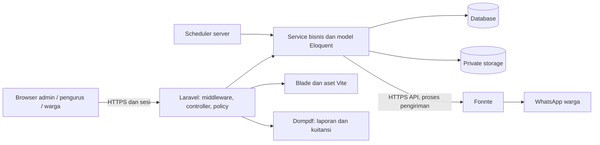

# Software Requirements Specification — EnviroPay

| Atribut | Nilai |
| --- | --- |
| Versi dokumen | 1.2 — halaman error EnviroPay |
| Tanggal penyusunan | 6 November 2026 |
| Peninjauan terakhir | 7 November 2026 |
| Acuan kode | Baseline `86e670b` beserta pembaruan halaman error; seluruh migrasi sampai `2026_11_06_000006` |
| Produk | EnviroPay — pengelolaan Iuran Pemeliharaan Lingkungan |
| Status | Draf untuk peninjauan kebutuhan dan penyempurnaan bertahap |

[Kembali ke README](../README.md) · [Panduan pengguna](PANDUAN-PENGGUNA.md)

## 1. Tujuan

Dokumen ini menjelaskan kebutuhan perangkat lunak, batas sistem, proses bisnis, model data, antarmuka dan kriteria penerimaan EnviroPay. Sasarannya adalah pengelola produk, pengurus perumahan, pengembang, penguji dan pengelola server.

Baseline mengikuti implementasi yang tersedia. Pernyataan **sistem harus** pada kebutuhan fungsional merumuskan perilaku yang dapat diperiksa pada kode saat ini. Target operasional yang belum diukur ditandai terpisah; keberadaan fitur atau pengujian tidak dianggap sebagai persetujuan pengguna terhadap seluruh kebutuhan.

## 2. Susunan dokumen

| Bagian | Isi |
| --- | --- |
| [Kebutuhan sistem](srs/01-KEBUTUHAN.md) | Aktor, matriks hak akses, kebutuhan fungsional/nonfungsional, aturan bisnis dan antarmuka. |
| [Model data dan ERD](srs/02-MODEL-DATA.md) | Entitas, relasi, kardinalitas, ERD konseptual dan aturan integritas. |
| [PDM dan kamus data](srs/03-PDM-KAMUS-DATA.md) | Diagram fisik per domain, seluruh 29 tabel, kolom, tipe SQLite, nullability, default, indeks dan foreign key. |
| [DFD dan alur proses](srs/04-DFD-DAN-PROSES.md) | Diagram konteks, DFD level 1/2, use case, diagram status dan sequence pembayaran/pengiriman. |
| [Verifikasi dan penerimaan](srs/05-VERIFIKASI.md) | Matriks ketertelusuran kebutuhan ke kode/pengujian, skenario penerimaan dan pekerjaan lanjutan. |

Diagram ditulis dalam **Mermaid** sehingga sumbernya dapat ditinjau dan diperbarui di Git. Buka dengan penampil Markdown yang mendukung Mermaid, misalnya halaman repository GitHub; penampil teks biasa hanya menampilkan kode diagram.

## 3. Ruang lingkup

EnviroPay mengelola beberapa perumahan dalam satu instalasi. Admin menyiapkan perumahan dan pengurus. Pengurus mengelola rumah, warga, tarif, rekening pembayaran, tagihan, verifikasi transfer, penerimaan tunai, kas, laporan, pengumuman dan tindak lanjut. Warga melihat tagihan sendiri, mengunggah bukti transfer dan memperoleh kuitansi.

Pemberitahuan tersedia melalui lonceng aplikasi dan WhatsApp Fonnte untuk kejadian tertentu. Sistem juga menyediakan template tagihan dengan konfirmasi penerbitan, lampiran kas privat, riwayat aktivitas, tutup buku dan riwayat pengiriman WhatsApp.

Di luar lingkup implementasi saat ini: payment gateway, pemeriksaan mutasi bank otomatis, cicilan, pendaftaran publik, pengiriman email, chat dua arah, penjadwalan penerbitan template otomatis, kirim ulang WhatsApp dari UI, serta notifikasi layar HP/Web Push aktif.

## 4. Lingkungan dan arsitektur

| Komponen | Baseline |
| --- | --- |
| Backend | PHP 8.2+, Laravel 12, monolit berbasis MVC/service |
| Frontend | Blade, Bootstrap 5, JavaScript dan Vite 6 |
| Database | SQLite untuk lokal; koneksi MySQL/MariaDB tersedia melalui konfigurasi Laravel |
| Penyimpanan file | Disk lokal privat, diunduh melalui endpoint terotorisasi |
| Ekspor | CSV dan PDF yang dibuat server |
| Sesi dan cache | Driver database pada konfigurasi contoh; cache bersama diperlukan untuk koordinasi scheduler |
| Integrasi eksternal aktif | Fonnte, opsional melalui environment |
| Proses terjadwal | Pengingat, pemrosesan outbox WhatsApp, pembersihan pratinjau impor |

## 5. Asumsi dan dependensi

- Pengurus memastikan validitas data warga, nomor WhatsApp, rekening dan penerimaan uang tunai. Sistem tidak memeriksa transaksi pada bank.
- Server menjalankan scheduler dan menjaga sinkronisasi jam. Waktu bisnis memakai server/WIB; mengubah jam browser warga tidak mengubah jam server. Mengubah jam mesin yang menjalankan server memengaruhi proses berbasis waktu.
- Token, koneksi perangkat dan kuota Fonnte tersedia bila pengiriman diaktifkan. Penerimaan API tidak membuktikan pesan sampai atau dibaca.
- Backup database, environment/kunci aplikasi dan private storage dikelola operator. Aplikasi belum menyediakan menu backup/restore.
- Hak administrator database/server berada di luar kontrol akses aplikasi; penutupan buku tidak mencegah perubahan SQL langsung oleh operator tersebut.

## 6. Istilah

| Istilah | Definisi |
| --- | --- |
| Perumahan / housing | Unit pembatas data dan akses dalam satu instalasi. |
| Penanggung jawab IPL | Akun warga yang menjadi penerima tagihan baru untuk rumahnya. |
| Periode tagihan | Bulan kewajiban pembayaran, disimpan sebagai tanggal awal bulan. |
| Pembayaran gabungan | Satu pembayaran atas beberapa tagihan milik satu warga. |
| Snapshot | Salinan nilai saat kejadian, agar dokumen keuangan tidak mengikuti perubahan master data. |
| Outbox | Catatan antrean dalam database yang diproses setelah transaksi bisnis selesai. |
| Tanggal transaksi | Tanggal uang masuk/keluar untuk pelaporan kas; berbeda dari waktu pencatatan. |
| ERD | Entity Relationship Diagram: entitas dan hubungan bisnis. |
| PDM | Physical Data Model: tabel, kolom, kunci, indeks dan relasi fisik. |
| DFD | Data Flow Diagram: perpindahan data antara aktor, proses dan penyimpanan. |
| PK / FK / UQ | Primary key / foreign key / unique constraint. |

## 7. Penyempurnaan bertahap

| Tahap | Hasil pada baseline ini | Peninjauan selanjutnya |
| --- | --- | --- |
| 1 — ruang lingkup dan kebutuhan | Aktor, batas sistem, ID kebutuhan dan aturan bisnis | Konfirmasi alur terhadap praktik pengurus. |
| 2 — model data | ERD, PDM, kamus seluruh tabel dan batas constraint | Perbarui ketika skema/aturan berubah. |
| 3 — proses | Konteks, DFD level 1/2, use case, status dan sequence | Tambahkan dekomposisi jika ada proses bisnis baru. |
| 4 — validasi | Referensi pengujian dan skenario penerimaan | Catat hasil UAT, target kinerja, kapasitas serta pemulihan yang disepakati. |

Dokumen sudah mencakup keempat tahap sebagai dasar awal. Hasil UAT, angka SLA/kinerja dan kebijakan operasional tetap terbuka karena belum ditetapkan atau diukur. Rincian ada pada [daftar tindak lanjut](srs/05-VERIFIKASI.md#4-hal-yang-belum-ditetapkan).

## 8. Riwayat revisi

| Versi | Tanggal | Perubahan |
| --- | --- | --- |
| 1.0 | 6 November 2026 | Baseline kebutuhan, model data, proses dan verifikasi; disesuaikan dengan penghapusan Web Push. |
| 1.1 | 7 November 2026 | Pisahkan kebutuhan akun, perjelas opsionalitas rumah, lengkapi aliran DFD dan skenario penerimaan, serta catat hasil audit struktur dan diagram. |
| 1.2 | 7 November 2026 | Tambahkan FR-29/AT-23 untuk halaman error mandiri, pertahankan kontrak JSON/validasi dan verifikasi penyembunyian detail teknis pada HTML. |

## 9. Pengelolaan perubahan

Setiap perubahan perilaku memperbarui ID kebutuhan terkait, aturan bisnis, diagram dan pemetaan pengujiannya. Perubahan migrasi memperbarui PDM/kamus data berdasarkan database kosong terisolasi; jangan menyalin data warga atau kredensial ke dokumentasi. Catat tanggal dan commit acuan baru pada halaman ini.

Dokumen kebutuhan tidak menggantikan [panduan pengguna](PANDUAN-PENGGUNA.md), [petunjuk instalasi](../README.md#instalasi-lokal), atau [catatan keamanan](../SECURITY.md).
