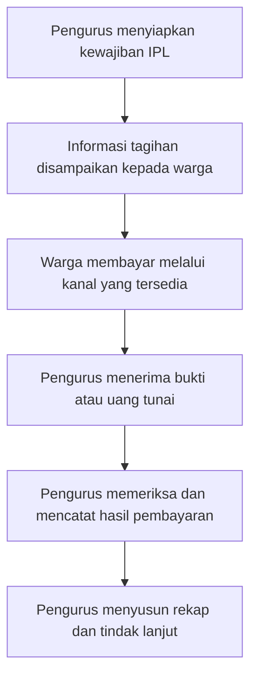

# Metodologi Waterfall dan Analisis Sistem

[Bab III](../BAB-III-PERANCANGAN.md) · [SRS](../SRS.md) · [Instrumen penelitian](06-INSTRUMEN-DAN-KELENGKAPAN.md)

## 1. Kedudukan penelitian dan bukti

Rancangan ini berorientasi pada pembuatan/evaluasi artefak perangkat lunak untuk administrasi IPL. Waterfall adalah metode pengembangan perangkat lunak yang dipilih, bukan teknik pengumpulan data atau bukti bahwa penelitian lapangan sudah dilakukan. Klasifikasi penelitian dalam naskah kampus dapat disesuaikan bersama pembimbing tanpa mengganti fakta implementasi.

Tiga status bukti digunakan: **tersedia** untuk sumber yang dapat diperiksa pada repository; **rencana** untuk kegiatan yang akan dikerjakan; **perlu konfirmasi** untuk kondisi lapangan atau keputusan yang belum disahkan. Label ini mencegah narasi rancangan berubah menjadi laporan hasil yang tidak memiliki dasar.

| ID bukti | Objek | Status | Cara pemeriksaan |
| --- | --- | --- | --- |
| EV-01 | Source code dan commit `94cda91` | Tersedia | Telusuri controller/service, route dan migration. |
| EV-02 | FR/BR/NFR serta ERD/PDM/DFD | Tersedia, draf teknis | Cocokkan relasi, status, input dan aturan dengan kode. |
| EV-03 | Kasus dan catatan uji otomatis | Tersedia pada suite/catatan SRS | Catat commit, environment, perintah, waktu dan output saat eksekusi penelitian. |
| EV-04 | Proses IPL di lokasi penelitian | Perlu konfirmasi | Observasi dengan O-01–08, lampirkan catatan bertanggal. |
| EV-05 | Kebutuhan pengurus/warga | Perlu konfirmasi | Wawancara W-01–10, validasi pemahaman dan izin penggunaan. |
| EV-06 | Dokumen bukti/tagihan/rekap nyata | Rencana, dengan izin | Samarkan identitas dan inventarisasi dokumen DOK. |
| EV-07 | Penerimaan pemakai | Rencana | UAT berdasarkan AT, catat keputusan dan koreksi. |
| EV-08 | Production, beban dan pemulihan | Rencana | Tentukan target dan lakukan pengukuran/simulasi. |

Nama perumahan, alamat/lokasi, periode penelitian dan peserta tidak diisi dengan asumsi. Sistem multi-perumahan dapat diteliti pada satu objek yang sah; jumlah lokasi tidak diturunkan dari jumlah tenant yang didukung aplikasi.

## 2. Pelaksanaan Waterfall yang dirancang

### 2.1 Analisis kebutuhan

Masukan analisis berupa kebutuhan pemilik proyek, bukti lapangan yang akan dikumpulkan, dan penelaahan implementasi. Kegiatan meliputi penetapan aktor, batasan, data masukan/keluaran, aturan dan risiko. Keluaran berupa SRS serta hubungan sumber kebutuhan ke FR/BR/NFR. Pengurus meninjau apakah istilah, otoritas dan hasil laporan sesuai dengan proses yang benar.

**Gerbang G1:** objek dan aktor ditetapkan, kebutuhan kritis tidak ambigu, setiap FR memiliki kriteria penerimaan, perbedaan pendapat dicatat. Dokumen teknis sudah tersedia; persetujuan G1 belum diasumsikan selesai hanya karena aplikasi dapat dijalankan.

### 2.2 Perancangan sistem

Masukan adalah baseline kebutuhan yang telah ditinjau. Kegiatan menyusun use case, aktivitas, urutan interaksi, DFD, ERD/PDM, modul, algoritma dan rancangan layar. Peninjauan memastikan setiap tujuan pengguna mempunyai jalur proses, sumber/tujuan data dan layar yang sesuai.

**Gerbang G2:** seluruh FR terpetakan ke RUC/UI/pengujian, model konseptual/fisik dibedakan, status dan nominal antarartefak konsisten. Format diagram tidak dicampur: DFD untuk arus data, UML untuk interaksi/kelas, wireframe untuk layar.

### 2.3 Implementasi

Implementasi menggunakan PHP/Laravel, Blade/Bootstrap, database relasional dan service Fonnte. Artefak implementasi sudah ada pada baseline dan dijelaskan sebagai referensi rancangan, bukan dihasilkan kembali pada pekerjaan dokumentasi ini. Dependency mengikuti lock file; penambahan skema melalui migration agar instalasi lama tetap dapat diperbarui.

**Gerbang G3:** source dapat dibangun, konfigurasi rahasia tidak masuk Git, migration diuji pada basis data uji, serta fungsi utama mempunyai pemeriksaan yang bermakna. Tidak dilakukan reset database aplikasi hanya untuk memperoleh skema dokumentasi.

### 2.4 Verifikasi dan pengujian

Pengujian teknis memeriksa keluaran, penolakan input, isolasi data dan integritas transaksi. Kegiatan UAT dilakukan terpisah bersama pengguna yang berwenang. Temuan ditautkan ke kebutuhan, diperbaiki dan diuji ulang sesuai dampaknya.

**Gerbang G4:** tidak ada temuan kritis terbuka yang mengakibatkan akses asing atau ketidakkonsistenan pembayaran; hasil aktual dan lingkungan terekam; keputusan UAT dicatat tanpa menjumlahkannya sebagai hasil suite otomatis.

### 2.5 Penerapan dan pemeliharaan

Penerapan mencakup konfigurasi production, migrasi, build, scheduler, akun awal, backup dan pemeriksaan fungsi. Pemeliharaan mencakup koreksi, penyesuaian kebutuhan dan peninjauan dependency. Prosedur rilis dan perubahan harus mempertahankan histori keuangan.

**Gerbang G5:** pihak pengelola menerima panduan, akses diberikan sesuai peran, backup telah diperiksa serta target pemulihan yang disepakati diuji. Deployment localhost tidak dinyatakan sebagai bukti penerapan production.

### 2.6 Pengendalian perubahan

Perubahan yang muncul setelah G1 tetap dapat ditangani dengan catatan CR: kebutuhan asal, alasan, dampak pada rancangan/database, keputusan pemilik, pengujian dan versi. Waterfall pada dokumen ini mengatur dependensi dan peninjauan artefak; koreksi tidak dihapus dari kronologi agar terlihat seolah proses tidak pernah kembali ke tahap desain.

## 3. Analisis kebutuhan dan hipotesis masalah

Tabel berikut adalah hipotesis untuk dikonfirmasi, bukan kesimpulan observasi.

| ID | Dugaan persoalan | Indikator yang dicari | Solusi rancangan | FR terkait |
| --- | --- | --- | --- | --- |
| H-01 | Identitas rumah/penanggung jawab kurang konsisten | Benturan kode, rumah tanpa penanggung jawab, alamat tidak seragam | Master rumah, relasi warga dan impor bertahap | FR-05–06 |
| H-02 | Sulit menelusuri kewajiban dan realisasi | Perbedaan daftar tagihan, bukti dan status | Tagihan berkomponen, status dan verifikasi | FR-08–14 |
| H-03 | Pencatatan kas dapat terpisah dari pembayaran | Kesesuaian nominal pembayaran sah dengan kas | Pemasukan otomatis satu kali per pembayaran | FR-11–15 |
| H-04 | Rekap membutuhkan pengolahan ulang | Waktu menyusun laporan dan jumlah sumber data | Filter laporan, kategori dan ekspor | FR-16–17 |
| H-05 | Pengingat sulit dilacak | Bukti kejadian pengingat dan hasil penyampaian | Outbox dan riwayat WhatsApp | FR-23–25 |
| H-06 | Koreksi bulan lampau sulit dipertanggungjawabkan | Catatan perubahan, alasan dan otorisasi | Log aktivitas dan tutup/buka buku | FR-19–20 |
| H-07 | Tindak lanjut janji bayar tidak terdokumentasi | Catatan kontak dan jadwal pengurus | Histori tindak lanjut per warga | FR-18 |

Indikator dapat diukur jika izin/data tersedia. Contoh desain pengukuran: durasi tugas dihitung dari awal hingga keluaran benar dengan skenario dan volume yang setara. Belum ada persentase percepatan atau penurunan kesalahan yang diisi pada dokumen ini.

## 4. Model kandidat proses berjalan

**Status model: kandidat yang belum divalidasi lapangan.** Diagram sengaja tidak menetapkan media, aplikasi atau jenis dokumen aktual. Hasil observasi harus memperbaiki diagram ini sebelum diberi label “sistem berjalan pada lokasi penelitian”.

## 5. Kebutuhan sumber daya

| Kebutuhan | Baseline teknis | Cara menentukan kecukupan |
| --- | --- | --- |
| Runtime | PHP 8.2+ dan ekstensi sesuai Composer | `composer check-platform-reqs`; cek runtime server. |
| Build | Node.js/npm sesuai dependency yang dikunci | Instalasi bersih dan build; bukan proses wajib saat aplikasi berjalan. |
| Database | SQLite untuk baseline lokal, MySQL/MariaDB dapat dikonfigurasi | Pilih target dan uji migration, lock serta beban. |
| Browser | Browser desktop/HP dengan dukungan web standar | Catat versi yang benar-benar diuji; jangan menganggap semua browser lulus. |
| File privat | Kapasitas menyimpan bukti/nota dan backup | Ukur volume rata-rata file dan retensi yang disepakati. |
| WhatsApp | Perangkat, token, jaringan dan kuota Fonnte | Uji nomor sendiri dengan izin operator. |
| Infrastruktur | HTTPS, pengaturan waktu server, cron dan hak tulis storage | Pemeriksaan konfigurasi serta simulasi kegagalan/pemulihan. |

RAM, CPU, kapasitas pengguna dan SLA tidak ditetapkan dari tebakan. Tabel spesifikasi mesin penelitian diisi dari perangkat yang benar-benar digunakan, termasuk OS, versi PHP, database, browser dan commit aplikasi.

## 6. Rencana urutan kegiatan

| Urutan | Aktivitas | Dependensi | Keluaran yang diperiksa |
| --- | --- | --- | --- |
| P1 | Tetapkan objek, izin dan informan | Persetujuan pemilik/kampus | Identitas objek dan izin. |
| P2 | Observasi, wawancara dan telaah dokumen | P1 | EV-04–06 dan catatan kebutuhan. |
| P3 | Tinjau analisis dan SRS | P2 serta baseline kode | G1 dan daftar revisi. |
| P4 | Tinjau rancangan proses/data/layar | P3 | G2 dan matriks ketertelusuran. |
| P5 | Sesuaikan implementasi jika ada revisi | P4 | Kode/migration dan G3. |
| P6 | Uji teknis dan UAT | P5 | Log, temuan, keputusan G4. |
| P7 | Uji penerapan, backup dan serah terima | P6 | G5 dan panduan operasional. |

P1–P7 adalah urutan rancangan, bukan klaim tanggal penelitian. Peneliti melengkapi jadwal kalender setelah objek dan waktu disetujui. Kode yang tersedia sebelum penelitian tetap dicatat sebagai baseline, tidak diberi tanggal implementasi fiktif untuk menyesuaikan bagan.
