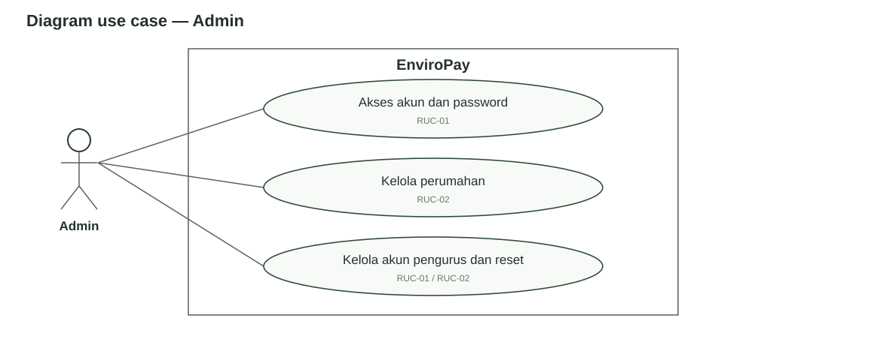
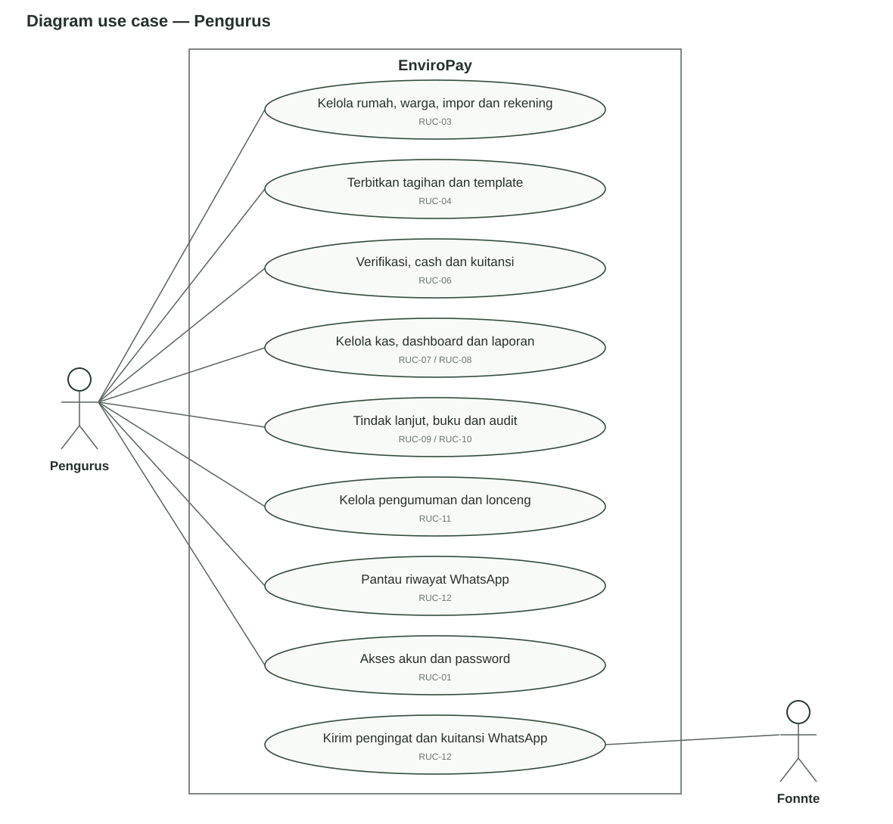
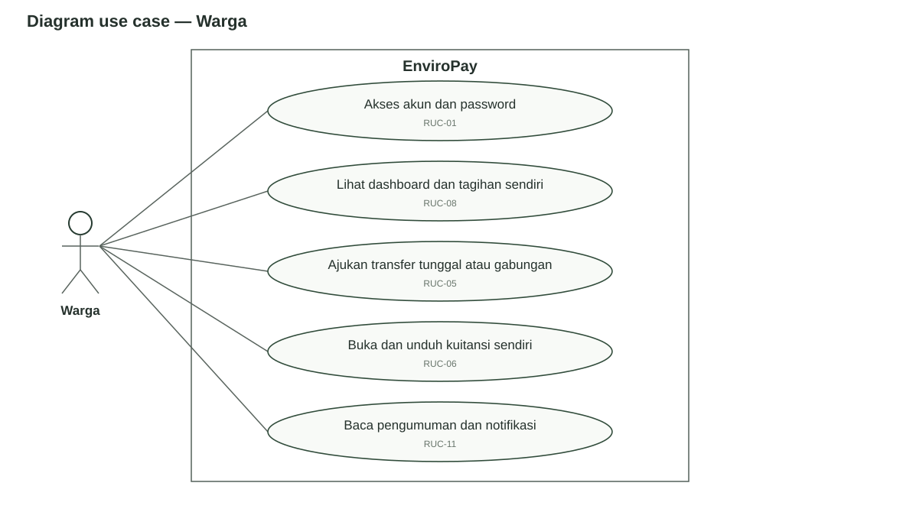
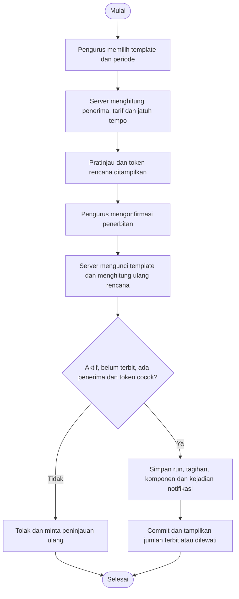
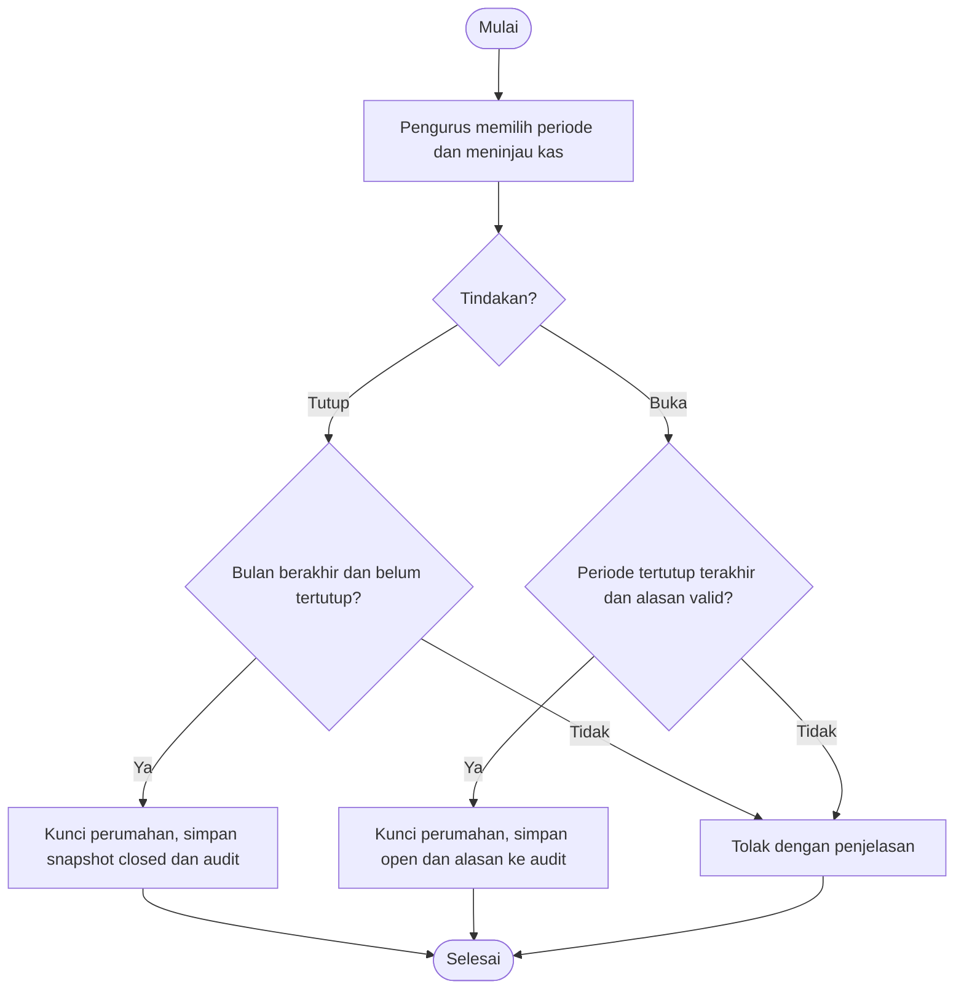

# Spesifikasi Use Case dan Aktivitas

[Bab III](../BAB-III-PERANCANGAN.md) · [Kebutuhan SRS](../srs/01-KEBUTUHAN.md) · [DFD dan sequence SRS](../srs/04-DFD-DAN-PROSES.md)

## 1. Konvensi model

RUC-01–13 mengelompokkan tujuan pengguna pada dokumen rancangan ini. Satu kelompok dapat memuat beberapa subfungsi; spesifikasi berikut menyebut cabang aktor masing-masing, bukan menganggap seorang aktor dapat menjalankan semua tindakan. Pengujian ditautkan ke AT SRS dan BB pada [rencana pengujian](05-RENCANA-PENGUJIAN.md).

Diagram SVG menggunakan aktor, batas sistem, elips tujuan dan asosiasi. Pengelompokan elips tidak menyatakan hubungan UML `include` atau `extend` yang tidak digambar. Diagram ini bukan ERD atau DFD; hubungan data dan urutan kerja ditunjukkan pada artefak lain.

## 2. Diagram use case per aktor

### Admin

Admin membuat/mengelola perumahan dan pengurus. Pembuatan admin pertama melalui CLI adalah tugas operator; tidak digambar sebagai pendaftaran publik.

### Pengurus

Pengurus mengelola lingkungannya dan membaca riwayat. Tujuan pengiriman WhatsApp ditampilkan sebagai elips terpisah yang berasosiasi dengan Fonnte; tidak ada asosiasi pengurus ke elips pengiriman manual. Scheduler memproses antrean internal dan Fonnte berpartisipasi sebagai sistem eksternal. Membaca riwayat tidak menghubungi provider. Diagram tidak menggambarkan pengurus bebas mengirim pesan manual atau mengirim ulang dari riwayat.

### Warga

Warga mengakses tagihan/kuitansi sendiri, serta pengumuman dan ringkasan lingkungan yang diizinkan. Warga tidak mengesahkan pembayaran sendiri.

## 3. Spesifikasi use case

### RUC-01 — Akses dan pengelolaan password

| Komponen | Spesifikasi |
| --- | --- |
| Aktor | Semua role untuk login/password sendiri; operator untuk admin awal; admin/pengurus untuk reset target yang diizinkan. |
| Acuan | FR-01–03, FR-27–28; AT-01/17/18; BB-01. |
| Prasyarat | Akun tersedia dan memenuhi status aktif; provisioning admin awal dilakukan di server. |
| Alur normal | Pengguna mengisi username/email dan password; server memvalidasi, meregenerasi sesi dan membuka dashboard sesuai role. Pengguna dapat logout untuk membatalkan sesi. Pada perubahan password sendiri, password saat ini diperiksa dan password baru dikonfirmasi. |
| Alternatif | Admin mereset pengurus; pengurus mereset warga lingkungannya; sesi target dicabut. CLI menolak admin kedua secara berurutan. Tidak ada alur email lupa password aktif. |
| Gagal | Kredensial salah, akun/perumahan nonaktif, batas laju atau target asing ditolak. |
| Kondisi akhir | Sesi/role sesuai; password tersimpan sebagai hash; histori transaksi tidak dihapus. |

### RUC-02 — Administrasi perumahan dan pengurus

| Komponen | Spesifikasi |
| --- | --- |
| Aktor / acuan | Admin; FR-04; AT-17; BB-02. |
| Prasyarat | Login admin aktif. |
| Alur normal | Buka daftar, isi/ubah perumahan dan akun pengurus, tentukan perumahan serta status aktif, lalu simpan. |
| Alternatif | Nonaktifkan perumahan/pengurus; pindahkan pengurus sesuai kewenangan admin. |
| Gagal | Identitas tidak unik, data tidak valid atau penghapusan perumahan berhistori ditolak. |
| Kondisi akhir | Data administrasi diperbarui; sesi terkait dicabut saat nonaktif/pindah; FK dan histori dipertahankan. |

### RUC-03 — Master rumah, warga, impor dan rekening

| Komponen | Spesifikasi |
| --- | --- |
| Aktor / acuan | Pengurus; FR-05–07; AT-02/19; BB-03/04/21. |
| Prasyarat | Pengurus/perumahan aktif; rumah tersedia sebelum impor warga yang merujuk kode rumah. |
| Alur normal | Pengurus menambah/menyunting master, menghubungkan warga dan penanggung jawab, menetapkan kondisi/tarif serta rekening. Untuk impor, unggah CSV, tinjau tambah/perbarui lalu konfirmasi. |
| Alternatif | Warga boleh belum terhubung pada input manual; rumah boleh belum memiliki penanggung jawab. Rekening/akun dinonaktifkan sesuai alurnya. |
| Gagal | Kode/identitas bertabrakan, rumah asing, CSV salah/kedaluwarsa atau perubahan setelah pratinjau menahan penyimpanan batch. |
| Kondisi akhir | Data konsisten dalam perumahan; perubahan rumah dicatat, tagihan historis tidak dipindahkan. |

### RUC-04 — Penerbitan tagihan dan template

| Komponen | Spesifikasi |
| --- | --- |
| Aktor / acuan | Pengurus; FR-08–09; AT-03/04; BB-05/06. |
| Prasyarat | Penerima/komponen valid dan terdapat warga yang memenuhi syarat; template aktif bila digunakan. |
| Alur normal | Tentukan judul, periode, jatuh tempo, komponen dan penerima. Server menghitung rencana serta menerapkan penanggung jawab/tarif. Template memerlukan pratinjau dan konfirmasi sebelum penerbitan. |
| Alternatif | Tarif kosong khusus mengganti total, bebas dilewati jika aturan aktif, tanggal 29–31 dijepit ke akhir bulan. |
| Gagal | Pratinjau berubah, template/periode sudah diterbitkan, nominal/jatuh tempo salah atau tidak ada penerima template ditolak. |
| Kondisi akhir | Tagihan `unpaid` dan komponen tersimpan, run template bila relevan serta kejadian notifikasi/outbox yang memenuhi syarat. |

### RUC-05 — Pengajuan transfer tunggal atau gabungan

| Komponen | Spesifikasi |
| --- | --- |
| Aktor / acuan | Warga; FR-10/13; AT-05/07; BB-07/08. |
| Prasyarat | Tagihan `unpaid`/`rejected` milik satu warga; 1–100 ID unik; bukti transfer valid. |
| Alur normal | Pilih tagihan, tinjau total/rekening, transfer di luar aplikasi, unggah bukti. Server memvalidasi ulang dan menyimpan pengajuan. |
| Alternatif | Satu pilihan memakai tagihan tunggal; beberapa pilihan membuat batch dan pivot historis; penolakan lama dapat diikuti pengajuan baru. |
| Gagal | Status berubah, total berbeda, ID asing, pemilik campuran atau file tidak valid ditolak; file baru dibersihkan pada kegagalan alur yang menanganinya. |
| Kondisi akhir | Status `pending`, bukti privat dan notifikasi pengurus; belum ada kas/kuitansi baru. |

### RUC-06 — Verifikasi, cash dan kuitansi

| Komponen | Spesifikasi |
| --- | --- |
| Aktor / acuan | Pengurus untuk keputusan/cash, warga/pengurus untuk kuitansi sesuai izin; FR-11–14; AT-05–07; BB-09/10/23. |
| Prasyarat | Transfer `pending` atau cash atas tagihan dapat dibayar; kas periode penerimaan terbuka. |
| Alur normal | Pengurus menilai bukti atau mengonfirmasi uang tunai; server mengunci/memeriksa data, menyimpan status lunas, satu kas, satu kuitansi dan pemberitahuan. |
| Alternatif | Tolak transfer dengan alasan; seluruh anggota batch ditolak bersama. Warga membuka kuitansi HTML/PDF miliknya; pengurus untuk perumahannya. |
| Gagal | Keputusan berulang, batch berubah, akses asing atau periode kas tertutup menolak penyelesaian; mutasi database dibatalkan bersama. |
| Kondisi akhir | Kas tidak digandakan per anggota batch; kuitansi snapshot tetap; cash tidak memerlukan tahap persetujuan transfer. Pengurus dapat menerima cash untuk warga nonaktif yang masih memiliki kewajiban; warga nonaktif tetap tidak dapat login, dan WhatsApp-nya dilewati. |

### RUC-07 — Kas manual dan lampiran

| Komponen | Spesifikasi |
| --- | --- |
| Aktor / acuan | Pengurus; FR-15; AT-08/12; BB-11. |
| Prasyarat | Tanggal dan dampak transaksi berada pada buku terbuka. |
| Alur normal | Isi nama, jenis, kategori, tanggal dan nominal; lampirkan nota bila perlu. Simpan, edit/hapus transaksi manual sesuai kewenangan. |
| Alternatif | Ganti/hapus nota privat; tanggal transaksi dibedakan dari waktu pencatatan. |
| Gagal | Kas otomatis, tanggal masa depan, kategori khusus otomatis, file salah atau periode terdampak tertutup ditolak. |
| Kondisi akhir | Kas/log berubah bersama; nota hanya diakses pengurus lingkungannya dan berkas pengganti dikelola sesuai alur. |

### RUC-08 — Dashboard, laporan dan ekspor

| Komponen | Spesifikasi |
| --- | --- |
| Aktor / acuan | Semua role untuk dashboard sesuai izin; pengurus untuk laporan/ekspor; FR-16–17/26; AT-09/10/22; BB-12/13/22/24. |
| Prasyarat | Login aktif; filter sesuai format. |
| Alur normal | Pilih jenis laporan, periode/tahun, status/kategori/sumber/pencarian yang tersedia; tinjau ringkasan/detail; ekspor CSV/PDF sesuai filter. |
| Alternatif | Buka rincian bulan pada rekap rumah; gunakan CSV untuk hasil melampaui batas PDF. |
| Gagal | Filter salah, akses asing atau batas PDF dilewati ditolak secara eksplisit. |
| Kondisi akhir | Total filter dan saldo keseluruhan dibedakan; rumah historis/status terkini dipertahankan; tidak ada perubahan tagihan/pengiriman pesan. |

### RUC-09 — Tindak lanjut tunggakan

| Komponen | Spesifikasi |
| --- | --- |
| Aktor / acuan | Pengurus; FR-18; AT-11; BB-14. |
| Prasyarat | Warga dalam lingkup pengurus, petugas penanggung jawab aktif. |
| Alur normal | Buka daftar/detail, catat komunikasi, status dan petugas; isi tanggal untuk janji/jadwal, lalu simpan catatan baru. |
| Alternatif | Catatan tetap dapat ditelusuri setelah tunggakan lunas. |
| Gagal | Petugas asing/nonaktif, catatan/tanggal tidak valid ditolak. |
| Kondisi akhir | Histori bertambah; tagihan tidak otomatis lunas dan WhatsApp tidak otomatis terkirim. |

### RUC-10 — Tutup/buka buku dan audit

| Komponen | Spesifikasi |
| --- | --- |
| Aktor / acuan | Pengurus; FR-19–20; AT-12; BB-15/16. |
| Prasyarat | Bulan sudah berakhir untuk penutupan; alasan valid untuk pembukaan. |
| Alur normal | Pilih bulan, tinjau saldo, konfirmasi tutup; server menyimpan snapshot/status dan log. Baca riwayat aktivitas sesuai filter. |
| Alternatif | Buka kembali periode tertutup paling akhir dengan alasan. |
| Gagal | Bulan berjalan/masa depan, buka bukan yang terakhir atau perubahan kas yang memengaruhi periode tertutup ditolak. |
| Kondisi akhir | Penguncian mencakup dampak saldo awal; log bukan data yang dapat diedit melalui UI; laporan tagihan tetap status terkini. |

### RUC-11 — Pengumuman dan lonceng

| Komponen | Spesifikasi |
| --- | --- |
| Aktor / acuan | Pengurus untuk publikasi; pengurus/warga untuk lonceng; warga untuk pengumuman yang diizinkan; FR-21–22; AT-20/21; BB-17. |
| Prasyarat | Akun/perumahan aktif dan sumber data dalam lingkupnya. |
| Alur normal | Simpan/edit draft, publikasikan untuk warga aktif, baca daftar/detail; tandai notifikasi sendiri dibaca. |
| Alternatif | Arsip hilang dari daftar aktif, tetapi detail dapat dibuka melalui tautan sah. |
| Gagal | Warga mengakses draft, mengubah publikasi atau menandai notifikasi asing ditolak. |
| Kondisi akhir | Pengumuman/lonceng sesuai status dan penerima; publikasi tidak menjadi pesan WhatsApp pada baseline. |

### RUC-12 — Pengingat, kuitansi WhatsApp dan riwayat

| Komponen | Spesifikasi |
| --- | --- |
| Aktor / acuan | Pengurus memantau, warga menerima, Fonnte eksternal; FR-23–25; AT-13–15; BB-18/19/25. |
| Prasyarat | Konfigurasi aktif untuk enqueue/kirim; penerima/kejadian memenuhi syarat; scheduler tersedia. |
| Alur normal | Kejadian bisnis membuat outbox, scheduler mengklaim dan memeriksa ulang, mencatat tujuan terakhir lalu mengirim; hasil dipetakan dan dapat dibaca pengurus. |
| Alternatif | Respons 2xx `status=false`/429 dijadwalkan ulang dalam batas; nomor/akun/status tidak sesuai dilewati; hasil ambigu menjadi `uncertain`. |
| Gagal | Token tidak terkonfigurasi menghentikan pengiriman; timeout tidak diulang otomatis; UI tidak menawarkan kirim ulang. |
| Kondisi akhir | Satu kuitansi satu antrean; `accepted` bukan delivered/read; identitas percobaan terakhir dipisah dari nomor warga terkini. |

### RUC-13 — Penanganan error

| Komponen | Spesifikasi |
| --- | --- |
| Aktor / acuan | Semua pengguna; FR-29; AT-23; BB-20. |
| Prasyarat | Terjadi exception HTTP yang mencapai Laravel. |
| Alur normal | Respons HTML menampilkan identitas EnviroPay, penjelasan aman, kode dan tautan halaman utama. |
| Alternatif | JSON, redirect autentikasi dan validasi form mempertahankan kontraknya. |
| Gagal/batas | Error sebelum Laravel pada proxy/web server memerlukan penanganan lapisan tersebut. |
| Kondisi akhir | Kode/status dan header protokol dipertahankan; HTML tidak mengungkap stack trace atau memerlukan query pengguna/aset build. |

## 4. Aktivitas penerbitan template

Pratinjau/simpan template tidak menerbitkan tagihan. Token rencana menggunakan HMAC; perubahan penerima/tarif setelah pratinjau tidak boleh disetujui diam-diam.

## 5. Aktivitas tutup dan buka buku

Tanggal suatu mutasi kas diperiksa terhadap semua periode tertutup yang dapat terpengaruh. Membuka satu periode tidak menghilangkan pembatasan periode tertutup lainnya.
