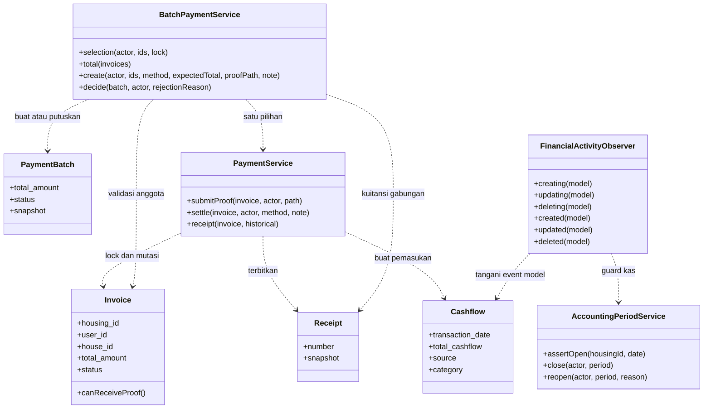
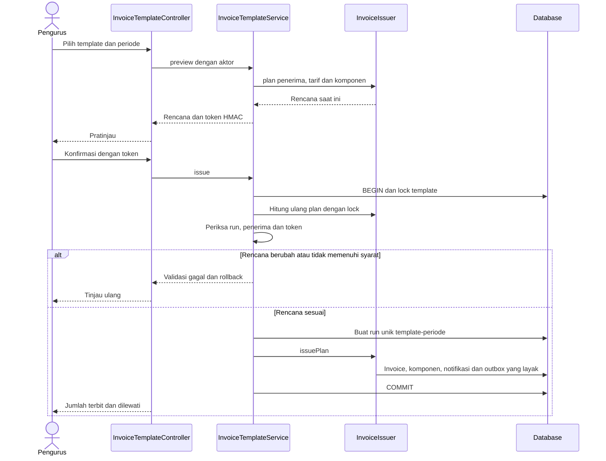
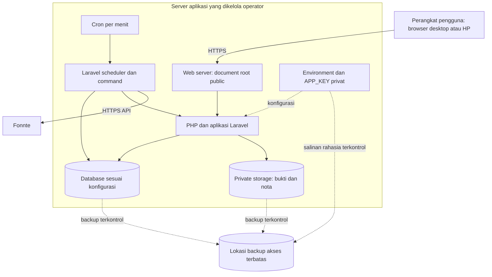

# Rancangan Arsitektur, Data dan Logika

[Bab III](../BAB-III-PERANCANGAN.md) · [ERD](../srs/02-MODEL-DATA.md) · [PDM/kamus lengkap](../srs/03-PDM-KAMUS-DATA.md)

## 1. Komponen dan kontrak

Aplikasi menggunakan satu basis kode dengan modul yang dipisah menurut tanggung jawab. Controller menerima input terautentikasi dan memanggil service. Service memeriksa ulang aturan pada titik mutasi, model menyimpan data dan observer mencatat aktivitas terpilih. Diagram ini merupakan perancangan yang dipetakan pada kelas aktual; bukan klaim bahwa seluruh logika ditempatkan hanya pada satu lapisan.

| Kontrak | Masukan yang dipercaya setelah validasi | Keluaran / invariannya |
| --- | --- | --- |
| Browser → controller | Identitas sesi dan field tervalidasi | Klien tidak menentukan sendiri pemilik, perumahan atau total akhir yang dianggap sah. |
| Controller → InvoiceIssuer | Aktor, komponen, periode, penerima dan aturan tarif | Rencana/hasil penerbitan sesuai rumah dan penanggung jawab. |
| Controller → PaymentService | Aktor, invoice terkunci dan keputusan/metode | Status, satu kas dan kuitansi konsisten dalam transaksi. |
| Controller → BatchPaymentService | ID unik satu warga dan total yang ditinjau | Total dibandingkan ulang; tidak ada penyelesaian sebagian. |
| Mutasi kas → AccountingPeriodService | Perumahan serta tanggal asal/tujuan | Perubahan yang memengaruhi buku tertutup ditolak. |
| Notifier → outbox | Kejadian serta notifikasi dalam transaksi bisnis | Deduplikasi dan rujukan data; bukan HTTP langsung. |
| Sender → FonnteClient | Nomor ternormalisasi dan teks yang dibentuk server | Status aman, tanpa menyimpan respons mentah/token pada riwayat. |

### 1.1 Diagram kelas inti



Atribut/method dipilih yang relevan dengan analisis, bukan seluruh anggota kelas. Panah putus-putus menunjukkan dependensi penggunaan, bukan FK. Multiplicity data tetap dijelaskan pada ERD/PDM. Observer terdaftar juga pada invoice, batch, template, run, tindak lanjut dan periode; gambar menyorot hubungannya dengan kas.

### 1.2 Sequence penerbitan template



Urutan detail query mengikuti implementasi service; diagram menyorot batas transaksi dan keputusan. Panggilan ke provider tidak termasuk di dalam sequence penerbitan.

## 2. Rancangan deployment



Diagram menunjukkan rancangan penempatan logis, bukan topologi production yang sudah dideploy. Database dapat dipisahkan ke host lain bila dipilih, dengan pengujian akses/latensi sendiri. Tidak ada keharusan menjalankan XAMPP untuk arsitektur ini; PHP CLI dan SQLite cukup bagi pengembangan lokal. Proses pengirim WhatsApp sekarang menggunakan scheduler tanpa worker queue tambahan.

## 3. Perancangan data dan normalisasi

### 3.1 CDM, ERD dan PDM

Model konseptual/CDM menggunakan istilah perumahan, akun, rumah, kewajiban, pembayaran dan dokumen keuangan. ERD memberikan hubungan/kardinalitas; PDM menerjemahkannya ke tabel, FK, nullability dan indeks. CDM pada paket ini merupakan ringkasan konseptual dalam ERD, bukan artefak terpisah yang diklaim telah dibuat dengan alat database tertentu.

| Entitas konseptual | Relasi fisik utama | Ketergantungan penting |
| --- | --- | --- |
| Perumahan | housings | id menentukan identitas dan status lingkungan. |
| Akun | users | id menentukan role, perumahan dan rumah saat ini; username/email unik. |
| Rumah | houses, house_histories | pasangan housing_id/code unik; histori menyimpan perubahan atribut. |
| Kewajiban | invoices, invoice_components | invoice id menentukan pemilik, periode dan nominal; component id menentukan invoice dan rinciannya. |
| Pembayaran gabungan | payment_batches, payment_batch_invoice | PK gabungan batch/invoice menghindari anggota ganda pada batch sama; satu tagihan dapat memiliki beberapa anggota historis. |
| Dokumen dan kas | receipts, cashflows | Sumber pembayaran nullable unique menghindari hasil ganda untuk sumber terisi. |
| Periode buku | accounting_periods | pasangan housing_id/period menentukan satu record periode. |
| Komunikasi | notifications, whatsapp_deliveries | notifiable bersifat polymorphic; outbox memakai FK dan UQ yang sesuai. |

### 3.2 Alasan pemisahan tabel

1. Identitas perumahan tidak diulang pada setiap rincian komponen; transaksi merujuk master dan menyimpan lingkup yang diperlukan untuk scoping.
2. Komponen tagihan merupakan hubungan satu-ke-banyak sehingga tidak dibuat sebagai kolom biaya_1, biaya_2 dan seterusnya pada invoice.
3. Pivot batch menyimpan hubungan historis banyak-ke-banyak. Mengandalkan `invoices.payment_batch_id` saja akan menghilangkan konteks percobaan batch yang sudah ditolak/digantikan.
4. Rekening tidak ditempel sebagai FK aktif pada tagihan; daftar rekening tersedia dari master perumahan. Snapshot kuitansi/batch menjaga rincian pembayaran yang memang diterbitkan.
5. Kategori kas adalah enum/kode aplikasi; tidak ada tabel kategori terpisah pada baseline. Diagram tidak membuat tabel fiktif untuk menyesuaikan teori.

### 3.3 Batas klaim bentuk normal

Pada bagian relasional, ID/PK mengidentifikasi baris dan pemisahan rincian/pivot mengurangi kelompok berulang. Namun snapshot, konfigurasi template, daftar ID penerima serta staging impor menggunakan JSON/teks terenkripsi. Data historis seperti label rumah dan nama aktor sengaja disalin. Karena itu, naskah menjelaskan alasan desain per tabel dan tidak menyatakan seluruh skema otomatis memenuhi 1NF/2NF/3NF hanya karena memakai Eloquent atau memiliki FK.

Eksklusivitas invoice/batch pada kuitansi/kas, kesamaan perumahan antarreferensi, peran aktor dan satu penanggung jawab per warga adalah aturan aplikasi yang belum semuanya menjadi CHECK/UQ SQL. Diagram fisik dan batasannya harus tetap mengikuti [kamus data](../srs/03-PDM-KAMUS-DATA.md).

## 4. Algoritma dan tabel keputusan

### ALG-01 — Penerima dan tarif tagihan

```text
masukan: aktor pengurus, periode, jatuh tempo, komponen, mode/ID penerima
validasi jatuh tempo >= awal periode dan total komponen dalam batas
ambil warga aktif dalam perumahan aktor dan sesuai pilihan
untuk setiap warga:
    temukan rumah pada perumahan yang sama bila house_id terisi
    jika referensi rumah tidak sesuai atau warga bukan penanggung jawab: lewati
    gunakan total dan komponen normal
    jika aturan rumah aktif dan kondisi rumah vacant:
        jika exempt: lewati
        jika custom: ganti total/komponen dengan nominal tarif khusus
    masukkan warga, rumah historis, label, nominal dan komponen ke rencana
saat diterbitkan: simpan invoice unpaid, komponen dan kejadian notifikasi
```

| Kondisi | Hasil |
| --- | --- |
| Warga tidak aktif atau perumahan asing | Tidak menjadi penerima pilihan yang sah. |
| Ada rumah, akun bukan penanggung jawab | Dilewati. |
| Tanpa rumah pada data manual/historis yang didukung | Komponen normal; tidak menebak rumah saat ini dari alamat. |
| Kosong + custom + aturan aktif | Total diganti nominal khusus positif. |
| Kosong + exempt + aturan aktif | Dilewati. |
| Aturan tarif dimatikan | Komponen normal; pembatasan penanggung jawab tetap berlaku. |

Contoh fiktif: komponen Rp 100.000 + Rp 50.000 menghasilkan Rp 150.000. Tarif kosong khusus Rp 25.000 mengganti total menjadi Rp 25.000, bukan menghasilkan Rp 125.000.

### ALG-02 — Total dan penyelesaian pembayaran gabungan

```text
validasi jumlah ID 1..100, unik, satu warga dan dalam perumahan aktor
lock invoice dalam urutan ID; periksa status unpaid/rejected untuk pengajuan
ubah nominal string ke satuan sen dan jumlahkan
bandingkan total server dengan total yang telah ditinjau
jika satu invoice: delegasikan ke alur PaymentService
jika beberapa: simpan batch, snapshot dan pivot; hubungkan invoice saat ini
untuk transfer: status pending dan notifikasi pengajuan
untuk cash atau persetujuan transfer yang sah:
    validasi ulang anggota, total, status dan periode kas
    simpan verified seluruh anggota, satu kas, satu kuitansi dan notifikasi
commit; bila salah satu bagian gagal, rollback transaksi database
```

Persetujuan batch transfer memakai total dan rincian snapshot yang disimpan pada pengajuan. Contoh fiktif: tiga tagihan Rp 100.000, Rp 75.000 dan Rp 25.000 menghasilkan satu pemasukan Rp 200.000, bukan tiga pemasukan ditambah pemasukan batch. Dua tagihan Rp 10.000,50 dan Rp 20.000,25 yang sudah tersimpan dijumlahkan menjadi Rp 30.000,75 melalui satuan sen; ini bukan contoh input komponen baru yang mensyaratkan rupiah bulat.

### ALG-03 — Saldo kas dan filter

Untuk perumahan h dan bulan m:

```text
saldo_awal(h,m) = jumlah income sebelum m - jumlah expense sebelum m
saldo_akhir(h,m) = saldo_awal(h,m) + income dalam m - expense dalam m
net_filter(h,m,F) = income cocok F dalam m - expense cocok F dalam m
```

Tanggal akuntansi adalah transaction_date, dengan fallback tanggal created_at untuk data yang memerlukannya. Interval bulan adalah awal bulan inklusif sampai awal bulan berikutnya eksklusif. Filter kategori/jenis/sumber/pencarian hanya memengaruhi rincian/rekap filter, bukan saldo keseluruhan.

Contoh fiktif: saldo awal Rp 1.000.000, pemasukan Rp 500.000 dan pengeluaran Rp 200.000 menghasilkan saldo akhir Rp 1.300.000. Filter pengeluaran Keamanan Rp 150.000 menunjukkan net filter −Rp 150.000, bukan saldo akhir Rp 850.000.

### ALG-03A — Umur tunggakan

Tunggakan hanya invoice `unpaid`/`rejected` dengan due_date < tanggal server hari ini, termasuk milik warga nonaktif. Umur 1–30 hari masuk age_30, 31–60 age_60, lebih dari 60 age_over_60; pending dan due hari ini tidak dihitung sebagai tunggakan. Search/detail mengikuti lingkup pengurus.

Filter umur memilih **warga yang memiliki nominal pada bucket tersebut**. Setelah warga terpilih, jumlah/total tetap memuat seluruh tunggakan warga itu, tidak hanya invoice di bucket filter. Contoh fiktif: warga memiliki Rp 100.000 umur 10 hari dan Rp 50.000 umur 70 hari. Filter >60 hari tetap memilih warga itu dengan total Rp 150.000, rincian bucket Rp 100.000/Rp 0/Rp 50.000. Dasar: `ReportService::arrears` dan ReportsTest.

### ALG-04 — Klasifikasi matriks tahunan

| Urutan evaluasi per rumah/akun dan bulan | Status |
| --- | --- |
| Tidak ada invoice | not_issued / Belum Ada Tagihan |
| Ada invoice unpaid/rejected | unpaid / Belum Lunas |
| Tidak ada unpaid/rejected, tetapi ada pending | pending / Menunggu Verifikasi |
| Ada invoice dan seluruhnya verified | paid / Lunas |

Pengelompokan memakai rumah saat invoice terbit; invoice tanpa rumah dikelompokkan per akun secara terpisah. Nominal pending tidak digabung menjadi nominal belum lunas. Keputusan “Lunas” tidak ditentukan oleh satu invoice saja bila bulan itu memiliki beberapa kewajiban.

### ALG-05 — Dampak periode buku

```text
untuk tanggal mutasi d, cari periode closed pada perumahan yang sama
jika ada periode >= awal_bulan(d): mutasi memengaruhi periode itu, tolak
pada edit: periksa tanggal asli dan tanggal tujuan
pada close: hanya bulan yang sudah berakhir, simpan snapshot saldo tanpa filter
pada reopen: wajib alasan dan tidak boleh ada closed yang lebih baru
```

Transaksi sebelum bulan tertutup ikut dikunci karena memengaruhi saldo awal. Pembayaran kewajiban lama tetap dapat masuk pada tanggal server bulan berjalan bila buku yang terdampak terbuka.

### ALG-06 — Pengiriman WhatsApp

```text
jika konfigurasi belum aktif: jangan enqueue/kirim
buat outbox hanya untuk kejadian yang didukung; deduplikasi notifikasi/kuitansi
scheduler memilih pending yang waktunya tersedia dan mengklaim processing
periksa ulang pemilik, akun/perumahan, status, kuitansi, nomor dan umur antrean
jika tidak layak: skipped
jika layak: simpan tujuan terakhir terenkripsi, lalu panggil Fonnte di luar transaksi bisnis
petakan hasil ke accepted / pending / failed / uncertain
jangan ulang otomatis hasil ambigu; riwayat pengurus hanya membaca catatan
```

Batas/pola retry mengikuti BR-18–20 pada SRS. Konfigurasi saat ini menggunakan satu nomor/token pengirim per instalasi dan nomor seluler Indonesia per warga. Tidak ada klaim webhook delivered/read atau broadcast bebas dari UI.

## 5. Pengendalian risiko rancangan

| Risiko | Kontrol yang dirancang/tersedia | Pemeriksaan | Batas |
| --- | --- | --- | --- |
| Akses lintas perumahan | Policy, middleware, scoping controller/service | AT-01; HousingIsolationTest | FK tunggal tidak memeriksa kesamaan lingkup. |
| Pembayaran ganda/parsial | Lock, validasi status/anggota, UQ hasil dan transaksi | AT-06/07; BatchPaymentsTest | Perilaku concurrency perlu diuji pada DB production. |
| Perubahan bukti/dokumen publik | Storage privat dan route terotorisasi | AT-08; SecurityHardeningTest | Backup juga memerlukan pembatasan akses operator. |
| Perubahan kas lampau | AccountingPeriodService dan observer | AT-12; ManagerWorkflowsTest | Administrator SQL langsung berada di luar guard aplikasi. |
| Pesan ganda setelah timeout | uncertain dan tidak retry otomatis | AT-14; FonnteTest | Hasil sampai/dibaca perlu bukti provider/penerima. |
| Bocor token/password | Environment privat, hash, encrypted cast dan log whitelist | SecurityHardeningTest, WhatsAppHistoryTest | Bukan enkripsi seluruh database atau hasil pentest. |
| Gagal render halaman error | Template mandiri tanpa query/asset build | AT-23; ErrorPagesTest | Proxy/error sebelum Laravel memerlukan konfigurasi sendiri. |

Nomor warga pada form/import divalidasi sebagai string wajib dengan batas panjang; format seluler Indonesia dinormalisasi dan diperiksa ketika pengiriman WhatsApp, bukan jaminan bahwa semua nomor yang tersimpan sudah lolos pola pengiriman. Nomor tidak valid dapat memiliki outbox lalu berakhir skipped. Jumlah attempts menghitung klaim/pemrosesan termasuk pemeriksaan yang akhirnya dilewati, bukan bukti jumlah HTTP yang benar-benar terkirim.
