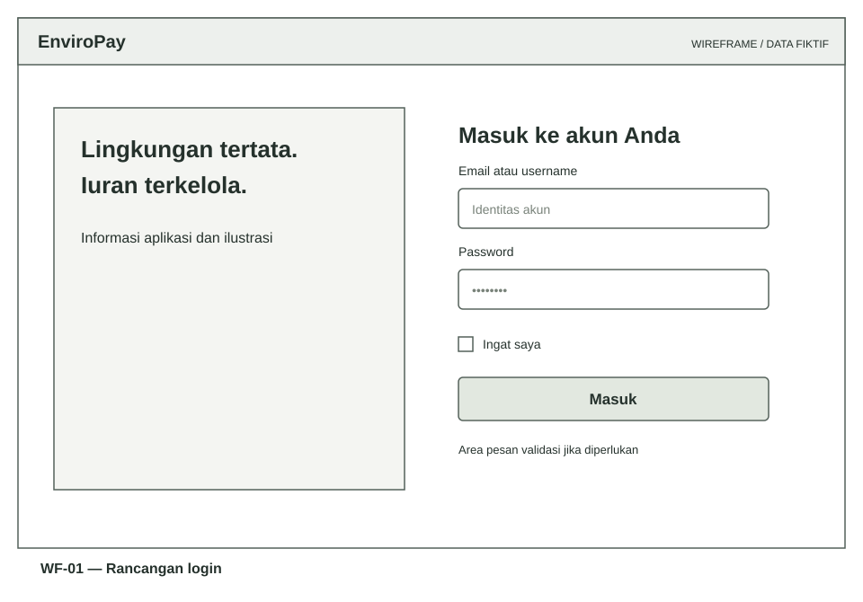
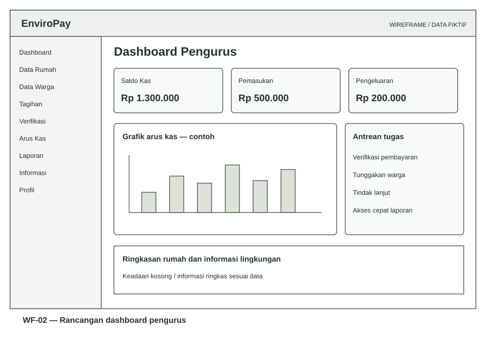
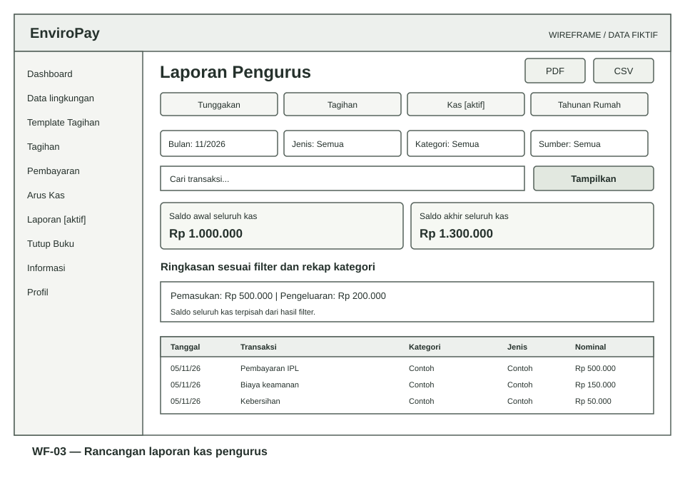
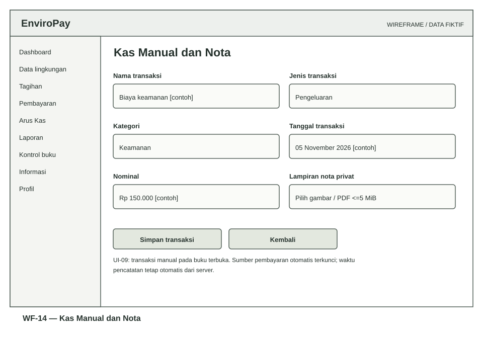

# Rancangan Antarmuka, Masukan dan Keluaran

[Bab III](../BAB-III-PERANCANGAN.md) · [Use case](02-USE-CASE-DAN-AKTIVITAS.md) · [Panduan pengguna](../PANDUAN-PENGGUNA.md)

## 1. Prinsip perancangan

Antarmuka mengikuti peran, menempatkan nominal/status pada posisi yang mudah dipindai, memberikan label formulir dan umpan balik pada tindakan keuangan. Persetujuan/penerbitan menampilkan rincian sebelum tindakan disahkan. Warna menjadi bantuan visual, bukan satu-satunya penanda status; teks status tetap tampil. Tabel lebar pada HP dapat digulir dan tindakan utama tetap dapat dijangkau.

UI-01–12 berikut adalah **kelompok layar**, bukan dua belas endpoint tunggal atau klaim bahwa menu terpisah digabung menjadi satu halaman. Komponen detail mengikuti Blade pada `resources/views/`. Wireframe bersifat low fidelity, berisi data fiktif, tanpa autentikasi atau koneksi database.

## 2. Peta navigasi

| Role | Kelompok menu | Akses konteks |
| --- | --- | --- |
| Admin | Dashboard, Perumahan, Pengurus, Profil | Kelola master, status dan reset pengurus. |
| Pengurus | Dashboard; Data Rumah/Warga; Template/Tagihan/Cash/Verifikasi; Arus Kas/Rekening/Laporan; Tindak Lanjut/Tutup Buku/Aktivitas; Pengumuman/Riwayat WhatsApp; Profil | Impor dari master, preview template, detail pembayaran/kuitansi dan file privat dari resource terkait. |
| Warga | Dashboard, Tagihan Saya, Pengumuman, Profil | Pilihan pembayaran, unggah bukti dan kuitansi miliknya. |

Lonceng tersedia pada area aplikasi pengurus/warga aktif. Halaman error mandiri dapat muncul sebelum login dan tidak mengambil data akun. Tidak ada menu publik registrasi, kirim ulang WhatsApp atau auto-publish tagihan dari jadwal.

## 3. Spesifikasi kelompok layar

| ID | Kelompok layar / acuan | Masukan dan informasi utama | Aksi dan hasil |
| --- | --- | --- | --- |
| UI-01 | Login dan error; FR-01–02/29 | Identitas, password, pilihan ingat saya; kode/pesan aman pada error | Masuk, penolakan jelas, redirect sesuai role, jalan kembali aman. |
| UI-02 | Profil/password dan reset; FR-27–28 | Password lama/baru/konfirmasi untuk diri sendiri; form reset terotorisasi terpisah | Validasi dan pencabutan sesi terkait; password tidak ditampilkan kembali. |
| UI-03 | Administrasi; FR-03–04 | Nama/alamat/status perumahan, identitas pengurus dan lingkup | Simpan/edit/nonaktif sesuai izin; admin awal tetap melalui CLI. |
| UI-04 | Rumah/warga/impor; FR-05–06 | Kode, alamat, kondisi, tarif, penanggung jawab; identitas warga; CSV/pratinjau | Tambah/perbarui, pencocokan impor, konfirmasi batch; histori tidak dipindahkan. |
| UI-05 | Rekening; FR-07 | Bank, nomor rekening, pemilik dan status aktif | Simpan/edit/nonaktif rekening perumahan. |
| UI-06 | Tagihan/template; FR-08–09 | Judul, komponen/total, periode, jatuh tempo, penerima dan opsi tarif | Buat manual, simpan/edit template, pratinjau dan konfirmasi penerbitan. |
| UI-07 | Tagihan/pengajuan warga; FR-10/13 | Daftar status, checkbox 1–100 tagihan, total server, rekening dan bukti | Tinjau lalu unggah; satu/gabungan otomatis menurut jumlah; tampilkan pending. |
| UI-08 | Verifikasi/cash/kuitansi; FR-11–14 | Bukti, rincian anggota, nominal, alasan/catatan, konfirmasi penerimaan | Sahkan/tolak/cash; buka kuitansi HTML/PDF sesuai otorisasi. |
| UI-09 | Arus kas/nota; FR-15 | Nama, jenis, kategori, tanggal transaksi, nominal dan lampiran | Simpan/edit/hapus manual; unduh nota privat; otomatis tetap terkunci. |
| UI-10 | Dashboard/laporan; FR-16–17/26 | Ringkasan, grafik, periode/tahun, filter, matriks rumah dan detail | Terapkan filter, rincian bulanan, ekspor sesuai lingkup; CSV/PDF. |
| UI-11 | Tindak lanjut/buku/aktivitas; FR-18–20 | Catatan/petugas/tanggal, bulan/saldo, alasan, pelaku dan before/after | Tambah catatan, tutup/buka dengan konfirmasi; baca audit tanpa edit/hapus. |
| UI-12 | Pengumuman/lonceng/WhatsApp; FR-21–25 | Draft/publikasi, daftar belum dibaca; filter status/event/tanggal dan detail pengiriman | Publikasi/arsip/read; pemantauan WhatsApp tanpa kirim ulang. |

## 4. Wireframe

### WF-01 — Login

Elemen inti: merek, tujuan halaman, identitas, password, ingat saya, tombol masuk dan area pesan. Password merupakan input tersembunyi. Error login tidak mengungkap apakah username/email tertentu ada. Wireframe tidak memuat tombol daftar/lupa password via email yang belum tersedia.

### WF-02 — Dashboard pengurus

Ringkasan mengutamakan saldo, pemasukan, pengeluaran, tunggakan dan antrean tugas. Label pada gambar merepresentasikan fungsi; jumlah kartu/posisi persis mengikuti implementasi saat versi berubah. Tampilan HP merapikan kartu menjadi satu/dua kolom dan navigasi menjadi offcanvas, bukan mengecilkan semua isi desktop menjadi gambar.

### WF-03 — Laporan kas

Filter periode, jenis, kategori, sumber dan pencarian disusun sebelum hasil. Saldo seluruh kas dipisahkan dari ringkasan sesuai filter. Tabel rekap kategori dan transaksi menampilkan seluruh ringkasan filter, sementara pagination hanya mengubah baris yang terlihat. Aksi PDF/CSV menggunakan filter sama.

Wireframe dibuat sebagai SVG agar teks, garis dan skala tetap jelas saat digunakan pada naskah. Gambar bukan screenshot hasil operasional, tidak dihasilkan dari data warga dan tidak mengukur usability. Contoh dashboard implementasi tersedia di [gambar dokumentasi](../images/dashboard-pengurus.png) dengan label data demo pada README.

### WF-04 sampai WF-13 — Layar peran dan transaksi tambahan

Seluruh gambar adalah rancangan low fidelity, bukan salinan satu-ke-satu semua dialog/endpoint. Tabel menunjukkan kelompok UI yang diwakili; layar dalam kelompok dapat tetap terpisah di aplikasi. Rincian field/aksi mengikuti spesifikasi UI-01–12 dan validasi server.

| Wireframe | Kelompok layar | Fokus |
| --- | --- | --- |
| [WF-04 — Master](../images/perancangan/wireframe-master.svg) | UI-04 | Rumah, penanggung jawab, tarif dan akses alur impor terpisah. |
| [WF-05 — Template](../images/perancangan/wireframe-template.svg) | UI-06 | Pratinjau dan konfirmasi penerbitan, bukan form yang langsung menerbitkan saat disimpan. |
| [WF-06 — Pembayaran](../images/perancangan/wireframe-pembayaran.svg) | UI-07 | Pilihan, total server, rekening dan unggah bukti. |
| [WF-07 — Verifikasi](../images/perancangan/wireframe-verifikasi.svg) | UI-08 | Keputusan transfer dan alasan penolakan; cash dijelaskan sebagai alur terpisah. |
| [WF-08 — Buku](../images/perancangan/wireframe-buku.svg) | UI-11 | Saldo keseluruhan, konfirmasi periode dan akses riwayat. |
| [WF-09 — WhatsApp](../images/perancangan/wireframe-whatsapp.svg) | UI-12 | Filter/ringkasan/detail yang hanya membaca, tanpa resend. |
| [WF-10 — Admin](../images/perancangan/wireframe-admin.svg) | UI-03 | Identitas pengurus, lingkup dan status akun. |
| [WF-11 — Rekening](../images/perancangan/wireframe-rekening.svg) | UI-05 | Bank, nomor, pemilik dan status, seluruh contoh fiktif. |
| [WF-12 — Pengumuman](../images/perancangan/wireframe-pengumuman.svg) | UI-12 | Draft tersimpan, publikasi dan batas pengeditan. |
| [WF-13 — Profil](../images/perancangan/wireframe-profil.svg) | UI-02 | Password saat ini, password baru/konfirmasi dan sesi terkait. |

UI-09 (kas manual) memiliki spesifikasi field/aksi pada tabel UI serta validasi masukan; rinciannya juga dipetakan pada wireframe laporan dan transaksi. Tambahan wireframe khusus kas tersedia sebagai WF-14 berikut agar form kas tidak disamakan dengan laporan baca saja.

WF-14 mewakili UI-09: sumber otomatis tetap tidak dapat diedit; tanggal, kategori, nominal dan nota mengikuti guard periode. Seluruh kelompok UI mempunyai representasi wireframe, bukan berarti setiap modal atau detail historis dibuat ulang sebagai gambar terpisah.

## 5. Rancangan masukan dan validasi

| Masukan | Aturan / penanganan | Bukti di rancangan |
| --- | --- | --- |
| Identitas akun | Unik sesuai aturan, format email, batas panjang; password di-hash | UI-01–04, RUC-01/03. |
| Hubungan rumah | House dalam perumahan; akun penanggung jawab warga sesuai rumah | UI-04, ALG-01. |
| CSV | UTF-8, header template, pemisah koma/titik koma, maksimal 2 MB; 1.000 rumah/100 warga | UI-04, pratinjau dan konfirmasi atomik. |
| Komponen tagihan baru | 1–50 komponen, bilangan bulat Rp 1.000–Rp 999.999.999.999; total dibatasi | UI-06, total dihitung server. |
| Periode/jatuh tempo | Awal bulan sebagai periode; due tidak sebelum periode; hari template 1–31 | UI-06, ALG-01. |
| Pilihan pembayaran | 1–100 ID unik, satu warga, status dapat dibayar dan total sama | UI-07/08, ALG-02. |
| Bukti transfer | JPG/PNG/WebP, validasi MIME/konten, maksimal 5 MB | UI-07, storage privat. |
| Nota kas | JPG/PNG/WebP/PDF, maksimal 5 MB; satu lampiran | UI-09, unduh terotorisasi. |
| Kas manual | Nominal positif sampai batas, 0–2 desimal, tanggal tidak masa depan; kategori manual | UI-09, guard periode. |
| Janji/jadwal | Catatan 5–2.000 karakter, petugas aktif, tanggal hari ini atau selanjutnya | UI-11, tidak melunasi invoice. |
| Buka buku | Alasan 10–1.000 karakter, urutan periode terakhir | UI-11, konfirmasi dan audit. |
| Tahun laporan | Integer 2000–2100, dropdown dari periode/server/terpilih | UI-10, status bulanan eksplisit. |

Batas 5 MB ditafsirkan sesuai validasi Laravel `5 * 1024` KB pada aplikasi; server/proxy/PHP dapat menolak unggahan lebih dahulu bila batas infrastrukturnya lebih kecil. Validasi form biasa tetap diarahkan ke form dengan kesalahan field; tidak semua validasi menjadi halaman error penuh.

## 6. Rancangan keluaran

| ID | Keluaran | Isi minimum dan batas |
| --- | --- | --- |
| OUT-01 | Daftar/detail tagihan | Pemilik/rumah, judul, periode, jatuh tempo, rincian/total dan status. |
| OUT-02 | Kuitansi | Nomor, snapshot identitas/biaya, total, metode, waktu konfirmasi dan pengurus; satu untuk batch. |
| OUT-03 | Tunggakan | Warga, jumlah/nominal belum lunas lewat jatuh tempo dan kelompok umur; dasar tanggal server. |
| OUT-04 | Tagihan bulanan | Total/status realisasi menurut periode kewajiban, bukan bulan arus uang. |
| OUT-05 | Kas bulanan | Saldo awal/akhir seluruh kas, pemasukan/pengeluaran dan rekap filter/kategori; tanggal transaksi. |
| OUT-06 | Rekap tahunan rumah | Januari–Desember, status gabungan per bulan, nominal, legenda serta detail. |
| OUT-07 | CSV/PDF | Hasil filter penuh dan identitas/periode; CSV aman terhadap awalan formula; PDF batas 2.000/500 baris. |
| OUT-08 | WhatsApp | Tagihan/pengingat/kuitansi teks dengan tautan; tidak melampirkan PDF. |
| OUT-09 | Log dan riwayat | Pelaku/waktu/perubahan terpilih atau status/tujuan terakhir/kendala pengiriman; tanpa token/response provider mentah. |

## 7. Keadaan antarmuka

| Keadaan | Perilaku yang dirancang | Pemeriksaan |
| --- | --- | --- |
| Kosong | Jelaskan belum ada data dan arahkan ke aksi yang diizinkan | Akun baru, pencarian tanpa hasil, bulan tanpa invoice. |
| Menunggu | Jangan menampilkan pending sebagai lunas atau menganggap proses terputus sebagai sukses | Pengajuan transfer dan outbox processing. |
| Sukses | Jelaskan hasil mutasi dan resource yang tersedia | Tagihan terbit, pembayaran sah dan ekspor berhasil. |
| Validasi gagal | Tampilkan pesan field/form, pertahankan masukan yang aman | Nominal/file salah, total berubah, impor bermasalah. |
| Akses/error | Halaman mandiri berbahasa Indonesia tanpa detail sensitif | 403/404/419/429/500/503 dan kontrak HTML/JSON. |
| Berkas/ekspor besar | Beri batas eksplisit; jangan memotong diam-diam | PDF melampaui batas, CSV sebagai alternatif. |
| HP/keyboard | Hindari overflow seluruh halaman, label/focus terlihat dan tabel dapat digulir | Catat ukuran layar, perangkat/browser dan temuan aktual. |

Belum ada klaim sertifikasi aksesibilitas, seluruh browser lulus, atau skor kemudahan penggunaan sebelum evaluasi formal.
