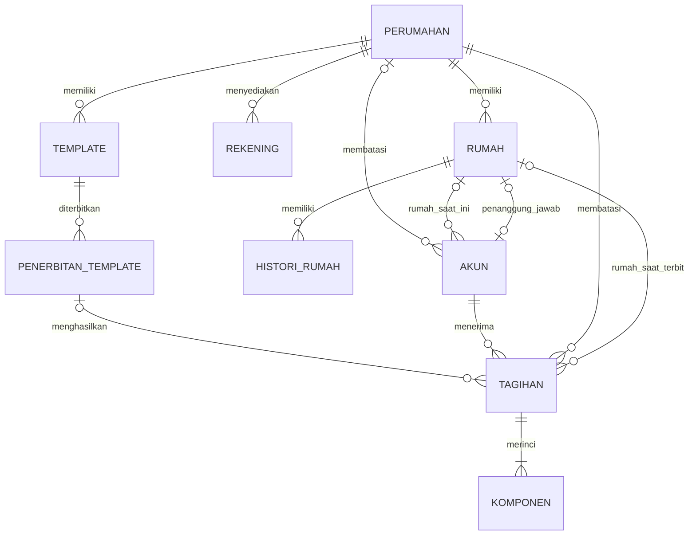
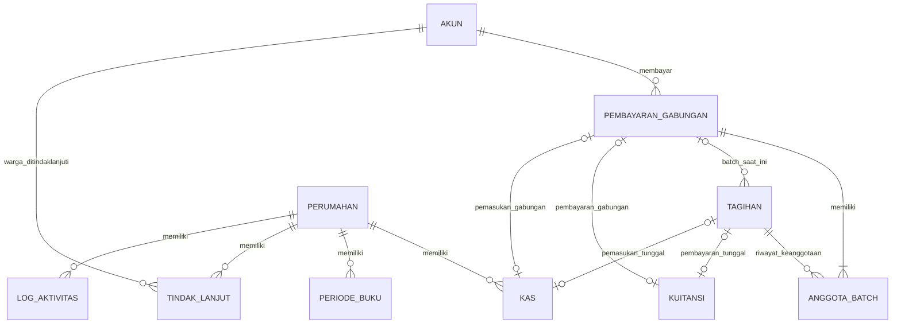
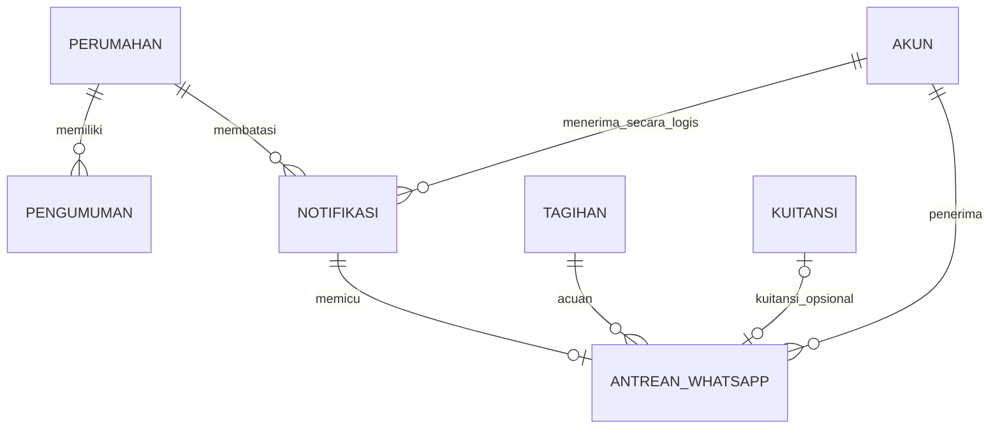

# Model Data dan ERD

[Indeks SRS](../SRS.md) · [PDM lengkap](03-PDM-KAMUS-DATA.md)

## 1. Pendekatan

ERD berikut adalah model konseptual domain aktif, bukan daftar seluruh FK database. Nama entitas dipermudah; atribut teknis, aktor pembuat/verifikator dan tabel infrastruktur dipindahkan ke PDM agar diagram terbaca. Kardinalitas berasal dari relasi bisnis saat ini; aturan yang hanya divalidasi aplikasi tidak dinyatakan sebagai constraint database.

Notasi Mermaid: `||` tepat satu, `o|` nol atau satu, `o{` nol atau banyak, `|{` satu atau banyak. FK memungkinkan tabel pivot tanpa anggota secara fisik, tetapi batch yang dibuat melalui alur bisnis memiliki sedikitnya dua tagihan. Kardinalitas satu-atau-banyak di ERD tidak menyatakan batas minimal dua sudah dijamin SQL.

## 2. ERD master dan penagihan

`AKUN` mencakup admin/pengurus/warga; relasi penerima tagihan secara bisnis hanya warga. Admin tidak harus memiliki perumahan. Kardinalitas penanggung jawab adalah aturan alur `HouseService`: paling banyak satu rumah per warga. FK fisik `houses.responsible_user_id` sendiri tidak unique; PDM mencerminkan batas fisik tersebut. Rekening tidak memiliki FK ke tagihan: pilihan rekening pembayaran dipisahkan dari data kewajiban.

## 3. ERD pembayaran dan kas

Relasi opsional ke kuitansi/kas menunjukkan satu sumber dapat belum memiliki hasil dan satu hasil menggunakan sumber yang sesuai. Kuitansi memakai **salah satu** tagihan tunggal atau batch. Kas manual memakai **tanpa keduanya**, sedangkan kas pembayaran memakai salah satu. Aturan eksklusivitas tersebut dijaga aplikasi, bukan CHECK constraint gabungan pada skema saat ini.

`PERIODE_BUKU` tidak mempunyai relasi FK ke setiap kas. Penguncian ditentukan oleh perumahan, tanggal transaksi dan periode tertutup. `LOG_AKTIVITAS.entity_type/entity_id` adalah referensi logis ke beberapa jenis entitas, bukan FK SQL.

## 4. ERD komunikasi

Notifikasi Laravel memakai pasangan `notifiable_type/notifiable_id` tanpa FK langsung ke `users`. Tidak semua notifikasi menghasilkan WhatsApp. Antrean kuitansi gabungan tetap memiliki satu `invoice_id` acuan dari anggota batch, serta `receipt_id` yang mengarah ke kuitansi gabungan; hal ini tidak membuat kuitansi individual baru.

## 5. Ringkasan entitas

| Kelompok | Entitas fisik | Makna |
| --- | --- | --- |
| Master | `housings`, `users`, `houses`, `house_histories`, `payment_accounts` | Identitas lingkungan, peran, rumah, histori dan rekening. |
| Penagihan | `invoices`, `invoice_components`, `invoice_templates`, `invoice_template_runs` | Kewajiban, komponen dan penerbitan berbasis template. |
| Pembayaran | `payment_batches`, `payment_batch_invoice`, `receipts` | Percobaan pembayaran gabungan, keanggotaan historis dan kuitansi. |
| Kas dan kontrol | `cashflows`, `accounting_periods`, `activity_logs`, `arrears_follow_ups` | Pergerakan uang, penguncian, audit aplikasi dan komunikasi pengurus. |
| Komunikasi | `announcements`, `notifications`, `whatsapp_deliveries` | Publikasi, lonceng dan outbox WhatsApp. |
| Staging impor | `house_imports`, `resident_imports` | Pratinjau sementara berisi rows terenkripsi. |
| Infrastruktur | `sessions`, `cache`, `cache_locks`, `jobs`, `job_batches`, `failed_jobs`, `password_reset_tokens`, `migrations` | Fasilitas framework; keberadaan tabel tidak berarti seluruh fitur memiliki UI aktif. |

Tabel Web Push dihapus oleh migration pembersihan. Migration pembuatnya tetap tersedia sebagai histori skema dan untuk rollback struktur; tabel tersebut bukan bagian skema akhir saat seluruh migration diterapkan.

## 6. Integritas dan denormalisasi terkontrol

1. PK mengidentifikasi record; UQ melindungi kode rumah per perumahan, nomor kuitansi, sumber kas pembayaran, run template per periode, serta antrean per notifikasi/kuitansi.
2. FK mencegah referensi hilang sesuai aturan `RESTRICT`, `SET NULL` atau `CASCADE` pada PDM. FK tidak memeriksa peran warga/pengurus maupun kesamaan `housing_id` antarreferensi; service/controller melakukan pemeriksaan itu.
3. `house_label` tagihan, snapshot kuitansi/batch/run dan `actor_name` adalah salinan historis yang disengaja. Snapshot tidak menggantikan master data atau FK.
4. `total_amount`/`total_cashflow` disimpan untuk transaksi dan diperiksa alur bisnis; total tagihan tidak boleh diserahkan kepada nilai bebas dari browser. Kolom nominal migrasi memakai `decimal(15,2)`; SQLite memiliki affinity berbeda dari DECIMAL native MySQL.
5. `invoice_templates.resident_ids` adalah daftar JSON dan bukan FK per elemen. Setiap ID divalidasi menurut warga/perumahan saat pemilihan dan penerbitan.
6. Nomor tujuan WhatsApp terenkripsi pada level model. Snapshot nama/rumah percobaan terakhir tidak menyatakan isi seluruh pesan pernah disimpan atau seluruh percobaan memiliki baris sendiri.
7. Kategori kas berupa kode pada kolom, bukan tabel master kategori. JSON komponen template dan komponen tagihan dinormalisasi ke tabel hanya ketika tagihan diterbitkan.
8. Unique nullable pada sumber kuitansi/kas mencegah duplikasi sumber yang terisi. Skema tetap dapat menerima kombinasi tidak sah bila ditulis langsung melewati validasi aplikasi; lihat batas kontrol pada SRS.

9. Batas satu admin diperiksa oleh perintah CLI sebelum pembuatan, bukan UQ pada `users.role`. Pengujian yang ada membuktikan penolakan pembuatan kedua secara berurutan; pembuatan admin serentak belum menjadi bukti pengujian pada baseline ini.
