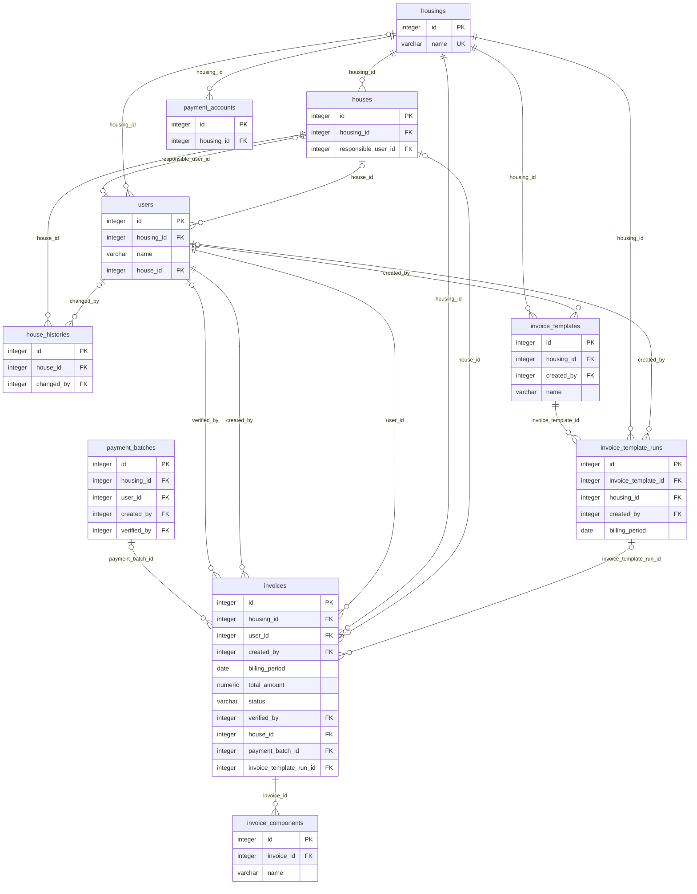
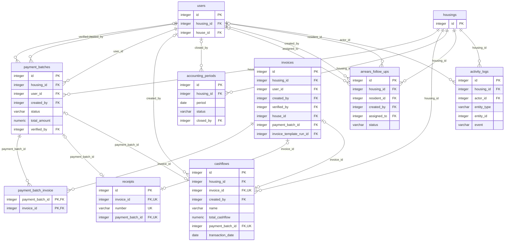
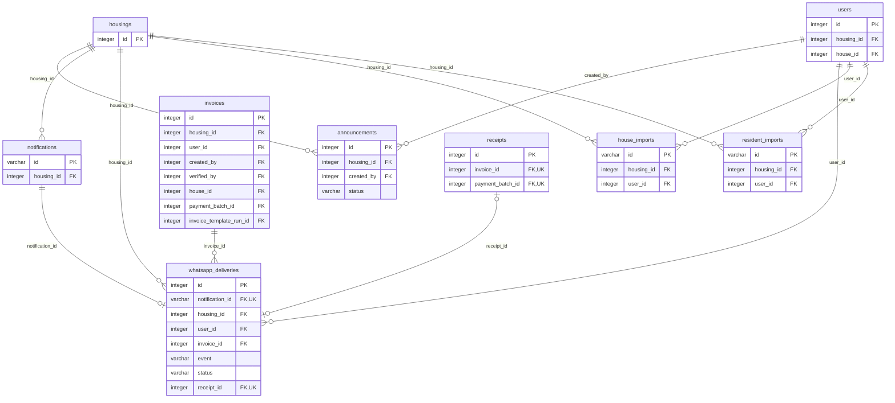

# PDM dan Kamus Data

[Indeks SRS](../SRS.md) · [ERD konseptual](02-MODEL-DATA.md)

## 1. Sumber dan batas representasi

Baseline diekstrak dari **seluruh migration pada database SQLite `:memory:` yang kosong**, sampai `2026_11_06_000006`. Ekstraksi menggunakan `Schema::getColumns`, `getIndexes` dan `getForeignKeys` setelah migrasi selesai. Tidak ada isi tabel/data warga yang dimasukkan. Hasil: **29 tabel, 269 kolom, 52 foreign key dan 68 indeks**. Jumlah indeks mencakup PK dan UQ hasil introspeksi SQLite; nama indeks otomatis dapat berbeda pada driver lain.

Tipe pada kamus adalah **tipe fisik hasil SQLite**, bukan DDL MySQL. SQLite dapat menampilkan `varchar` tanpa panjang, JSON sebagai `text`, foreign ID sebagai `integer`, dan nominal sebagai `numeric`. Definisi lintas mesin tetap mengikuti [migration sumber](../../database/migrations): ID Laravel umumnya unsigned BIGINT pada MySQL; nominal bisnis dideklarasikan `decimal(15,2)`, dan tipe/length lain mengikuti setiap migration. Kamus ini tidak menjanjikan constraint tipe/precision SQLite sama dengan MySQL.

`NULL: Ya` berarti kolom boleh kosong secara fisik, bukan berarti selalu boleh kosong pada form. Default `—` berarti tidak ada default eksplisit menurut introspeksi; nullable dapat menghasilkan NULL. `AI` berarti auto increment; `PK`, `FK` dan `UQ` adalah kunci primer, relasi SQL dan unique. UQ gabungan dijelaskan pada daftar indeks, bukan ditandai seolah setiap kolom unik sendiri.

## 2. Diagram fisik per domain

Diagram menampilkan PK, FK dan beberapa atribut identitas. **Semua kolom dan indeks** tersedia pada kamus di bawah. Entitas yang muncul lintas diagram tetap tabel yang sama. Relasi SQL opsional ditentukan oleh nullability FK; referensi polymorphic/logis tidak digambar sebagai FK.

### Master dan penagihan

### Pembayaran dan kontrol kas

### Komunikasi dan staging

### Relasi yang tidak berupa FK SQL

- `notifications.notifiable_type/notifiable_id` menunjuk penerima secara polymorphic.
- `activity_logs.entity_type/entity_id` menunjuk objek yang dicatat tanpa FK dinamis.
- `sessions.user_id` hanya diindeks, tanpa constraint referensial.
- `invoice_templates.resident_ids` berisi array ID JSON, tanpa FK per elemen.
- `cashflows.category` dan kolom status berupa kode; daftar nilai divalidasi aplikasi. Untuk kolom `enum` migration, representasi CHECK/enum fisik mengikuti driver.

## 3. Kamus tabel lengkap

### Master dan penagihan

#### `housings`

Perumahan, unit pembatas data.

| Kolom | Tipe fisik SQLite | NULL | Default | Kunci / catatan |
| --- | --- | --- | --- | --- |
| `id` | `integer` | Tidak | — | PK, AI |
| `name` | `varchar` | Tidak | — | UQ |
| `address` | `text` | Tidak | — | — |
| `phone_number` | `varchar` | Ya | — | — |
| `is_active` | `tinyint(1)` | Tidak | `'1'` | — |
| `created_at` | `datetime` | Ya | — | — |
| `updated_at` | `datetime` | Ya | — | — |

**Indeks dan constraint unik:**

- `housings_is_active_index` — INDEX (`is_active`).
- `housings_name_unique` — UQ (`name`).
- `primary` — PK (`id`).

**Foreign key:**

- Tidak ada FK SQL.

#### `users`

Identitas login dan peran; housing_id/house_id opsional secara fisik. Admin tidak memerlukan perumahan.

| Kolom | Tipe fisik SQLite | NULL | Default | Kunci / catatan |
| --- | --- | --- | --- | --- |
| `id` | `integer` | Tidak | — | PK, AI |
| `housing_id` | `integer` | Ya | — | FK |
| `name` | `varchar` | Tidak | — | — |
| `username` | `varchar` | Tidak | — | UQ |
| `email` | `varchar` | Tidak | — | UQ |
| `phone_number` | `varchar` | Ya | — | — |
| `house_address` | `text` | Ya | — | — |
| `role` | `varchar` | Tidak | — | — |
| `is_active` | `tinyint(1)` | Tidak | `'1'` | — |
| `email_verified_at` | `datetime` | Ya | — | — |
| `password` | `varchar` | Tidak | — | — |
| `remember_token` | `varchar` | Ya | — | — |
| `created_at` | `datetime` | Ya | — | — |
| `updated_at` | `datetime` | Ya | — | — |
| `house_id` | `integer` | Ya | — | FK |

**Indeks dan constraint unik:**

- `primary` — PK (`id`).
- `users_email_unique` — UQ (`email`).
- `users_housing_id_role_is_active_index` — INDEX (`housing_id`, `role`, `is_active`).
- `users_is_active_index` — INDEX (`is_active`).
- `users_username_unique` — UQ (`username`).

**Foreign key:**

- (`house_id`) → `houses` (`id`); ON DELETE **RESTRICT**, ON UPDATE **NO ACTION**.
- (`housing_id`) → `housings` (`id`); ON DELETE **RESTRICT**, ON UPDATE **NO ACTION**.

#### `houses`

Master rumah; responsible_user_id adalah akun penanggung jawab, bukan bukti kepemilikan hukum.

| Kolom | Tipe fisik SQLite | NULL | Default | Kunci / catatan |
| --- | --- | --- | --- | --- |
| `id` | `integer` | Tidak | — | PK, AI |
| `housing_id` | `integer` | Tidak | — | FK |
| `code` | `varchar` | Tidak | — | — |
| `address` | `varchar` | Tidak | — | — |
| `occupancy` | `varchar` | Tidak | `'occupied'` | — |
| `owner_name` | `varchar` | Ya | — | — |
| `occupant_name` | `varchar` | Ya | — | — |
| `responsible_user_id` | `integer` | Ya | — | FK |
| `vacant_billing` | `varchar` | Tidak | `'full'` | — |
| `vacant_amount` | `numeric` | Ya | — | — |
| `notes` | `text` | Ya | — | — |
| `created_at` | `datetime` | Ya | — | — |
| `updated_at` | `datetime` | Ya | — | — |

**Indeks dan constraint unik:**

- `houses_housing_id_code_unique` — UQ (`housing_id`, `code`).
- `primary` — PK (`id`).

**Foreign key:**

- (`responsible_user_id`) → `users` (`id`); ON DELETE **RESTRICT**, ON UPDATE **NO ACTION**.
- (`housing_id`) → `housings` (`id`); ON DELETE **RESTRICT**, ON UPDATE **NO ACTION**.

#### `house_histories`

Snapshot perubahan rumah; changed_by dapat kosong bila aktor dihapus.

| Kolom | Tipe fisik SQLite | NULL | Default | Kunci / catatan |
| --- | --- | --- | --- | --- |
| `id` | `integer` | Tidak | — | PK, AI |
| `house_id` | `integer` | Tidak | — | FK |
| `changed_by` | `integer` | Ya | — | FK |
| `data` | `text` | Tidak | — | — |
| `created_at` | `datetime` | Ya | — | — |
| `updated_at` | `datetime` | Ya | — | — |

**Indeks dan constraint unik:**

- `primary` — PK (`id`).

**Foreign key:**

- (`changed_by`) → `users` (`id`); ON DELETE **SET NULL**, ON UPDATE **NO ACTION**.
- (`house_id`) → `houses` (`id`); ON DELETE **RESTRICT**, ON UPDATE **NO ACTION**.

#### `payment_accounts`

Rekening perumahan; tidak direlasikan langsung ke tagihan.

| Kolom | Tipe fisik SQLite | NULL | Default | Kunci / catatan |
| --- | --- | --- | --- | --- |
| `id` | `integer` | Tidak | — | PK, AI |
| `housing_id` | `integer` | Tidak | — | FK |
| `bank_name` | `varchar` | Tidak | — | — |
| `account_number` | `varchar` | Tidak | — | — |
| `account_holder` | `varchar` | Tidak | — | — |
| `is_active` | `tinyint(1)` | Tidak | `'1'` | — |
| `created_at` | `datetime` | Ya | — | — |
| `updated_at` | `datetime` | Ya | — | — |

**Indeks dan constraint unik:**

- `payment_accounts_housing_id_bank_name_account_number_unique` — UQ (`housing_id`, `bank_name`, `account_number`).
- `payment_accounts_is_active_index` — INDEX (`is_active`).
- `primary` — PK (`id`).

**Foreign key:**

- (`housing_id`) → `housings` (`id`); ON DELETE **RESTRICT**, ON UPDATE **NO ACTION**.

#### `invoice_templates`

Konfigurasi template; components dan resident_ids berupa JSON di model.

| Kolom | Tipe fisik SQLite | NULL | Default | Kunci / catatan |
| --- | --- | --- | --- | --- |
| `id` | `integer` | Tidak | — | PK, AI |
| `housing_id` | `integer` | Tidak | — | FK |
| `created_by` | `integer` | Ya | — | FK |
| `name` | `varchar` | Tidak | — | — |
| `title` | `varchar` | Tidak | — | — |
| `components` | `text` | Tidak | — | — |
| `recipient_mode` | `varchar` | Tidak | `'all'` | — |
| `resident_ids` | `text` | Ya | — | — |
| `due_day` | `integer` | Tidak | `'10'` | — |
| `due_month_offset` | `integer` | Tidak | `'0'` | — |
| `apply_house_tariff` | `tinyint(1)` | Tidak | `'1'` | — |
| `is_active` | `tinyint(1)` | Tidak | `'1'` | — |
| `created_at` | `datetime` | Ya | — | — |
| `updated_at` | `datetime` | Ya | — | — |

**Indeks dan constraint unik:**

- `invoice_templates_housing_id_is_active_index` — INDEX (`housing_id`, `is_active`).
- `primary` — PK (`id`).

**Foreign key:**

- (`created_by`) → `users` (`id`); ON DELETE **SET NULL**, ON UPDATE **NO ACTION**.
- (`housing_id`) → `housings` (`id`); ON DELETE **RESTRICT**, ON UPDATE **NO ACTION**.

#### `invoice_template_runs`

Riwayat penerbitan satu template pada satu periode; snapshot konfigurasi dan jumlah hasil.

| Kolom | Tipe fisik SQLite | NULL | Default | Kunci / catatan |
| --- | --- | --- | --- | --- |
| `id` | `integer` | Tidak | — | PK, AI |
| `invoice_template_id` | `integer` | Tidak | — | FK |
| `housing_id` | `integer` | Tidak | — | FK |
| `created_by` | `integer` | Ya | — | FK |
| `billing_period` | `date` | Tidak | — | — |
| `issued_count` | `integer` | Tidak | `'0'` | — |
| `skipped_count` | `integer` | Tidak | `'0'` | — |
| `snapshot` | `text` | Tidak | — | — |
| `created_at` | `datetime` | Ya | — | — |
| `updated_at` | `datetime` | Ya | — | — |

**Indeks dan constraint unik:**

- `invoice_template_runs_invoice_template_id_billing_period_unique` — UQ (`invoice_template_id`, `billing_period`).
- `primary` — PK (`id`).

**Foreign key:**

- (`created_by`) → `users` (`id`); ON DELETE **SET NULL**, ON UPDATE **NO ACTION**.
- (`housing_id`) → `housings` (`id`); ON DELETE **RESTRICT**, ON UPDATE **NO ACTION**.
- (`invoice_template_id`) → `invoice_templates` (`id`); ON DELETE **RESTRICT**, ON UPDATE **NO ACTION**.

#### `invoices`

Kewajiban warga serta status/metode pembayaran; house_id/house_label menjaga rumah saat penerbitan.

| Kolom | Tipe fisik SQLite | NULL | Default | Kunci / catatan |
| --- | --- | --- | --- | --- |
| `id` | `integer` | Tidak | — | PK, AI |
| `housing_id` | `integer` | Tidak | — | FK |
| `user_id` | `integer` | Tidak | — | FK |
| `created_by` | `integer` | Tidak | — | FK |
| `billing_period` | `date` | Tidak | — | — |
| `due_date` | `date` | Tidak | — | — |
| `total_amount` | `numeric` | Tidak | `'0'` | — |
| `status` | `varchar` | Tidak | `'unpaid'` | — |
| `payment_proof_path` | `varchar` | Ya | — | — |
| `submitted_at` | `datetime` | Ya | — | — |
| `verified_at` | `datetime` | Ya | — | — |
| `verified_by` | `integer` | Ya | — | FK |
| `rejection_reason` | `text` | Ya | — | — |
| `created_at` | `datetime` | Ya | — | — |
| `updated_at` | `datetime` | Ya | — | — |
| `title` | `varchar` | Tidak | `'Tagihan IPL'` | — |
| `house_id` | `integer` | Ya | — | FK |
| `house_label` | `varchar` | Ya | — | — |
| `payment_method` | `varchar` | Ya | — | — |
| `paid_at` | `datetime` | Ya | — | — |
| `payment_note` | `text` | Ya | — | — |
| `payment_batch_id` | `integer` | Ya | — | FK |
| `invoice_template_run_id` | `integer` | Ya | — | FK |

**Indeks dan constraint unik:**

- `invoices_housing_id_status_billing_period_index` — INDEX (`housing_id`, `status`, `billing_period`).
- `invoices_status_index` — INDEX (`status`).
- `invoices_user_id_billing_period_index` — INDEX (`user_id`, `billing_period`).
- `primary` — PK (`id`).

**Foreign key:**

- (`invoice_template_run_id`) → `invoice_template_runs` (`id`); ON DELETE **RESTRICT**, ON UPDATE **NO ACTION**.
- (`house_id`) → `houses` (`id`); ON DELETE **RESTRICT**, ON UPDATE **NO ACTION**.
- (`housing_id`) → `housings` (`id`); ON DELETE **RESTRICT**, ON UPDATE **NO ACTION**.
- (`user_id`) → `users` (`id`); ON DELETE **RESTRICT**, ON UPDATE **NO ACTION**.
- (`created_by`) → `users` (`id`); ON DELETE **RESTRICT**, ON UPDATE **NO ACTION**.
- (`verified_by`) → `users` (`id`); ON DELETE **SET NULL**, ON UPDATE **NO ACTION**.
- (`payment_batch_id`) → `payment_batches` (`id`); ON DELETE **RESTRICT**, ON UPDATE **NO ACTION**.

#### `invoice_components`

Rincian komponen untuk satu tagihan.

| Kolom | Tipe fisik SQLite | NULL | Default | Kunci / catatan |
| --- | --- | --- | --- | --- |
| `id` | `integer` | Tidak | — | PK, AI |
| `invoice_id` | `integer` | Tidak | — | FK |
| `name` | `varchar` | Tidak | — | — |
| `amount` | `numeric` | Tidak | — | — |
| `created_at` | `datetime` | Ya | — | — |
| `updated_at` | `datetime` | Ya | — | — |

**Indeks dan constraint unik:**

- `primary` — PK (`id`).

**Foreign key:**

- (`invoice_id`) → `invoices` (`id`); ON DELETE **CASCADE**, ON UPDATE **NO ACTION**.

### Pembayaran dan kontrol kas

#### `payment_batches`

Percobaan pembayaran gabungan dan snapshot rincian saat pengajuan.

| Kolom | Tipe fisik SQLite | NULL | Default | Kunci / catatan |
| --- | --- | --- | --- | --- |
| `id` | `integer` | Tidak | — | PK, AI |
| `housing_id` | `integer` | Tidak | — | FK |
| `user_id` | `integer` | Tidak | — | FK |
| `created_by` | `integer` | Tidak | — | FK |
| `method` | `varchar` | Tidak | — | — |
| `status` | `varchar` | Tidak | — | — |
| `total_amount` | `numeric` | Tidak | — | — |
| `snapshot` | `text` | Tidak | — | — |
| `proof_path` | `varchar` | Ya | — | — |
| `note` | `text` | Ya | — | — |
| `rejection_reason` | `text` | Ya | — | — |
| `submitted_at` | `datetime` | Tidak | — | — |
| `verified_at` | `datetime` | Ya | — | — |
| `verified_by` | `integer` | Ya | — | FK |
| `created_at` | `datetime` | Ya | — | — |
| `updated_at` | `datetime` | Ya | — | — |

**Indeks dan constraint unik:**

- `payment_batches_housing_id_user_id_status_index` — INDEX (`housing_id`, `user_id`, `status`).
- `payment_batches_status_index` — INDEX (`status`).
- `primary` — PK (`id`).

**Foreign key:**

- (`verified_by`) → `users` (`id`); ON DELETE **SET NULL**, ON UPDATE **NO ACTION**.
- (`created_by`) → `users` (`id`); ON DELETE **RESTRICT**, ON UPDATE **NO ACTION**.
- (`user_id`) → `users` (`id`); ON DELETE **RESTRICT**, ON UPDATE **NO ACTION**.
- (`housing_id`) → `housings` (`id`); ON DELETE **RESTRICT**, ON UPDATE **NO ACTION**.

#### `payment_batch_invoice`

Pivot historis batch/tagihan dengan PK gabungan; tidak memiliki id atau timestamps.

| Kolom | Tipe fisik SQLite | NULL | Default | Kunci / catatan |
| --- | --- | --- | --- | --- |
| `payment_batch_id` | `integer` | Tidak | — | PK, FK |
| `invoice_id` | `integer` | Tidak | — | PK, FK |

**Indeks dan constraint unik:**

- `sqlite_autoindex_payment_batch_invoice_1` — PK (`payment_batch_id`, `invoice_id`).

**Foreign key:**

- (`invoice_id`) → `invoices` (`id`); ON DELETE **RESTRICT**, ON UPDATE **NO ACTION**.
- (`payment_batch_id`) → `payment_batches` (`id`); ON DELETE **RESTRICT**, ON UPDATE **NO ACTION**.

#### `receipts`

Nomor dan snapshot kuitansi; memakai salah satu invoice_id/payment_batch_id.

| Kolom | Tipe fisik SQLite | NULL | Default | Kunci / catatan |
| --- | --- | --- | --- | --- |
| `id` | `integer` | Tidak | — | PK, AI |
| `invoice_id` | `integer` | Ya | — | FK, UQ |
| `number` | `varchar` | Tidak | — | UQ |
| `snapshot` | `text` | Tidak | — | — |
| `created_at` | `datetime` | Ya | — | — |
| `updated_at` | `datetime` | Ya | — | — |
| `payment_batch_id` | `integer` | Ya | — | FK, UQ |

**Indeks dan constraint unik:**

- `primary` — PK (`id`).
- `receipts_invoice_id_unique` — UQ (`invoice_id`).
- `receipts_number_unique` — UQ (`number`).
- `receipts_payment_batch_id_unique` — UQ (`payment_batch_id`).

**Foreign key:**

- (`payment_batch_id`) → `payment_batches` (`id`); ON DELETE **RESTRICT**, ON UPDATE **NO ACTION**.
- (`invoice_id`) → `invoices` (`id`); ON DELETE **RESTRICT**, ON UPDATE **NO ACTION**.

#### `cashflows`

Kas manual atau otomatis; category kode enum, transaction_date tanggal pelaporan, attachment_path nota privat.

| Kolom | Tipe fisik SQLite | NULL | Default | Kunci / catatan |
| --- | --- | --- | --- | --- |
| `id` | `integer` | Tidak | — | PK, AI |
| `housing_id` | `integer` | Tidak | — | FK |
| `invoice_id` | `integer` | Ya | — | FK, UQ |
| `created_by` | `integer` | Ya | — | FK |
| `name` | `varchar` | Tidak | — | — |
| `type` | `varchar` | Tidak | — | — |
| `source` | `varchar` | Tidak | `'manual'` | — |
| `total_cashflow` | `numeric` | Tidak | — | — |
| `created_at` | `datetime` | Ya | — | — |
| `updated_at` | `datetime` | Ya | — | — |
| `payment_batch_id` | `integer` | Ya | — | FK, UQ |
| `category` | `varchar` | Tidak | `'uncategorized'` | — |
| `transaction_date` | `date` | Ya | — | — |
| `attachment_path` | `varchar` | Ya | — | — |

**Indeks dan constraint unik:**

- `cashflows_housing_id_category_type_index` — INDEX (`housing_id`, `category`, `type`).
- `cashflows_housing_id_transaction_date_index` — INDEX (`housing_id`, `transaction_date`).
- `cashflows_housing_id_type_source_index` — INDEX (`housing_id`, `type`, `source`).
- `cashflows_invoice_id_unique` — UQ (`invoice_id`).
- `cashflows_payment_batch_id_unique` — UQ (`payment_batch_id`).
- `primary` — PK (`id`).

**Foreign key:**

- (`payment_batch_id`) → `payment_batches` (`id`); ON DELETE **RESTRICT**, ON UPDATE **NO ACTION**.
- (`housing_id`) → `housings` (`id`); ON DELETE **RESTRICT**, ON UPDATE **NO ACTION**.
- (`invoice_id`) → `invoices` (`id`); ON DELETE **RESTRICT**, ON UPDATE **NO ACTION**.
- (`created_by`) → `users` (`id`); ON DELETE **SET NULL**, ON UPDATE **NO ACTION**.

#### `accounting_periods`

Status buka/tutup dan snapshot ringkasan kas per perumahan/bulan. closed_at tetap dapat menyimpan waktu penutupan terakhir ketika dibuka kembali.

| Kolom | Tipe fisik SQLite | NULL | Default | Kunci / catatan |
| --- | --- | --- | --- | --- |
| `id` | `integer` | Tidak | — | PK, AI |
| `housing_id` | `integer` | Tidak | — | FK |
| `period` | `date` | Tidak | — | — |
| `status` | `varchar` | Tidak | `'open'` | — |
| `snapshot` | `text` | Ya | — | — |
| `closed_by` | `integer` | Ya | — | FK |
| `closed_at` | `datetime` | Ya | — | — |
| `reopen_reason` | `text` | Ya | — | — |
| `created_at` | `datetime` | Ya | — | — |
| `updated_at` | `datetime` | Ya | — | — |

**Indeks dan constraint unik:**

- `accounting_periods_housing_id_period_unique` — UQ (`housing_id`, `period`).
- `primary` — PK (`id`).

**Foreign key:**

- (`closed_by`) → `users` (`id`); ON DELETE **SET NULL**, ON UPDATE **NO ACTION**.
- (`housing_id`) → `housings` (`id`); ON DELETE **RESTRICT**, ON UPDATE **NO ACTION**.

#### `arrears_follow_ups`

Catatan tindak lanjut per warga; assigned_to pengurus penanggung jawab dan resident_id warga.

| Kolom | Tipe fisik SQLite | NULL | Default | Kunci / catatan |
| --- | --- | --- | --- | --- |
| `id` | `integer` | Tidak | — | PK, AI |
| `housing_id` | `integer` | Tidak | — | FK |
| `resident_id` | `integer` | Tidak | — | FK |
| `created_by` | `integer` | Ya | — | FK |
| `assigned_to` | `integer` | Ya | — | FK |
| `status` | `varchar` | Tidak | — | — |
| `next_action_date` | `date` | Ya | — | — |
| `note` | `text` | Tidak | — | — |
| `created_at` | `datetime` | Ya | — | — |
| `updated_at` | `datetime` | Ya | — | — |

**Indeks dan constraint unik:**

- `arrears_follow_ups_housing_id_resident_id_id_index` — INDEX (`housing_id`, `resident_id`, `id`).
- `primary` — PK (`id`).

**Foreign key:**

- (`assigned_to`) → `users` (`id`); ON DELETE **SET NULL**, ON UPDATE **NO ACTION**.
- (`created_by`) → `users` (`id`); ON DELETE **SET NULL**, ON UPDATE **NO ACTION**.
- (`resident_id`) → `users` (`id`); ON DELETE **RESTRICT**, ON UPDATE **NO ACTION**.
- (`housing_id`) → `housings` (`id`); ON DELETE **RESTRICT**, ON UPDATE **NO ACTION**.

#### `activity_logs`

Audit model terpilih; entity_type/entity_id referensi logis tanpa FK. before/after whitelist; hanya created_at, tanpa updated_at.

| Kolom | Tipe fisik SQLite | NULL | Default | Kunci / catatan |
| --- | --- | --- | --- | --- |
| `id` | `integer` | Tidak | — | PK, AI |
| `housing_id` | `integer` | Tidak | — | FK |
| `actor_id` | `integer` | Ya | — | FK |
| `actor_name` | `varchar` | Tidak | — | — |
| `entity_type` | `varchar` | Tidak | — | — |
| `entity_id` | `integer` | Tidak | — | — |
| `event` | `varchar` | Tidak | — | — |
| `before` | `text` | Ya | — | — |
| `after` | `text` | Ya | — | — |
| `created_at` | `datetime` | Tidak | — | — |

**Indeks dan constraint unik:**

- `activity_logs_housing_id_created_at_index` — INDEX (`housing_id`, `created_at`).
- `primary` — PK (`id`).

**Foreign key:**

- (`actor_id`) → `users` (`id`); ON DELETE **SET NULL**, ON UPDATE **NO ACTION**.
- (`housing_id`) → `housings` (`id`); ON DELETE **RESTRICT**, ON UPDATE **NO ACTION**.

### Komunikasi dan staging

#### `announcements`

Pengumuman lingkungan dengan status draft/published/archived.

| Kolom | Tipe fisik SQLite | NULL | Default | Kunci / catatan |
| --- | --- | --- | --- | --- |
| `id` | `integer` | Tidak | — | PK, AI |
| `housing_id` | `integer` | Tidak | — | FK |
| `created_by` | `integer` | Tidak | — | FK |
| `title` | `varchar` | Tidak | — | — |
| `body` | `text` | Tidak | — | — |
| `status` | `varchar` | Tidak | `'draft'` | — |
| `published_at` | `datetime` | Ya | — | — |
| `archived_at` | `datetime` | Ya | — | — |
| `created_at` | `datetime` | Ya | — | — |
| `updated_at` | `datetime` | Ya | — | — |

**Indeks dan constraint unik:**

- `announcements_housing_id_status_published_at_index` — INDEX (`housing_id`, `status`, `published_at`).
- `primary` — PK (`id`).

**Foreign key:**

- (`created_by`) → `users` (`id`); ON DELETE **RESTRICT**, ON UPDATE **NO ACTION**.
- (`housing_id`) → `housings` (`id`); ON DELETE **RESTRICT**, ON UPDATE **NO ACTION**.

#### `notifications`

Notifikasi Laravel polymorphic; notifiable_type/notifiable_id referensi logis tanpa FK user. deduplication_key menghindari kejadian berulang.

| Kolom | Tipe fisik SQLite | NULL | Default | Kunci / catatan |
| --- | --- | --- | --- | --- |
| `id` | `varchar` | Tidak | — | PK |
| `type` | `varchar` | Tidak | — | — |
| `notifiable_type` | `varchar` | Tidak | — | — |
| `notifiable_id` | `integer` | Tidak | — | — |
| `housing_id` | `integer` | Tidak | — | FK |
| `deduplication_key` | `varchar` | Ya | — | UQ |
| `data` | `text` | Tidak | — | — |
| `read_at` | `datetime` | Ya | — | — |
| `created_at` | `datetime` | Ya | — | — |
| `updated_at` | `datetime` | Ya | — | — |

**Indeks dan constraint unik:**

- `notifications_deduplication_key_unique` — UQ (`deduplication_key`).
- `notifications_inbox_index` — INDEX (`notifiable_id`, `notifiable_type`, `housing_id`, `read_at`).
- `notifications_notifiable_type_notifiable_id_index` — INDEX (`notifiable_type`, `notifiable_id`).
- `sqlite_autoindex_notifications_1` — PK (`id`).

**Foreign key:**

- (`housing_id`) → `housings` (`id`); ON DELETE **RESTRICT**, ON UPDATE **NO ACTION**.

#### `whatsapp_deliveries`

Outbox aktif. recipient_phone encrypted cast; recipient_name/house dan last_attempt_at adalah metadata percobaan terakhir, bukan seluruh histori percobaan. receipt_id opsional untuk pesan kuitansi.

| Kolom | Tipe fisik SQLite | NULL | Default | Kunci / catatan |
| --- | --- | --- | --- | --- |
| `id` | `integer` | Tidak | — | PK, AI |
| `notification_id` | `varchar` | Tidak | — | FK, UQ |
| `housing_id` | `integer` | Tidak | — | FK |
| `user_id` | `integer` | Tidak | — | FK |
| `invoice_id` | `integer` | Tidak | — | FK |
| `event` | `varchar` | Tidak | — | — |
| `due_date` | `date` | Tidak | — | — |
| `status` | `varchar` | Tidak | `'pending'` | — |
| `attempts` | `integer` | Tidak | `'0'` | — |
| `available_at` | `datetime` | Tidak | — | — |
| `claimed_until` | `datetime` | Ya | — | — |
| `accepted_at` | `datetime` | Ya | — | — |
| `last_error` | `varchar` | Ya | — | — |
| `created_at` | `datetime` | Ya | — | — |
| `updated_at` | `datetime` | Ya | — | — |
| `receipt_id` | `integer` | Ya | — | FK, UQ |
| `recipient_phone` | `text` | Ya | — | encrypted cast |
| `recipient_name` | `varchar` | Ya | — | — |
| `recipient_house` | `text` | Ya | — | — |
| `last_attempt_at` | `datetime` | Ya | — | — |

**Indeks dan constraint unik:**

- `primary` — PK (`id`).
- `whatsapp_deliveries_housing_id_created_at_index` — INDEX (`housing_id`, `created_at`).
- `whatsapp_deliveries_notification_id_unique` — UQ (`notification_id`).
- `whatsapp_deliveries_receipt_id_unique` — UQ (`receipt_id`).
- `whatsapp_deliveries_status_available_at_index` — INDEX (`status`, `available_at`).

**Foreign key:**

- (`receipt_id`) → `receipts` (`id`); ON DELETE **RESTRICT**, ON UPDATE **NO ACTION**.
- (`notification_id`) → `notifications` (`id`); ON DELETE **CASCADE**, ON UPDATE **NO ACTION**.
- (`housing_id`) → `housings` (`id`); ON DELETE **RESTRICT**, ON UPDATE **NO ACTION**.
- (`user_id`) → `users` (`id`); ON DELETE **CASCADE**, ON UPDATE **NO ACTION**.
- (`invoice_id`) → `invoices` (`id`); ON DELETE **CASCADE**, ON UPDATE **NO ACTION**.

#### `house_imports`

Staging pratinjau impor rumah; rows berupa encrypted:array pada longText, bukan JSON terbuka.

| Kolom | Tipe fisik SQLite | NULL | Default | Kunci / catatan |
| --- | --- | --- | --- | --- |
| `id` | `varchar` | Tidak | — | PK |
| `housing_id` | `integer` | Tidak | — | FK |
| `user_id` | `integer` | Tidak | — | FK |
| `rows` | `text` | Tidak | — | encrypted:array |
| `expires_at` | `datetime` | Tidak | — | — |
| `completed_at` | `datetime` | Ya | — | — |
| `created_at` | `datetime` | Ya | — | — |
| `updated_at` | `datetime` | Ya | — | — |

**Indeks dan constraint unik:**

- `sqlite_autoindex_house_imports_1` — PK (`id`).

**Foreign key:**

- (`user_id`) → `users` (`id`); ON DELETE **RESTRICT**, ON UPDATE **NO ACTION**.
- (`housing_id`) → `housings` (`id`); ON DELETE **RESTRICT**, ON UPDATE **NO ACTION**.

#### `resident_imports`

Staging pratinjau impor warga; rows berupa encrypted:array, hidden pada serialisasi model.

| Kolom | Tipe fisik SQLite | NULL | Default | Kunci / catatan |
| --- | --- | --- | --- | --- |
| `id` | `varchar` | Tidak | — | PK |
| `housing_id` | `integer` | Tidak | — | FK |
| `user_id` | `integer` | Tidak | — | FK |
| `rows` | `text` | Tidak | — | encrypted:array |
| `expires_at` | `datetime` | Tidak | — | — |
| `completed_at` | `datetime` | Ya | — | — |
| `created_at` | `datetime` | Ya | — | — |
| `updated_at` | `datetime` | Ya | — | — |

**Indeks dan constraint unik:**

- `sqlite_autoindex_resident_imports_1` — PK (`id`).

**Foreign key:**

- (`user_id`) → `users` (`id`); ON DELETE **RESTRICT**, ON UPDATE **NO ACTION**.
- (`housing_id`) → `housings` (`id`); ON DELETE **RESTRICT**, ON UPDATE **NO ACTION**.

### Infrastruktur Laravel

#### `sessions`

Sesi Laravel. user_id diindeks namun tidak memiliki FK SQL.

| Kolom | Tipe fisik SQLite | NULL | Default | Kunci / catatan |
| --- | --- | --- | --- | --- |
| `id` | `varchar` | Tidak | — | PK |
| `user_id` | `integer` | Ya | — | — |
| `ip_address` | `varchar` | Ya | — | — |
| `user_agent` | `text` | Ya | — | — |
| `payload` | `text` | Tidak | — | — |
| `last_activity` | `integer` | Tidak | — | — |

**Indeks dan constraint unik:**

- `sessions_last_activity_index` — INDEX (`last_activity`).
- `sessions_user_id_index` — INDEX (`user_id`).
- `sqlite_autoindex_sessions_1` — PK (`id`).

**Foreign key:**

- Tidak ada FK SQL.

#### `cache`

Cache key/value beserta waktu kedaluwarsa.

| Kolom | Tipe fisik SQLite | NULL | Default | Kunci / catatan |
| --- | --- | --- | --- | --- |
| `key` | `varchar` | Tidak | — | PK |
| `value` | `text` | Tidak | — | — |
| `expiration` | `integer` | Tidak | — | — |

**Indeks dan constraint unik:**

- `sqlite_autoindex_cache_1` — PK (`key`).

**Foreign key:**

- Tidak ada FK SQL.

#### `cache_locks`

Koordinasi lock cache untuk proses aplikasi/scheduler.

| Kolom | Tipe fisik SQLite | NULL | Default | Kunci / catatan |
| --- | --- | --- | --- | --- |
| `key` | `varchar` | Tidak | — | PK |
| `owner` | `varchar` | Tidak | — | — |
| `expiration` | `integer` | Tidak | — | — |

**Indeks dan constraint unik:**

- `sqlite_autoindex_cache_locks_1` — PK (`key`).

**Foreign key:**

- Tidak ada FK SQL.

#### `jobs`

Infrastruktur queue Laravel; outbox WhatsApp saat ini tidak memakai tabel ini sebagai antrean.

| Kolom | Tipe fisik SQLite | NULL | Default | Kunci / catatan |
| --- | --- | --- | --- | --- |
| `id` | `integer` | Tidak | — | PK, AI |
| `queue` | `varchar` | Tidak | — | — |
| `payload` | `text` | Tidak | — | — |
| `attempts` | `integer` | Tidak | — | — |
| `reserved_at` | `integer` | Ya | — | — |
| `available_at` | `integer` | Tidak | — | — |
| `created_at` | `integer` | Tidak | — | — |

**Indeks dan constraint unik:**

- `jobs_queue_index` — INDEX (`queue`).
- `primary` — PK (`id`).

**Foreign key:**

- Tidak ada FK SQL.

#### `job_batches`

Infrastruktur batch job Laravel, berbeda dari payment_batches.

| Kolom | Tipe fisik SQLite | NULL | Default | Kunci / catatan |
| --- | --- | --- | --- | --- |
| `id` | `varchar` | Tidak | — | PK |
| `name` | `varchar` | Tidak | — | — |
| `total_jobs` | `integer` | Tidak | — | — |
| `pending_jobs` | `integer` | Tidak | — | — |
| `failed_jobs` | `integer` | Tidak | — | — |
| `failed_job_ids` | `text` | Tidak | — | — |
| `options` | `text` | Ya | — | — |
| `cancelled_at` | `integer` | Ya | — | — |
| `created_at` | `integer` | Tidak | — | — |
| `finished_at` | `integer` | Ya | — | — |

**Indeks dan constraint unik:**

- `sqlite_autoindex_job_batches_1` — PK (`id`).

**Foreign key:**

- Tidak ada FK SQL.

#### `failed_jobs`

Infrastruktur pencatatan kegagalan queue Laravel.

| Kolom | Tipe fisik SQLite | NULL | Default | Kunci / catatan |
| --- | --- | --- | --- | --- |
| `id` | `integer` | Tidak | — | PK, AI |
| `uuid` | `varchar` | Tidak | — | UQ |
| `connection` | `text` | Tidak | — | — |
| `queue` | `text` | Tidak | — | — |
| `payload` | `text` | Tidak | — | — |
| `exception` | `text` | Tidak | — | — |
| `failed_at` | `datetime` | Tidak | `CURRENT_TIMESTAMP` | — |

**Indeks dan constraint unik:**

- `failed_jobs_uuid_unique` — UQ (`uuid`).
- `primary` — PK (`id`).

**Foreign key:**

- Tidak ada FK SQL.

#### `password_reset_tokens`

Tabel bawaan reset password; bukan bukti ada alur email lupa password aktif pada UI.

| Kolom | Tipe fisik SQLite | NULL | Default | Kunci / catatan |
| --- | --- | --- | --- | --- |
| `email` | `varchar` | Tidak | — | PK |
| `token` | `varchar` | Tidak | — | — |
| `created_at` | `datetime` | Ya | — | — |

**Indeks dan constraint unik:**

- `sqlite_autoindex_password_reset_tokens_1` — PK (`email`).

**Foreign key:**

- Tidak ada FK SQL.

#### `migrations`

Riwayat migrasi skema Laravel.

| Kolom | Tipe fisik SQLite | NULL | Default | Kunci / catatan |
| --- | --- | --- | --- | --- |
| `id` | `integer` | Tidak | — | PK, AI |
| `migration` | `varchar` | Tidak | — | — |
| `batch` | `integer` | Tidak | — | — |

**Indeks dan constraint unik:**

- `primary` — PK (`id`).

**Foreign key:**

- Tidak ada FK SQL.

## 4. Kamus kode dan payload bisnis

| Elemen | Nilai / isi |
| --- | --- |
| users.role | `admin`, `pengurus`, `warga` |
| houses.occupancy | `occupied`, `rented`, `vacant`, `renovation` |
| houses.vacant_billing | `full`, `custom`, `exempt` |
| invoices.status / payment_batches.status | `unpaid` (tagihan baru), `pending`, `verified`, `rejected`; batch tidak memakai `unpaid` dalam alur normal. |
| payment_method / method | `transfer`, `cash`; bisa NULL pada tagihan yang belum dibayar. |
| cashflows.type / source | `income`, `expense` / `manual`, `invoice` |
| cashflows.category | `ipl`, `security`, `cleanliness`, `utilities`, `maintenance`, `administration`, `activities`, `donation`, `other`, `uncategorized`; `ipl` untuk kas pembayaran otomatis. |
| invoice_templates.recipient_mode | `all`, `selected` |
| arrears_follow_ups.status | `contacted`, `promised`, `scheduled`, `closed` |
| accounting_periods.status | `open`, `closed`; belum ada baris juga berarti belum ditutup. |
| announcements.status | `draft`, `published`, `archived` |
| whatsapp_deliveries.status | `pending`, `processing`, `accepted`, `failed`, `skipped`, `uncertain` |
| whatsapp_deliveries.event | `issued`, `due_soon`, `overdue`, `verified`, `cash_paid`, `batch_verified`, `batch_cash_paid` |
| activity_logs.event | `created`, `updated`, `deleted` untuk model yang diamati. |
| receipts.snapshot | Identitas perumahan/warga/alamat, judul/periode, komponen atau daftar tagihan, nominal, metode, waktu konfirmasi, pengurus, catatan dan penanda legacy. |
| payment_batches.snapshot | Identitas perumahan/warga dan daftar tagihan (ID, judul, periode, alamat, nominal, komponen) pada saat pengajuan. |
| invoice_template_runs.snapshot | Konfigurasi penerbitan (`title`, komponen, mode/daftar penerima, aturan tarif, periode dan jatuh tempo); bukan salinan seluruh data akun. |
| house_histories.data | Objek `before` dan `after` berisi atribut rumah yang dapat diisi pada saat perubahan. |
| invoice_templates.components | Array objek `name` dan `amount`; resident_ids adalah array ID atau NULL. |
| accounting_periods.snapshot | Ringkasan saldo awal, pemasukan, pengeluaran, selisih, saldo akhir serta ringkasan kas dari service laporan saat penutupan. Struktur aktual mengikuti ReportService. |
| activity_logs.before / after | Objek atribut yang diizinkan observer, ditambah `has_attachment` untuk kas; bukan dump seluruh model. |
| imports.rows | Pratinjau baris tervalidasi yang dienkripsi, termasuk informasi pencocokan tambah/perbarui. |

JSON/array adalah struktur aplikasi, bukan tabel relasional tambahan. Lihat [model](../../app/Models), [service pembayaran](../../app/Services/PaymentService.php), [service batch](../../app/Services/BatchPaymentService.php) dan [observer](../../app/Observers/FinancialActivityObserver.php) untuk bentuk payload saat baseline berubah.

## 5. Catatan pemeliharaan PDM

Setelah migration baru, buat database SQLite **sementara dalam memori**, nonaktifkan Fonnte, jalankan migration di koneksi tersebut, lalu bandingkan kolom/indeks/FK dengan dokumen ini. Jangan menjalankan `migrate:fresh` terhadap database aplikasi untuk memperbarui dokumentasi. Untuk deployment MySQL/MariaDB, verifikasi DDL hasil driver tersebut sebelum memperlakukan tipe SQLite di sini sebagai spesifikasi fisik server production.
