# DFD dan Alur Proses

[Indeks SRS](../SRS.md) · [Kebutuhan](01-KEBUTUHAN.md) · [Verifikasi](05-VERIFIKASI.md)

## 1. Notasi dan batas sistem

DFD menggunakan kotak untuk entitas eksternal, bentuk membulat untuk proses, silinder untuk penyimpanan, serta panah berlabel nama data. Mermaid dipakai sebagai media gambar dengan notasi DFD yang disederhanakan. Panah menunjukkan perpindahan data, bukan urutan klik atau perpindahan uang fisik. Urutan peristiwa dijelaskan terpisah pada sequence diagram.

Konvensi level: **diagram konteks / proses 0** menampilkan satu EnviroPay; **level 1** menguraikan proses 0; **level 2** menguraikan proses 3.0 pembayaran. Scheduler berada dalam batas operasional EnviroPay. Fonnte di luar sistem; warga adalah penerima pesan akhir melalui Fonnte. Transfer uang berlangsung di luar aplikasi, yang menerima data/bukti pembayaran saja.

## 2. Diagram konteks

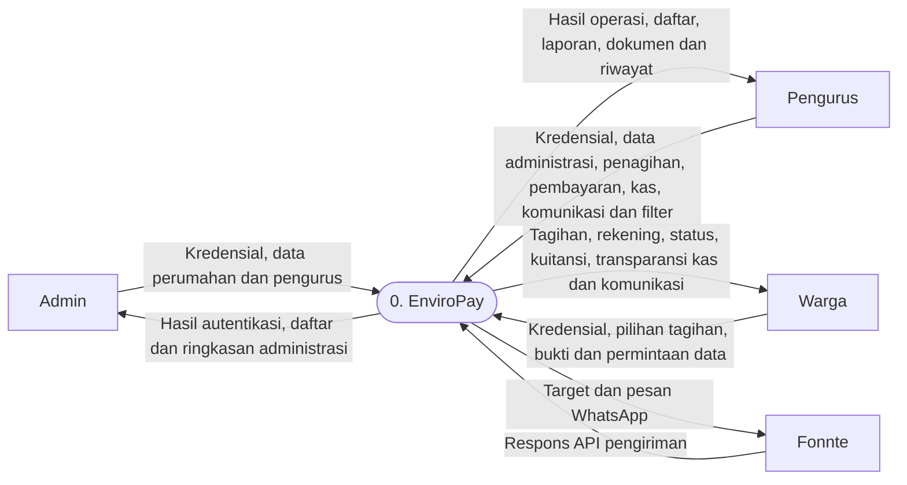

WhatsApp diteruskan Fonnte kepada warga di luar batas aplikasi. Tidak ada arus balik status dibaca/delivered melalui webhook pada baseline.

## 3. Kamus penyimpanan DFD

| ID | Penyimpanan logis | Realisasi |
| --- | --- | --- |
| D1 | Identitas dan master lingkungan | housings, users, houses, house_histories, payment_accounts, sessions |
| D2 | Penagihan | invoices, invoice_components, invoice_templates, invoice_template_runs |
| D3 | Pembayaran dan kuitansi | payment_batches, payment_batch_invoice, receipts; atribut pembayaran pada invoices |
| D4 | Kas dan periode buku | cashflows, accounting_periods |
| D5 | Komunikasi | announcements, notifications, whatsapp_deliveries |
| D6 | Audit dan tindak lanjut | activity_logs, arrears_follow_ups |
| D7 | Dokumen privat | File bukti transfer dan nota kas; path pada database |
| D8 | Pratinjau impor | house_imports, resident_imports |

Pengelompokan bersifat logis. Atribut pembayaran dalam D2 dan referensi D3 tetap satu database fisik; diagram tidak menyatakan ada dua salinan tabel invoices.

## 4. DFD level 1

Diagram dibagi menjadi beberapa tampilan pada **level yang sama** agar label dapat dibaca. Node dengan ID yang sama adalah proses/aktor/penyimpanan yang sama; proses di luar fokus ditampilkan sebagai referensi. Gabungan tampilan berikut mempertahankan seluruh arus data pada level ini.

### Administrasi dan penagihan

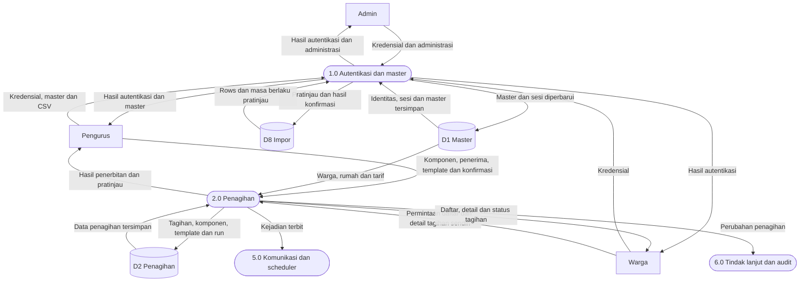

### Pembayaran

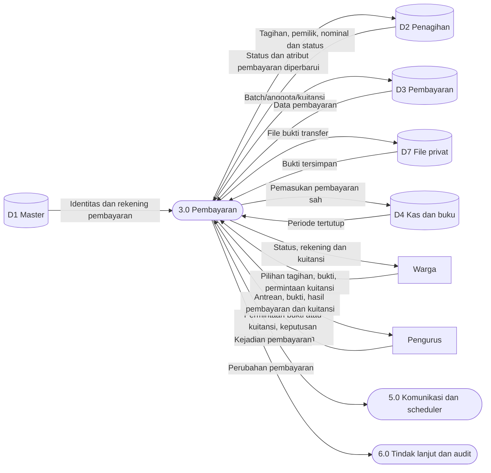

### Kas dan pelaporan

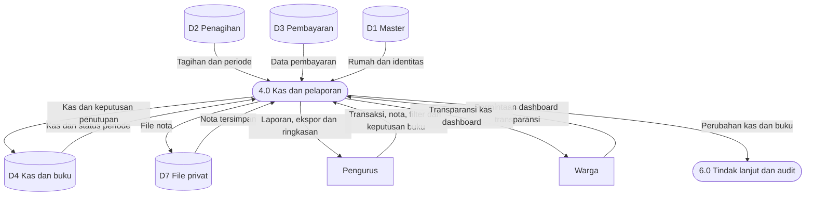

### Komunikasi, audit dan tindak lanjut

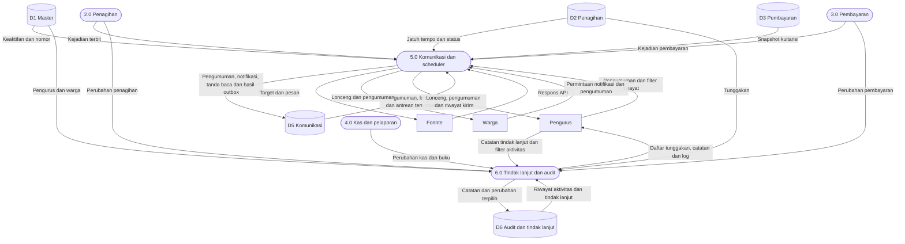

Hak akses, perubahan password dan validasi kepemilikan merupakan tanggung jawab lintas proses, dilambangkan oleh 1.0 dan diterapkan pada setiap endpoint. Proses 5.0 juga menerima pemicu internal scheduler; pemicu waktu bukan arus data dari aktor eksternal baru.

## 5. DFD level 2 — proses 3.0 pembayaran

Diagram dibagi menjadi beberapa tampilan pada **level yang sama** agar label dapat dibaca. Node dengan ID yang sama adalah proses/aktor/penyimpanan yang sama; proses di luar fokus ditampilkan sebagai referensi. Gabungan tampilan berikut mempertahankan seluruh arus data pada level ini.

### Pengajuan transfer

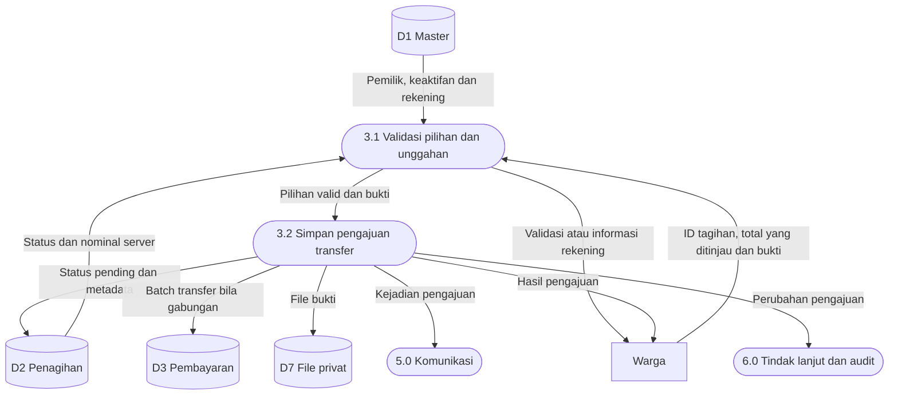

### Keputusan transfer dan cash

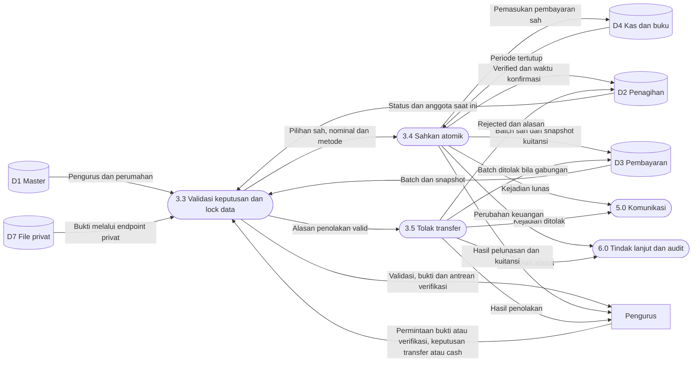

### Penyajian kuitansi

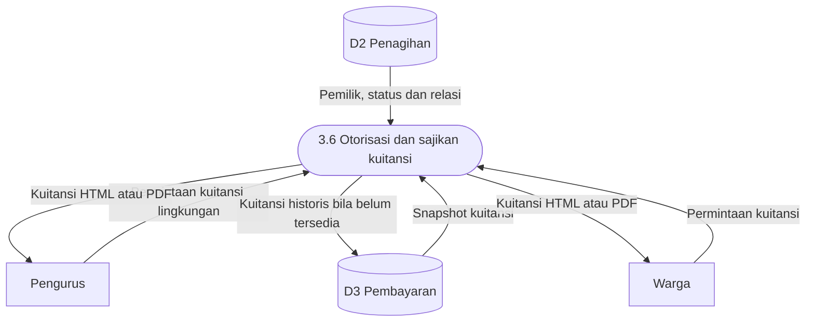

Untuk menjaga diagram terfokus, permintaan kuitansi oleh pengurus mengikuti proses 3.6 yang sama dengan otorisasi perumahan. Dua arah pada penyimpanan telah dipisah menjadi data baca/tulis. Data lintas batas pada level 1 dipertahankan: pilihan/bukti warga, keputusan pengurus, rekening/status/kuitansi, perubahan D2/D3/D4/D7 dan kejadian ke proses 5.0/6.0. Cabang gagal validasi tidak mengubah status keuangan.

## 6. Use case utama

| ID | Aktor | Pemicu / prasyarat | Alur sukses | Pengecualian |
| --- | --- | --- | --- | --- |
| UC-01 | Admin | Login aktif | Buat perumahan dan akun pengurus | Identitas ganda atau data berelasi membatasi operasi. |
| UC-02 | Pengurus | Master siap | Unggah CSV, tinjau, konfirmasi tambah/perbarui | Baris salah, kedaluwarsa atau benturan saat konfirmasi menahan batch. |
| UC-03 | Pengurus | Warga/rumah valid | Buat manual atau tinjau template, lalu terbitkan | Template nonaktif, pratinjau berubah atau run ganda ditolak. |
| UC-04 | Warga | Tagihan dapat dibayar | Pilih, transfer di luar aplikasi, unggah bukti | Kepemilikan/status berubah atau file salah ditolak. |
| UC-05 | Pengurus | Transfer pending | Periksa bukti, sahkan seluruh pembayaran | Tolak dengan alasan; sudah diproses tidak disahkan ulang. |
| UC-06 | Pengurus | Cash diterima | Pilih tagihan, tinjau, konfirmasi penerimaan | Total/status berubah atau kas terkunci menggagalkan transaksi. |
| UC-07 | Pengurus | Data tersedia | Pilih laporan/filter, lihat ringkasan, unduh | Melebihi batas PDF diminta mempersempit filter/memakai CSV. |
| UC-08 | Pengurus | Bulan berakhir | Tinjau dan tutup buku; buka terakhir dengan alasan bila perlu | Bulan berjalan/masa depan atau buka bukan terakhir ditolak. |
| UC-09 | Pengurus | Ada riwayat outbox | Filter riwayat dan periksa detail/Fonnte | Halaman tidak mengirim ulang; hasil API bukan bukti pesan dibaca. |

## 7. Status tagihan

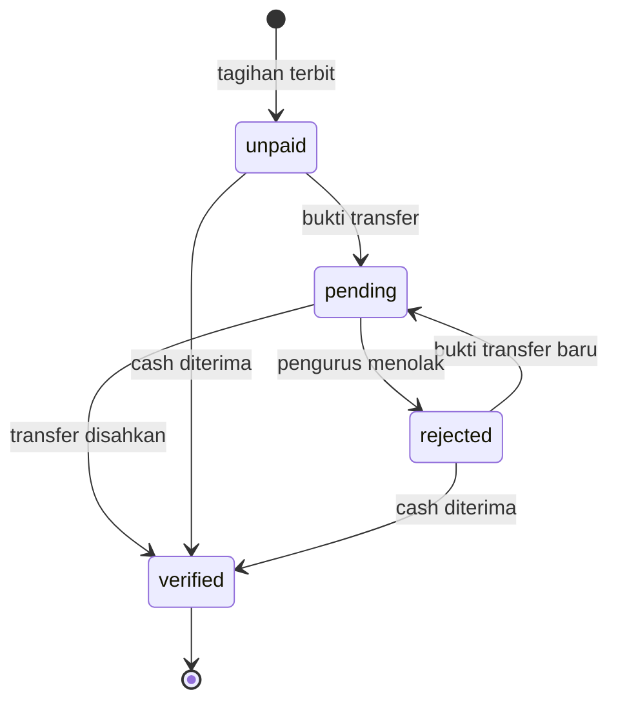

Cash gabungan menggunakan status internal `pending` lalu `verified` dalam transaksi yang sama; tidak membentuk antrean verifikasi transfer. Batch transfer yang ditolak tetap menjadi histori ketika warga mengajukan pembayaran baru. Tidak tersedia alur pembatalan/refund tagihan lunas pada baseline.

## 8. Status outbox WhatsApp

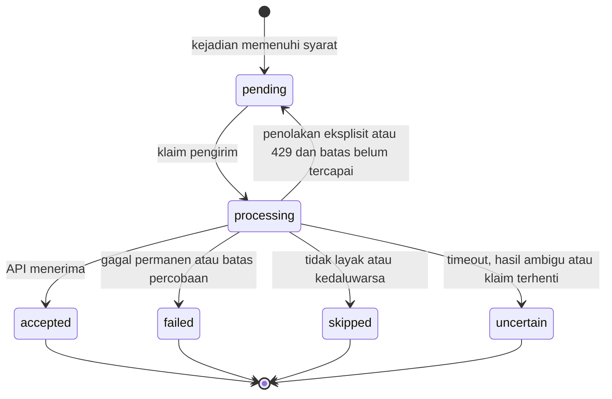

Klaim yang terhenti diperiksa oleh perintah pengirim. Status akhir tidak memiliki transisi kirim ulang dari UI.

## 9. Sequence — pelunasan transfer dan kuitansi

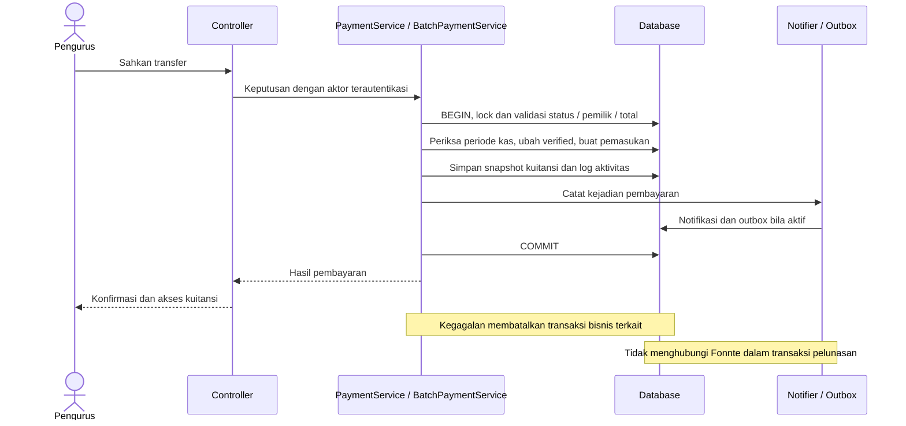

## 10. Sequence — scheduler WhatsApp

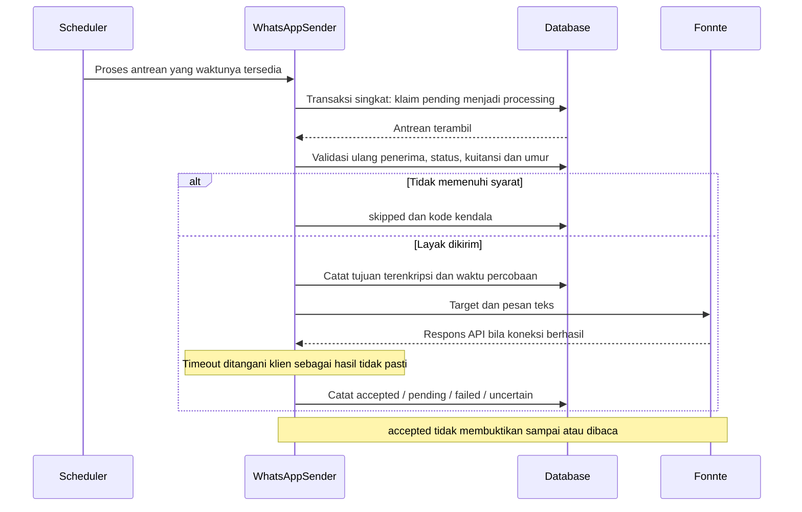

## 11. Detail use case pembayaran dan kontrol buku

### UC-04 — Pengajuan transfer

- **Prasyarat:** warga/perumahan aktif; 1–100 tagihan unik milik satu warga berstatus `unpaid`/`rejected`; rekening tujuan tersedia untuk ditinjau di aplikasi.
- **Alur:** warga memilih tagihan, memeriksa total server dan rekening, transfer di luar aplikasi, mengunggah bukti yang valid; server mengunci serta memvalidasi ulang pilihan, lalu menyimpan bukti/metadata dan status `pending`.
- **Alternatif/gagal:** pilihan berubah, ID asing, total salah atau unggahan tidak valid ditolak. Kegagalan penyimpanan bisnis membersihkan file baru sesuai jalur controller; tidak ada status pembayaran sebagian.
- **Kondisi akhir sukses:** satu pilihan memakai alur tunggal; lebih dari satu membuat batch dan pivot historis. Notifikasi pengajuan tersedia bagi pengurus; belum ada kas/kuitansi lunas atau WhatsApp kuitansi.
- **Verifikasi:** AT-05/07, BillingWorkflowTest dan BatchPaymentsTest.

### UC-05 — Keputusan transfer

- **Prasyarat:** pengurus aktif dalam perumahan; pembayaran transfer `pending`; batch harus tetap memiliki anggota dan nominal sesuai snapshot.
- **Alur:** pengurus memeriksa bukti, menyetujui pembayaran; server memvalidasi ulang di dalam transaksi, menyimpan status `verified`, satu pemasukan, snapshot kuitansi, log terpilih dan notifikasi/outbox yang memenuhi syarat.
- **Alternatif/gagal:** penolakan wajib alasan dan mengubah seluruh anggota batch menjadi `rejected`, tanpa pemasukan/kuitansi baru. Keputusan berulang, batch berubah atau periode kas tertutup menolak penyelesaian; perubahan dalam transaksi dibatalkan.
- **Kondisi akhir sukses:** pembayaran lunas hanya sekali; batch memperoleh satu kuitansi/satu kas. Bukti dan percobaan ditolak tetap dapat ditelusuri sesuai otorisasi.
- **Verifikasi:** AT-05/07/12, PaymentsAnnouncementsAndPasswordTest, BatchPaymentsTest dan ManagerWorkflowsTest.

### UC-06 — Penerimaan cash

- **Prasyarat:** uang benar-benar diterima pengurus; tagihan satu warga memenuhi syarat dan periode tanggal penerimaan server terbuka.
- **Alur:** pengurus memilih tagihan, meninjau total dan mengonfirmasi penerimaan; server memeriksa ulang status/total dan menyelesaikan pembayaran menggunakan metode `cash`.
- **Alternatif/gagal:** `pending` transfer atau tagihan lunas tidak dapat langsung diterima cash; nominal berubah, akun asing atau kas terkunci menolak penyelesaian.
- **Kondisi akhir sukses:** status `verified`, satu pemasukan, satu kuitansi dan pemberitahuan; tidak ada langkah persetujuan transfer tambahan. Tagihan lampau dapat dibayar di bulan berjalan.
- **Verifikasi:** AT-06/12, PaymentsAnnouncementsAndPasswordTest, BatchPaymentsTest dan ManagerWorkflowsTest.

### UC-08 — Tutup dan buka kembali buku kas

- **Prasyarat penutupan:** pengurus aktif memilih bulan yang sudah berakhir dan meninjau laporan kas lengkap, bukan total filter kategori saja.
- **Alur penutupan:** konfirmasi diterima, server mengunci koordinasi perumahan, memeriksa periode, menyimpan snapshot ringkasan/status `closed` serta log aktivitas.
- **Alternatif pembukaan:** pilih periode tertutup paling akhir, masukkan alasan 10–1.000 karakter; status berubah `open` dan log menyimpan perubahan. Bulan yang lebih awal belum dapat dibuka bila ada bulan tertutup setelahnya.
- **Kondisi akhir:** mutasi kas dengan tanggal yang memengaruhi periode tertutup ditolak; buka kembali mengizinkan perubahan sesuai sisa periode tertutup. Snapshot/status tagihan laporan tahunan tidak diubah menjadi kondisi historis akhir tahun.
- **Verifikasi:** AT-12 dan ManagerWorkflowsTest.
